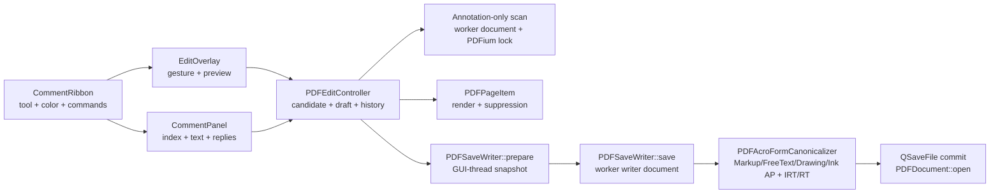

# Kiến trúc và pipeline comment/annotation PDF

Tài liệu này mô tả implementation comment hiện tại của TrePDF, từ lúc người
dùng chọn công cụ trong tab Comment, quét annotation có sẵn, tạo draft,
undo/redo/discard, hiển thị trên trang, quản lý reply, đến lúc Save/Save As ghi
annotation chuẩn vào PDF và mở lại tệp đã lưu.

Phần **Implementation hiện tại** là hành vi đang có trong mã nguồn. Phần
**Gaps và roadmap** chỉ là định hướng; không được xem là tính năng đã hỗ trợ.

Các tệp chính:

- [`CommentRibbon.qml`](../src/Components/CommentRibbon.qml): command surface,
  tool, màu markup và history.
- [`CommentPanel.qml`](../src/Components/CommentPanel.qml): chỉ mục comment toàn
  tài liệu, sửa `/Contents`, reply một cấp, điều hướng và xóa.
- [`DocumentWorkspace.qml`](../src/Components/DocumentWorkspace.qml): mở panel
  Comment cho đúng document session.
- [`EditOverlay.qml`](../src/Components/EditOverlay.qml): gesture tạo annotation,
  preview, selection và draft presentation trên trang.
- [`SquigglyLine.qml`](../src/Components/SquigglyLine.qml): renderer zigzag dùng
  chung cho gesture và draft Squiggly.
- [`CommentDrawingView.qml`](../src/Components/CommentDrawingView.qml): renderer
  vector dùng chung cho preview và draft Square/Circle/Line/Polygon/PolyLine.
- [`InkDrawingView.qml`](../src/Components/InkDrawingView.qml): renderer
  Qt Quick Shapes dùng chung cho gesture Pencil và draft Ink.
- [`PDFEditController.h`](../src/PDFEditController.h) và
  [`PDFEditController.cpp`](../src/PDFEditController.cpp): candidate scan,
  comment index, selection, draft, reply, history và điều phối Save.
- [`PDFPageItem.cpp`](../src/PDFPageItem.cpp): render PDFium, ẩn annotation draft
  đã xóa và ẩn appearance độc lập của reply.
- [`PDFSaveWriter.h`](../src/PDFSaveWriter.h) và
  [`PDFSaveWriter.cpp`](../src/PDFSaveWriter.cpp): tạo, sửa và xóa annotation
  trên writer document riêng.
- [`PDFAcroFormCanonicalizer.h`](../src/PDFAcroFormCanonicalizer.h) và
  [`PDFAcroFormCanonicalizer.cpp`](../src/PDFAcroFormCanonicalizer.cpp): hoàn
  thiện `/IRT`, `/RT /R`, appearance Free Text, text markup và drawing comment
  trên file staging.
- [`tst_PDFEditController.cpp`](../tests/tst_PDFEditController.cpp): fixture và
  regression round-trip bằng PDFium.

## 1. Phạm vi hiện tại

TrePDF coi **comment** là tập con của markup annotation trong PDF. Widget của
AcroForm, Link, nội dung text của page và shape thuộc tab Edit không đi qua
pipeline này.

| Công cụ UI | `Candidate.kind` | PDF subtype | Geometry hiện tại |
|---|---|---|---|
| Highlight | `highlight` | `/Highlight` | Rectangle tự do, ghi thành một hoặc nhiều `/QuadPoints`. |
| Underline | `underline` | `/Underline` | Rectangle tự do, ghi thành `/QuadPoints`. |
| Squiggly | `squiggly` | `/Squiggly` | Giao gesture với glyph nguồn, snap thành rectangle/QuadPoints theo dòng. |
| Strikeout | `strikeout` | `/StrikeOut` | Rectangle tự do, ghi thành `/QuadPoints`. |
| Sticky Note | `stickyNote` | `/Text` | Frame cố định 24 PDF point tại vị trí click. |
| Free Text | `freeText` | `/FreeText` | Click dùng frame mặc định; drag dùng text box đã clamp trong page. |
| Stamp | `stamp` | `/Stamp` | Sáu preset chuẩn; click dùng frame 160 × 50 point, drag dùng Rect đã clamp. |
| Rectangle | `square` | `/Square` | Drag tạo Rect. |
| Oval | `circle` | `/Circle` | Drag tạo Rect, `/AP` dùng bốn cubic Bézier. |
| Line | `line` | `/Line` | Drag tạo hai điểm `/L`. |
| Polygon | `polygon` | `/Polygon` | Click nhiều đỉnh, Enter/nhấp đúp để đóng path `/Vertices`. |
| Polyline | `polyLine` | `/PolyLine` | Click nhiều đỉnh, Enter/nhấp đúp để lưu path mở `/Vertices`. |
| Pencil | `ink` | `/Ink` | Một drag tạo một annotation; model/rehydrate giữ nhiều stroke trong `/InkList`. |

Các markup subtype `/Caret`, `/FileAttachment`, `/Sound`, `/Redact` và
`/Projection` (PDF 2.0) cũng được đọc vào CommentPanel với
`Candidate.kind == "comment"`. Chúng chỉ hỗ trợ index, metadata, chọn và điều
hướng; sửa nội dung, xóa và thêm reply đều bị khóa cho đến khi writer hỗ trợ
mutation an toàn theo subtype.

Với cả mười ba loại có kind riêng ở bảng trên, implementation hiện tại hỗ trợ:

- tạo annotation mới dưới dạng session draft;
- đọc và index annotation đã có trong PDF;
- chọn và điều hướng từ CommentPanel;
- sửa `/Contents` trong CommentPanel;
- xóa, undo, redo và discard;
- thêm reply vào comment gốc;
- Save/Save As rồi rehydrate sau khi mở lại;
- hiển thị author và ngày sửa, fallback về ngày tạo;
- bảo vệ annotation ReadOnly hoặc LockedContents.

Giới hạn hiện tại:

- ngoài Ink nguồn hợp lệ, geometry annotation nguồn không move/resize được;
- reply-to-reply không được tạo từ UI;
- reply chain nhập từ phần mềm khác được flatten thành một cấp hiển thị;
- mỗi comment hoặc reply tối đa 700 UTF-16 code unit;
- Rectangle, Ellipse, Line, Arrow, Triangle và Diamond trong tab Edit là page
  content path object, không phải drawing comment annotation;
- review state và XFDF chưa được model hóa;
- 5 markup subtype chỉ đọc chưa có tool tạo mới, property editor hoặc writer.

## 2. Luồng kiến trúc tổng thể



Các ownership quan trọng:

- QML, `PDFDocument` và `PDFEditController` sống trên GUI thread.
- Candidate/comment scan mở document riêng từ file path dưới process-wide
  PDFium lock. GUI/QML không giữ `FPDF_PAGE` hoặc `FPDF_ANNOTATION`.
- Writer nhận snapshot bất biến, mở writer document riêng và không giữ con trỏ
  tới controller/document.
- Chỉ sau khi commit và reopen thành công, draft và history mới bị reset.

## 3. Mô hình dữ liệu

### 3.1 `Candidate`

Một comment nguồn hoặc comment mới được biểu diễn bằng `Candidate`. Các trường
quan trọng cho annotation gồm:

```text
page
objectId
sourceAnnotationIndex
sourceAnnotationName       // /NM
kind                       // highlight, stickyNote, freeText, square, line...
text                       // /Contents
geometry.sourceRect
highlightRects             // QuadPoints đã chuẩn hóa theo page
highlightColor
drawingVertices            // storage nội bộ cho /L hoặc /Vertices
inkStrokes                 // mỗi path /InkList là một stroke riêng
commentProperties          // stroke/interior/opacity/border/effect/endings
sourceDrawingAppearanceFingerprint // SHA-256 bounded của normal AP nguồn
drawingPropertiesEditable  // capability style riêng, không dùng chung geometry
commentAuthor              // /T
commentCreationDate        // /CreationDate
commentModifiedDate        // /M
commentThreadId
replyToObjectId
replyToThreadId
replyToSourceAnnotationIndex
replyDirectParentSourceAnnotationIndex
commentTextReadOnly
added / addedOrder
```

`sourceAnnotationIndex` chỉ có ý nghĩa trong source page và document revision
đã quét. Writer không tin index một cách mù quáng: trước khi mutation, nó kiểm
lại subtype, `/Contents`, `/NM` nếu có và các cờ bảo vệ.

`objectId` của annotation nguồn có dạng `annotation:<index>`. Vì cùng index có
thể xuất hiện trên nhiều page, mọi API và draft key phải dùng cặp
`page + objectId`, không dùng `objectId` độc lập.

Map đưa sang QML công bố contract ổn định `frameRect`, `annotationPoints`,
`strokeColor`, `fillColor`, `strokeWidthRatio`, `opacity`, `borderStyle`,
`dashPattern`, `borderEffect`, `lineStartStyle` và `lineEndStyle`. Các khóa
`drawing*` cũ vẫn được giữ như compatibility alias, nhưng renderer mới dùng bộ
khóa chung này.

### 3.2 `Draft` và history

`Draft` giữ snapshot của candidate cùng text và geometry hiện hành:

```text
candidate
commentProperties          // style hiện hành cho preview/history/save
text
characterSpans
paragraphFormats
frameRect
contentBounds
deleted
```

Comment dùng chung `Command` snapshot với text/image/shape. Một action logic tạo
một command before/after; undo và redo phục hồi toàn bộ candidate/draft state.
Xóa annotation nguồn được biểu diễn bằng tombstone draft thay vì gỡ annotation
khỏi document đang mở.

`hasDrafts` còn tính cả pending Squiggly creation. Vì vậy thả chuột khi glyph
geometry chưa sẵn sàng vẫn kích hoạt draft guard; Discard phải hủy cả pending
request đó.

### 3.3 Tọa độ

Controller và draft lưu geometry theo normalized page coordinates `0..1` của
trang logic chưa xoay. `EditOverlay` đổi qua pixel bằng kích thước local của
`pageSurface`; writer đổi tiếp sang PDF page coordinates bằng
`FPDF_DeviceToPage()`.

View rotation chỉ là transform scene graph. Không đưa rotation của UI vào
candidate, draft hoặc save-time geometry.

## 4. Quét và lập chỉ mục comment

### 4.1 Candidate scan theo page

Scan page phục vụ hover/edit nội dung đồng thời đọc đủ 18 markup annotation
subtype mà TrePDF nhận diện. Mười ba subtype do TrePDF hỗ trợ mutation giữ kind
riêng; 5 subtype còn lại dùng kind `comment` chỉ đọc. Với mỗi annotation,
controller lấy:

- `/Contents`, `/NM`, `/T`, `/CreationDate`, `/M`;
- `/Rect` và attachment points/QuadPoints của text markup;
- annotation color;
- flags ReadOnly và LockedContents;
- `/IRT` và `/RT` để nhận diện reply;
- private thread id của TrePDF nếu annotation đang ở giữa save pipeline.

Với `/Ink`, scanner đọc `/InkList` có giới hạn trước khi cấp phát: tối đa 64
stroke, 4.096 điểm mỗi stroke và 32.768 điểm tổng. Mỗi stroke phải có ít nhất
hai điểm hữu hạn và đổi được về normalized page coordinates. Ink thiếu/malformed
geometry hoặc vượt giới hạn vẫn được đưa vào panel dưới kind `comment` generic
chỉ đọc; writer không được mutation annotation đó.

Một số PDF reader, gồm Foxit, lưu reply `/Text` hợp lệ với `/IRT` và `/RT /R`
nhưng để `/Rect [0 0 0 0]`. Reply kiểu này vẫn được lập chỉ mục và hiển thị
trong CommentPanel vì nó không cần standalone page geometry; appearance của nó
tiếp tục bị ẩn trong viewer. Annotation không phải reply vẫn phải có `/Rect`
hoặc QuadPoints hữu dụng, nên comment gốc có geometry rỗng vẫn bị loại.

Kết quả được cache theo display page và document revision. Khi revision đổi,
mọi kết quả cũ và callback đến muộn phải bị loại.

### 4.2 Annotation-only comment index

`requestCommentIndex()` chạy một lượt riêng qua mọi source page:

1. Mở source page trong worker document.
2. Chỉ gọi `appendAnnotationCandidates()`; không scan text/image page object.
3. Giữ lại comment candidate và nhả PDFium lock giữa các page.
4. Post kết quả về GUI thread nếu document/revision vẫn khớp.

Index riêng giúp CommentPanel liệt kê toàn tài liệu mà không làm cache
text/image của viewport tăng theo tổng số page. Request bị hủy khi document,
revision hoặc session thay đổi.

### 4.3 Sắp thứ tự hiển thị

Comment gốc được sắp theo page, vị trí trên-trái, insertion order rồi object id.
Replies của một root ưu tiên creation date, sau đó source annotation index và
geometry. Model trả về theo thứ tự `root, replies..., root, replies...`.

Quan hệ reply malformed, dangling hoặc cross-page không được tạo thành thread
sâu trong UI; item vẫn có thể được trình bày như comment top-level để người dùng
đọc được.

## 5. Tương tác QML

### 5.1 `CommentRibbon`

Khi mở tab Comment, ribbon chọn Highlight làm tool mặc định. Người dùng có thể
chuyển sang Sticky Note, Free Text, text markup, Pencil hoặc năm
drawing-comment tool mà không bật form designer.

Năm drawing-comment tool nằm trong một dropdown Shapes dạng lưới, dùng cùng mẫu
popup với dropdown Shapes của tab Edit và đánh dấu tool hiện hành.

Highlight, Underline, Squiggly và Strikeout dùng split button cùng color grid
và system color picker. Mỗi tool giữ màu riêng; Underline, Squiggly và Strikeout
dùng màu đậm/opacity cao hơn vì nét mảnh.
History dùng chung `PDFEditController::undo()` và `redo()`.

### 5.2 `EditOverlay`

Overlay giữ gesture tạm trong QML và chỉ commit một draft command khi release:

- text markup nhận rectangle kéo;
- Sticky Note nhận một click;
- Free Text nhận click hoặc drag;
- Square, Circle và Line nhận drag;
- Polygon và PolyLine nhận chuỗi click; Enter hoặc nhấp đúp commit, Escape hủy
  và Backspace bỏ đỉnh cuối;
- Pencil nhận một drag liên tục và commit đúng một Ink annotation khi release;
- preview được vẽ trên page surface trước khi texture mới sẵn sàng.

QML chỉ nhận mẫu Ink mới khi pointer cách mẫu trước ít nhất một logical pixel,
giữ tối đa 4.096 raw points và tiếp tục cập nhật endpoint cuối khi đã đầy. Khi
commit, controller kiểm kiểu/finite/bounds,
clamp, bỏ điểm gần trùng, từ chối path quá ngắn, rồi dùng Ramer-Douglas-Peucker
với tolerance khoảng 0,75 PDF point; kết quả bị hard-cap ở 1.024 điểm. Một
gesture hiện tạo một stroke, nhưng candidate/draft và rehydrate vẫn giữ mảng
stroke để round-trip đầy đủ `/InkList` nguồn.

Controller giữ `pendingDrawingCommentPage` làm owner duy nhất của gesture
nhiều đỉnh. Khi người dùng bắt đầu ở một page delegate khác, owner đổi và
delegate cũ hủy point tạm; pooling, đổi tool, đổi document và Save/session reset
đều release owner này.

Free Text không dùng rich `TextEdit` của page-content text. Hộp được vẽ trên
trang, nhưng `/Contents` được sửa trong CommentPanel.

### 5.3 `CommentPanel`

Khi được load, panel yêu cầu annotation-only index. Mỗi card hiển thị subtype,
page, màu, author, ngày, nội dung và draft state. Chọn card sẽ:

1. commit editor comment đang mở nếu hợp lệ;
2. chuyển controller về Select;
3. chọn candidate bằng `page + objectId`;
4. phát `pageRequested()` để điều hướng.

Editor giữ buffer local để không tạo history command cho mỗi phím. Text được
commit khi mất focus, đổi item, thu gọn panel, đổi session hoặc trước Save.
Card chỉ đọc vẫn chọn và điều hướng được, nhưng nút sửa, xóa và Reply bị vô hiệu.
Ink có geometry hợp lệ dùng kind `ink` nên sửa `/Contents`, Reply và xóa giống
comment được hỗ trợ; chỉ Ink bị downgrade generic mới khóa các action này.

Khi chọn drawing comment, panel hiện property editor cho stroke, fill (chỉ
Square/Circle/Polygon) và opacity. Color dialog chỉ được tạo khi mở; slider
opacity preview giá trị local nhưng commit đúng một history command khi thả,
còn phím mũi tên commit theo từng bước. Added comment luôn dùng được editor.
Cả sáu source drawing subtype chỉ bật khi provenance TrePDF, normal `/AP`,
border/dash/fill và flags đều nằm trong tập có thể round-trip; appearance
ngoài/custom hiển thị thông báo chỉ đọc. Property-only Save của Line/PolyLine
giữ nguyên `/LE` cùng `/BS`, `/BE` và các dictionary entry không liên quan.

QML cho phép text tạm vượt 700 UTF-16 code unit để không phá IME/local undo,
nhưng commit, gửi reply và Save bị chặn cho đến khi độ dài hợp lệ. C++ kiểm lại
cùng giới hạn; không dựa riêng vào validation QML.

## 6. Geometry text markup, Squiggly và Ink

### 6.1 Text markup và Squiggly

Highlight, Underline và Strikeout hiện giữ free rectangle của gesture. Writer
đổi rectangle này thành QuadPoints và bounding `/Rect`.

Squiggly có pipeline riêng:

1. Candidate scan cache bbox normalized của glyph source-text không whitespace.
2. OCR Invisible được giữ dạng hit-test-only, không xuất hiện như text có thể
   select/edit.
3. QML gửi gesture rectangle normalized cho controller.
4. Controller giao gesture với glyph, nhóm theo visual line và snap thành các
   rectangle/QuadPoints theo dòng.
5. Vùng chỉ có whitespace hoặc không có glyph bị từ chối.

Nét gần nằm ngang dùng hit-test band tối thiểu ba pixel. Nếu glyph geometry vẫn
đang tải lúc release, controller giữ revision/page/selection/color, ưu tiên scan
page đó và tự materialize draft khi kết quả về.

Giới hạn an toàn:

- chỉ glyph ngang/upright được cache;
- glyph xoay/dọc cần oriented QuadPoints và hiện bị bỏ qua;
- page trên 50.000 text characters không giữ partial per-glyph cache;
- image-only page hoặc page không có usable text layer không hỗ trợ Squiggly.

`SquigglyLine` chỉ vẽ presentation. Hit-test, grouping và QuadPoints luôn thuộc
controller/writer, không được sao chép logic sang QML.

### 6.2 Ink

`InkDrawingView` vẽ cả path đang kéo và mọi stroke của draft bằng Qt Quick
Shapes với round cap/join. Nó chỉ nhận normalized stroke, màu, opacity và độ
rộng nét; validation, simplification và PDF geometry thuộc controller/writer.

Một Pencil drag tạo một `Command` add và một candidate `ink` chứa đúng một
stroke. Cấu trúc dữ liệu vẫn là `QVector<QVector<QPointF>>`: file nguồn có nhiều
path `/InkList` được rehydrate không làm phẳng, nên sửa `/Contents`, reply,
xóa, undo/redo/discard và Save/reopen đều giữ nguyên semantic nhiều stroke.
Geometry candidate là union của stroke, có padding theo border width; tọa độ
vẫn normalized theo page chưa xoay.

Ink mới và Ink nguồn hợp lệ có thể kéo bằng toàn bộ bounding box, di chuyển bằng
phím mũi tên hoặc resize bằng tám handle cạnh/góc. Move áp cùng một delta
normalized; resize áp affine scale ngang/dọc từ frame ban đầu vào mọi điểm của
mọi stroke. Mỗi gesture chỉ commit một command nên undo/redo/discard không tạo
history theo từng mouse move. Ink nguồn có ReadOnly, LockedContents, Locked
hoặc `/InkList` không hợp lệ vẫn không thể đổi geometry.

## 7. Reply và comment thread

### 7.1 Quan hệ chuẩn PDF

Reply mới được lưu thành `/Text` annotation. Sau khi canonicalize, dictionary có:

```text
/IRT <parent-reference>
/RT /R
```

TrePDF chỉ cho reply comment gốc. Reply không có action reply tiếp trong UI.
Khi nhập một PDF có chuỗi reply nhiều tầng, controller lần `/IRT` về root rồi
flatten các descendants thành một cấp hiển thị.

`/RT /Group` không phải reply relation và không đi qua thread logic hiện tại.
Review state dùng `/IRT` nhưng có `/State` và `/StateModel`; đây là gap cần phân
biệt rõ trước khi bổ sung status để state entry không bị coi là reply thường.

### 7.2 ID tạm trong save pipeline

PDFium public API không đủ để tạo mọi indirect `/IRT` relationship cần thiết.
Writer dùng các key private:

```text
/TrePDFThreadId
/TrePDFReplyTo
```

Các key này là metadata phụ để tìm parent/child ổn định trong file staging và
có thể vẫn tồn tại trong output. `PDFAcroFormCanonicalizer` tìm annotation qua
thread id và `/NM`, promote direct annotation thành indirect object nếu cần,
rồi thêm `/IRT` và `/RT /R` chuẩn. Khi mở lại, logic nghiệp vụ phải ưu tiên
relationship chuẩn; không được coi private key là sự thay thế cho `/IRT`.

### 7.3 Hiển thị reply

Reply tồn tại trong CommentPanel nhưng standalone annotation appearance của nó
không được vẽ trên page viewer. Trong render worker, `PDFPageItem` tạm ẩn reply
markup và Popup liên kết, render page, rồi phục hồi flags dưới PDFium lock.

Đây là presentation rule của TrePDF; reply semantic vẫn tồn tại và được ghi vào
PDF.

### 7.4 Xóa thread

- Xóa root tạo tombstone cho root và ẩn toàn thread trong session.
- Xóa reply chỉ tạo tombstone cho reply đó.
- Save lần `/IRT` descendants, xác thực markup subtype và xóa từ annotation
  index lớn xuống nhỏ.
- `/Popup` liên kết cũng bị xóa để không để lại orphan.
- Nếu chain chứa cấu trúc không thể xác thực an toàn, Save thất bại và giữ draft
  thay vì ghi file thiếu dữ liệu.

## 8. Permission và annotation flags

Mọi mutation comment phải vượt qua hai lớp kiểm tra:

1. document security cho phép sửa annotation;
2. source annotation không có ReadOnly hoặc LockedContents.

Annotation bị bảo vệ vẫn được index, hiển thị và điều hướng, nhưng không cho sửa
text hoặc xóa. Cả QML và controller đều có trạng thái disable/reason; writer vẫn
kiểm lại flags để chống source thay đổi giữa scan và Save.

Ngoại lệ geometry hiện tại là Ink nguồn hợp lệ: move/resize cần annotation
permission, không có ReadOnly/LockedContents/Locked và writer kiểm lại các điều
kiện này trước Save. Các annotation nguồn khác vẫn không được move/resize page
appearance nếu UI chưa cung cấp mutation đó.

## 9. Render và draft presentation

Page texture sạch do PDFium render annotation nguồn. `EditOverlay` vẽ comment
mới hoặc Free Text đã đổi nội dung lên trên texture khi cần.

Với text markup đã có `/AP`, candidate scan coi appearance là nguồn màu hiển
thị: nếu `FPDFAnnot_GetColor()` từ chối annotation có AP, controller đọc màu
fill/stroke thực tế từ path object trong normal appearance. Không dùng `/C` hay
`/CA` stale để ghi đè màu/alpha đã đóng gói trong AP.

Các quy tắc tránh vẽ hai lần:

- source annotation bị draft xóa được tạm ẩn trong render worker;
- Ink nguồn đang kéo/đã dịch được tạm ẩn, còn `InkDrawingView` vẽ mọi stroke ở
  vị trí draft để không phụ thuộc appearance nguồn cũ;
- source drawing đổi style được tạm ẩn và delegate vẽ stroke/fill/opacity draft;
  delegate chỉ vẽ khi object ID có trong suppression snapshot đi cùng texture;
  undo/discard giữ một restoration preview theo đúng object cho tới khi texture
  sạch thay snapshot đó, còn content-only draft không được vẽ chồng appearance
  nguồn;
- reply appearance được tạm ẩn nhưng reply vẫn ở CommentPanel;
- Free Text nguồn chưa đổi giữ appearance gốc;
- Free Text đã sửa được preview bằng hộp trắng, viền đen và text wrap của TrePDF;
- khi texture mới đã phản ánh đúng draft revision, overlay không chồng preview
  không cần thiết.

Render suppression phải luôn phục hồi annotation flags trước khi đóng page.
Page, document handle và process-wide PDFium lock phải sống trong toàn bộ
lifetime của guard. `PDFPageItem` publish snapshot object ID trước scene-graph
sync và giữ ảnh pending đã accept qua draft invalidation, để QML overlay và ảnh
PDFium luôn đổi cùng một rendered frame.

## 10. Save và Save As

### 10.1 Chuẩn bị request

Trên GUI thread, controller:

1. commit editor comment đang mở;
2. từ chối Save nếu còn pending Squiggly geometry;
3. lấy form snapshot nếu form runtime có draft;
4. gọi `PDFSaveWriter::prepare()` để copy draft, page map, metadata và target;
5. đặt `saving = true` để khóa mutation/tab lifecycle.

Worker request không giữ controller, `PDFDocument`, QML object hoặc GUI-thread
PDFium handle.

### 10.2 Tạo annotation mới

Writer mở document riêng và tạo annotation bằng `FPDFPage_CreateAnnot()`:

- text markup: subtype tương ứng, color, Print flag, attachment points và Rect;
- Sticky Note: `/Text`, Rect, color, `/Contents`, metadata, Print flag và normal
  `/AP` vector hình tờ ghi chú;
- Free Text: `/FreeText`, Rect, `/Contents`, `/DA`, border, metadata, Print flag
  và appearance id cho canonicalizer;
- drawing comment: PDFium tạo `/Square` placeholder có `/NM`; canonicalizer đổi
  thành subtype cuối, ghi `/Rect`, `/L` hoặc `/Vertices`, common properties và
  vector `/AP` trong cùng staging transaction;
- Ink: dùng cùng placeholder transaction, nhưng writer map từng điểm normalized
  qua `FPDF_DeviceToPage()` và chuyển toàn bộ stroke đã map cho canonicalizer;
- reply: tạo `/Text` placeholder rồi hoàn thiện `/IRT` và `/RT /R` ở bước
  canonicalize.

Text comment dùng LF trong controller/QML. Khi ghi PDF, writer gom CRLF, CR và
LF đầu vào rồi lưu mọi line break trong `/Contents` thành CR; khi index lại,
controller đổi CR về LF cho editor.

Sau khi PDFium serialize staging file, canonicalizer tìm text markup mới bằng
`/NM` và thêm `/AP << /N <form-ref> >>`. Normal appearance là Form XObject
vector có `/BBox`, identity `/Matrix` và `/ExtGState` chứa opacity. Highlight
dùng fill với blend mode `/Multiply`; Underline, Squiggly và Strikeout dùng
stroke với blend mode `/Normal`. Màu, alpha và geometry được đóng gói trong
appearance stream để reader không phải tự suy diễn từ `/C`, `/CA` và
`/QuadPoints`.

Drawing comment dùng `PDFCommentAnnotation::CommonProperties` làm snapshot
chung cho preview/writer: stroke `/C`, interior `/IC`, opacity `/CA`, border
`/BS`, flags `/F`, effect `/BE`, intent `/IT`, name `/Name` và line endings
`/LE`. MVP tạo nét solid, fill trong suốt và line ending `/None`; backend từ
chối effect/ending chưa có primitive `/AP` tương ứng thay vì ghi dictionary và
appearance lệch nhau.

Ink dùng cùng common stroke/opacity/border snapshot nhưng không có interior,
effect hay line ending. Canonicalizer atomically đổi placeholder thành
`/Subtype /Ink`, ghi `/InkList`, `/BS`, `/C`, `/CA`, Print flag và `/AP /N`
vector. Appearance dùng PDF line cap/join tròn (`1 J 1 j`) để khớp
`InkDrawingView` và giữ mỗi stroke thành một subpath độc lập.

Metadata comment mới gồm `/NM`, `/T`, `/CreationDate` và `/M` khi đã sửa.
Author hiện lấy lần lượt từ `USER`, `LOGNAME`, tên home directory rồi application
name; chưa có user profile riêng trong UI.

### 10.3 Sửa annotation nguồn

Trước khi sửa, writer xác thực annotation index, subtype, original `/Contents`,
`/NM` nếu có và flags bảo vệ. Khi hợp lệ:

- chỉ cập nhật `/Contents` và `/RC` khi nội dung thật sự đổi; geometry-only
  không làm phẳng rich text;
- cập nhật `/M` khi nội dung hoặc geometry đổi;
- giữ `/Popup`, `/IRT`, `/RT`, geometry, color và metadata không liên quan;
- với Free Text, xóa stale `/AP`, ghi appearance id và để canonicalizer tạo lại
  wrapped Unicode appearance.

Với drawing comment đổi geometry, controller translate hoặc scale từng vertex
hay Ink stroke từ frame ban đầu sang frame mới. Với property edit, draft giữ
stroke/interior/opacity hiện hành tách khỏi snapshot gốc để mỗi action là một
command undoable. Writer map frame và geometry
qua `FPDF_DeviceToPage()`, gắn marker UUID tạm rồi để canonicalizer thay trực
tiếp `/Rect` cùng `/L`, `/Vertices` hoặc `/InkList` sau bước serialize. Luồng
này tránh side effect của `FPDFAnnot_SetRect()` có thể nới `/AP /BBox` mà không
scale drawing commands. Move thuần và appearance ngoài/custom giữ nguyên `/AP`.
Với annotation có provenance TrePDF hợp lệ (`/NM` và `/TrePDFThreadId` cùng ID
`<kind>:<uuid>`), resize tạo normal `/AP` mới từ geometry đã scale nếu toàn bộ
properties được hỗ trợ và fingerprint AP nguồn vẫn khớp; nếu không thì giữ
appearance nguồn. Marker luôn bị xóa
trong cùng incremental transaction; `/Popup`, `/IRT`, metadata và key mở rộng
không bị viết lại. Save annotation-only không gọi
`FPDFPage_GenerateContent()`.

Property Save nguồn chỉ nhận drawing comment TrePDF-managed đã qua capability
check. Writer xác thực lại subtype/identity/flags và SHA-256 của normal `/AP`
đã index trước khi mutation. Canonicalizer chỉ thay `/C`, `/IC`, `/CA` và
normal `/AP`; `/BS`, `/BE`, `/LE` cùng các key mở rộng được giữ nguyên. Nếu AP
đổi giữa index và Save, hoặc không thể tạo replacement AP atomically, toàn bộ
Save thất bại trước khi commit target.

Sticky Note, text markup và Ink giữ nguyên appearance nguồn khi chỉ sửa nội dung
vì page geometry không đổi. Nếu Sticky Note/reply nguồn đang được sửa nhưng thiếu
normal appearance, writer bổ sung `/AP` vector từ Rect và color hiện có.
Canonicalizer nhận drawing nguồn chỉ khi geometry hoặc property thực sự đổi.
Content-only source drawing vẫn giữ `/AP`; Free Text là ngoại lệ vì text hiển
thị trực tiếp trên trang.

### 10.4 Xóa annotation nguồn

Writer thu thập root/reply descendants và Popup trước mutation, xác thực subtype,
identity và relation, rồi xóa theo index giảm dần. Việc xóa comment chỉ thay
page annotation array; không được gọi `FPDFPage_GenerateContent()`.

### 10.5 Appearance và canonicalizer

Free Text được canonicalizer dựng `/AP` Unicode có wrap, nền trắng và viền đen;
`/Contents` vẫn là semantic text cho reader khác tìm kiếm và đọc.

Bốn text-markup subtype mới được dựng `/AP /N` vector từ chính `/QuadPoints`,
`/C` và `/CA` đã ghi trên annotation. `Rect`, `QuadPoints` và AP được tạo trong
cùng giao dịch staging; bất kỳ lỗi parse/canonicalize nào đều làm Save thất
bại trước khi target được commit. Source text markup giữ nguyên `/AP` hiện hữu.
Sticky Note mới và mọi reply mới có normal `/AP` vector riêng. TrePDF vẫn tạm
ẩn appearance của reply khi render page, nhưng giữ nó trong file để reader khác
có thể hiển thị annotation hợp chuẩn.

Square và Circle dùng path inset theo nửa border width; Circle dùng bốn cubic
Bézier. Line và PolyLine giữ path mở, Polygon đóng path. `/BBox` bằng `/Rect`,
matrix identity, và `/ExtGState` dùng cùng opacity cho stroke/fill. Annotation
chỉ có comment vẫn không gọi `FPDFPage_GenerateContent()`.

Stamp mới được canonicalizer ghi `/Subtype /Stamp`, preset `/Name`, `/C`, Print
flag và normal `/AP` vector dùng Helvetica Bold, viền kép và màu preset.
`/Contents` vẫn là semantic comment text; sửa Stamp nguồn giữ nguyên geometry
và `/AP` hiện có. Stamp nguồn không move/resize, còn Stamp mới dùng cùng frame
draft và tám handle cạnh/góc trước lần Save đầu tiên.

Ink dùng một path mở cho mỗi entry `/InkList`, round cap/join, cùng border width,
màu và opacity giữa dictionary với appearance. Pipeline vẫn chưa phải generic
appearance generator cho Caret hoặc các subtype PDF 2.0; mỗi subtype mới vẫn
cần chiến lược `/AP` riêng và regression mở bằng reader ngoài PDFium.

### 10.6 Transaction và reopen

- Nội dung trung gian được serialize bằng `FPDF_SaveAsCopy()` qua `QSaveFile`.
- Canonicalizer chỉ append incremental objects vào staging file.
- Chỉ commit target sau khi mọi bước thành công.
- Annotation-only page không regenerate content stream.
- Sau commit, `PDFDocument::open()` mở lại target và tăng revision.
- Draft/history chỉ reset sau reopen thành công.
- Nếu reopen thất bại sau commit, document stale phải đóng vì source annotation
  indices không còn đáng tin.

## 11. Invariant không được phá

1. GUI/QML không truy cập `FPDF_PAGE`, `FPDF_TEXTPAGE` hoặc
   `FPDF_ANNOTATION` của worker.
2. Không dùng main `FPDF_DOCUMENT` để Save.
3. Comment-only save không gọi `FPDFPage_GenerateContent()`.
4. Mọi async result phải khớp document, revision, page và request generation.
5. Source annotation mutation phải xác thực identity và flags ngay trước khi
   thay đổi.
6. Update `/Contents` không được làm mất Popup, thread relation, geometry hoặc
   metadata không thuộc mutation.
7. Xóa root phải xử lý descendants và Popup; không để orphan thread.
8. Reply appearance có thể bị ẩn trong viewer nhưng reply semantic không được
   bỏ khỏi index hoặc save request.
9. Normalized geometry không phụ thuộc view rotation.
10. Save failure phải giữ target cũ, draft và undo/redo để người dùng thử lại.
11. User-visible string mới phải dùng `qsTrId()`/`qtTrId()` literal với `//%` và
    cập nhật `i18n/qml_vi.ts`.

## 12. Kiểm thử

Regression chính nằm trong `tests/tst_PDFEditController.cpp`. Fixture nên là PDF
nhỏ nhất tự dựng được, sau đó kiểm cả state trước Save và file đã mở lại.

Coverage comment hiện cần được duy trì cho:

- round-trip Highlight, Underline, Squiggly và Strikeout;
- Squiggly glyph snap, OCR Invisible, pending scan, whitespace rejection,
  rotated glyph và safety cap;
- Sticky Note và Free Text Unicode appearance;
- normal `/AP` của Sticky Note/reply và chuẩn hóa CR trong `/Contents`;
- round-trip Square, Circle, Line, Polygon và PolyLine, gồm source/add geometry,
  move/resize tám handle, undo/redo/discard, `/Rect` + `/L`/`/Vertices`, giữ AP
  custom, tái tạo AP TrePDF-managed, common properties, delete và rehydrate;
- Ink: một drag/một annotation, raw cap 4.096, validate/dedup/RDP và output cap
  1.024; rehydrate nhiều stroke, dictionary `/InkList`/`/BS`/`/C`/`/CA`/Print,
  vector `/AP` round cap/join, move/resize added/source với undo/redo/discard,
  affine-transform mọi stroke, pure move giữ source AP, resize TrePDF-managed
  đồng bộ `/AP` với `/InkList`, external/custom AP và metadata vẫn được giữ,
  cùng round-trip contents/reply/delete/history;
- source Ink malformed/oversized downgrade thành generic read-only theo giới hạn
  64 stroke, 4.096 điểm/stroke và 32.768 điểm tổng;
- Stamp preset: add/move/resize/history, `/Name`/`Contents`/Print/vector `/AP`,
  annotation-only Save, reopen, source contents/reply/delete và giữ source `/AP`;
- read-only index cho 5 markup subtype chưa hỗ trợ mutation;
- author, creation/modification date và 700 UTF-16 code-unit limit;
- comment index xuyên trang, duplicate page-local `/NM` và navigation;
- sửa `/Contents`, `/M` và `/RC` của annotation nguồn;
- ReadOnly/LockedContents và document annotation permission;
- reply vào comment mới/nguồn, nested import flattening và standard `/IRT`;
- xóa reply, cascade root deletion, Popup và mixed-subtype descendants;
- undo/redo/discard trước Save;
- annotation-only Save không làm thay đổi page-content object count;
- CropBox, page rotation và Save/reopen lifecycle, gồm mapping từng điểm Ink.

Lệnh kiểm tra chuẩn sau thay đổi:

```sh
/Applications/CLion.app/Contents/bin/cmake/mac/aarch64/bin/cmake \
  --build /Users/luongvanhuy/Documents/TreOffice/TrePDF/cmake-build-debug \
  --target trepdf -j 8

/Applications/CLion.app/Contents/bin/cmake/mac/aarch64/bin/cmake \
  --build /Users/luongvanhuy/Documents/TreOffice/TrePDF/cmake-build-debug \
  --target trepdf_edit_controller_tests -j 8

ctest --test-dir \
  /Users/luongvanhuy/Documents/TreOffice/TrePDF/cmake-build-debug \
  --output-on-failure -R PDFEditControllerTests

git diff --check
```

Sau thay đổi appearance/render suppression, cần mở file kết quả bằng TrePDF và
ít nhất một reader khác trên macOS để kiểm tra interoperability thực tế.

## 13. Gaps và roadmap

Bảng này không mô tả tính năng đã có.

| Ưu tiên | Gap | Hướng triển khai |
|---|---|---|
| P0 | Text-aware markup đồng nhất | Dùng glyph cache của Squiggly cho Highlight, Underline và Strikeout. |
| P1 | Drawing style nâng cao | UI cho border width/style, dash, effect và line endings với parser/capability source đầy đủ. |
| P1 | Free Text nâng cao | `/IT /FreeTextCallout`, `/CL`, `/LE`, Typewriter, `/Q`, `/RC`/`DS`, border/fill/opacity. |
| P1 | Review state và grouping | Phân biệt `/State` + `/StateModel`, `/RT /R` và `/RT /Group`; hỗ trợ Accepted/Rejected/Completed/Marked. |
| P1 | Text-edit marks | `/Caret`, Insert/Replace review workflow. |
| P1 | Comment workflow | Search/filter/sort, author profile, export selected và import/export XFDF. |
| P2 | File attachment comment | `/FileAttachment` + `/FS`, byte snapshot, size limit và sandbox mở/extract. |
| P2 | Flattened copy/summary | Save a Flattened Copy riêng; cảnh báo mất semantic thread/metadata. |
| Riêng | Redaction | Mark `/Redact` và Apply Redaction phải là pipeline bảo mật riêng, không chỉ vẽ rectangle đen. |

Không ưu tiên mutation cho Comment tab: Link/Widget, Movie, Sound, PrinterMark,
TrapNet, Watermark, 3D, Projection và RichMedia. `/Sound` và `/Projection` vẫn
được index chỉ đọc vì PDF xếp chúng vào markup annotation; Movie, Sound và
TrapNet là legacy/deprecated trong PDF 2.0. PDFium chưa có public enum cho
Projection, nên scanner nhận diện chính xác tên `/Subtype /Projection`.

Reply nhiều cấp không phải ưu tiên: UI một cấp hiện tại vẫn giữ quan hệ root và
giúp thread dễ đọc. Nếu mở rộng, phải có fixture cho chain, cycle, cross-page và
orphan trước khi đổi model.

## 14. Checklist khi thêm subtype hoặc property comment

1. Thêm tool/kind và xác định rõ subtype là comment, page content hay form.
2. Mở rộng candidate scan và annotation-only index với giới hạn dữ liệu đầu vào.
3. Bổ sung `Candidate`/`Draft` fields và snapshot equality/history.
4. Thêm ribbon, cursor/gesture, overlay preview và CommentPanel label/property.
5. Xác định normalized geometry và phép đổi qua `FPDF_DeviceToPage()`.
6. Xác định `/Contents`, metadata, flags, subtype-specific dictionary và `/AP`.
7. Quyết định source annotation nào chỉ đọc, sửa được, move/resize được hoặc
   phải được bảo vệ.
8. Kiểm tra reply/state/group semantics; không coi mọi `/IRT` là reply thường.
9. Cập nhật render suppression để không vẽ source/draft/reply hai lần.
10. Cập nhật writer create/update/delete và canonicalizer nếu cần indirect refs.
11. Không regenerate page content nếu chỉ thay annotation.
12. Thêm translation ID, fixture, pre-save assertions và round-trip inspection.
13. Cập nhật tài liệu này, QML/C++ guide và source-file map nếu ownership đổi.

## 15. Tài liệu chuẩn tham khảo

- [PDF Association — ISO 32000-2:2020](https://pdfa.org/resource/iso-32000-2/)
- [PDF 2.0 errata — Clause 12, Interactive features](https://pdf-issues.pdfa.org/32000-2-2020/clause12.html)
- [Adobe PDF Reference 1.7 — Annotations](https://opensource.adobe.com/dc-acrobat-sdk-docs/pdfstandards/pdfreference1.7old.pdf)
- [Adobe — Importing and exporting comments](https://helpx.adobe.com/acrobat/using/importing-exporting-comments.html)
