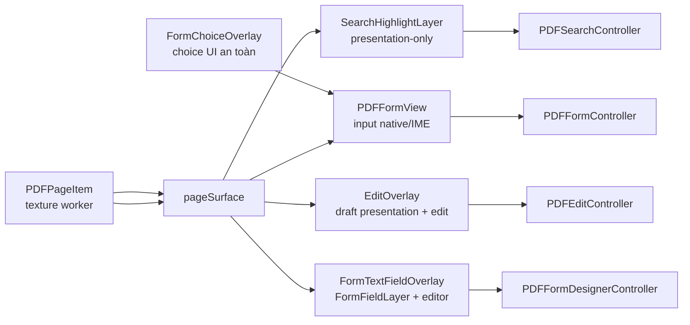

# Kiến trúc overlay của một trang PDF

Tài liệu này mô tả cấu trúc **đang chạy** của các overlay đặt lên một trang PDF.
Nó bổ sung cho [Hướng dẫn tệp QML](qml-file-guide.md) bằng cách giải thích vì sao
các lớp được đặt theo thứ tự hiện tại, lớp nào được quyền bắt input trong từng
mode, và cách chúng giữ đồng bộ với texture PDF bên dưới.

Phạm vi chính là:

- [`src/Components/PageLayoutDelegate.qml`](../src/Components/PageLayoutDelegate.qml)
- [`src/Components/PdfPageDelegate.qml`](../src/Components/PdfPageDelegate.qml)
- [`src/Components/SearchHighlightLayer.qml`](../src/Components/SearchHighlightLayer.qml)
- [`src/Components/PageInteractionOverlay.qml`](../src/Components/PageInteractionOverlay.qml)
- [`src/Components/EditOverlay.qml`](../src/Components/EditOverlay.qml)
- [`src/Components/FormChoiceOverlay.qml`](../src/Components/FormChoiceOverlay.qml)
- [`src/Components/FormTextFieldOverlay.qml`](../src/Components/FormTextFieldOverlay.qml)
- [`src/PDFPageItem.cpp`](../src/PDFPageItem.cpp),
  [`src/PDFSearchController.cpp`](../src/PDFSearchController.cpp),
  [`src/PDFFormView.cpp`](../src/PDFFormView.cpp), và
  [`src/FormFieldLayer.cpp`](../src/FormFieldLayer.cpp)

## 1. Một trang được ghép như thế nào

`DocumentView` là `ListView` ảo hóa cho Single, Continuous, Facing và Continuous
Facing. Mỗi delegate là một `PageLayoutDelegate`, chứa một `PdfPageDelegate`
hoặc hai child đặt cạnh nhau khi ở Facing. Chỉ các hàng/spread đang thấy hoặc
gần vùng nhìn mới sống. Mỗi page delegate có hai phần tách biệt:

- `pageFrame`: khung layout đã tính margin, zoom và kích thước sau quarter-turn.
  Nó chỉ quyết định trang chiếm bao nhiêu chỗ trong `ListView`.
- `pageSurface`: mặt phẳng logic của trang PDF. Nó giữ kích thước trang **chưa
  xoay** và là nơi mọi texture/overlay được đặt chồng. Rotation chỉ áp ở đây.

```text
DocumentView (ListView, reuseItems: true)
└── PageLayoutDelegate              một hàng hoặc spread
    ├── PdfPageDelegate [trang thứ nhất]
    │   ├── pageFrame                khung layout / kích thước hiển thị
    │   ├── shadow                   ngoài mặt phẳng trang
    │   ├── pageSurface              mặt phẳng chung, rotation = viewRotation
    │   │   ├── PDFPageView          z 0: texture PDF từ worker
    │   │   ├── page border          z 0: nằm trên texture
    │   │   ├── SearchHighlightLayer z 0.5: highlight không tương tác
    │   │   └── PageInteractionOverlay z 1: coordinator input
    │   │       ├── PDFFormView      z 1: bridge input form PDFium
    │   │       │   └── FormChoiceOverlay
    │   │       ├── EditOverlay      z 2: draft và interaction Edit
    │   │       └── FormTextFieldOverlay z 3: form designer
    │   └── page label               ngoài mặt phẳng trang
    └── PdfPageDelegate [trang thứ hai, tùy chọn]
```

Hai mode phân trang và hai mode liên tục cố ý dùng model khác nhau:

- Single Page/Facing chỉ giữ **một** `PageLayoutDelegate`; `layoutIndex` của nó
  trỏ tới page/spread active. Không có delegate kề bên nên trang/spread trước và
  sau không thể lộ một phần. Wheel và phím cuộn bên trong delegate trước, chỉ
  đổi page/spread khi đã chạm biên; zoom hiện tại được giữ nguyên.
- Continuous/Continuous Facing giữ toàn bộ page row/spread trong model nhưng
  chỉ materialize các delegate gần viewport nhờ pooling. Các hàng cách nhau qua
  `pageGap`; current page là child có diện tích giao viewport lớn nhất.
- Separate Cover chỉ thay đổi mapping của hai Facing mode: page 1 đứng riêng,
  các page còn lại ghép cặp. Toggle không tạo layout thứ năm.

`DocumentWorkspace` có thể host một viewport, hai viewport trái-phải/trên-dưới,
hoặc bốn viewport 2x2. Hai kiểu split cơ bản giữ scroll, zoom và page độc lập;
Spreadsheet Split dùng chung zoom và phối hợp X/Y theo cột/hàng. Chỉ viewport
chính chứa interaction Edit/Form hoạt động, nên không nhân đôi focus/controller
ownership dù texture và navigation xuất hiện ở mọi vùng.

`pageSurface` là invariant quan trọng: texture, search highlight, runtime form,
edit overlay và form designer phải là con của cùng một item này nếu chúng chia
sẻ tọa độ trang. Nhờ vậy mọi lớp xoay đồng thời khi người dùng đổi
`viewRotation`, còn dữ liệu lưu vẫn dùng geometry của trang logic ban đầu.

`PageInteractionOverlay` chỉ là `Item` điều phối. Nó không vẽ, không clip,
không bật `layer.enabled` và không tạo FBO/texture riêng. Việc thêm coordinator
không thay đổi đường render full-page; nó gom mode, z-order, choice handshake và
cleanup của ba nhánh tương tác vào một nơi. `PDFPageView.formDesignMode` bind
vào mode của coordinator để suppression texture và ownership pointer không lệch
trạng thái.

## 2. Thứ tự vẽ và ý nghĩa của `z`

### Lớp trực tiếp trong `pageSurface`

| Thứ tự | Thành phần | `z` | Trách nhiệm | Có thể nhận input khi |
|---:|---|---:|---|---|
| 0 | `PDFPageView` | 0 | Texture nền do `PDFPageItem` render. | Không trực tiếp. |
| 0 | viền trang `Rectangle` | 0 | Viền current page; được khai báo sau texture nên nằm trên texture cùng `z`. | Không. |
| 0.5 | `SearchHighlightLayer` | 0.5 | Vẽ tập rect match đã giới hạn trên display page; match hiện tại có màu cam. | Không; root luôn `enabled: false`. |
| 1 | `PageInteractionOverlay` | 1 | Coordinator chứa toàn bộ runtime/edit/designer interaction. | Root không tự nhận input; child quyết định. |

### Lớp bên trong `PageInteractionOverlay`

| Thứ tự | Thành phần | `z` | Trách nhiệm | Có thể nhận input khi |
|---:|---|---:|---|---|
| 1 | `PDFFormView` | 1 | Pointer, keyboard, IME và cursor cho AcroForm native; host cho choice overlay. | Browse/runtime form hợp lệ. |
| 2 | `EditOverlay` | 2 | Chọn/thêm/sửa/move/resize draft text, image, shape, text markup và drawing comment. | Tool edit khác Browse, không save/pool. |
| 3 | `FormTextFieldOverlay` | 3 | Đặt, chọn, sửa, resize, move field form designer. | Tùy từng child/control; xem bên dưới. |

Các số `z` trong bảng này là thứ tự quyết định giữa các overlay lớn. Một `z`
bên trong component không phải “z toàn cục”. Ví dụ combo popup có `z: 100`,
nhưng đó là thứ tự trong subtree `FormChoiceOverlay`; không được dùng số đó để
kết luận popup vượt qua `EditOverlay` (`z: 2`) hay form designer (`z: 3`). Khi
đánh giá chồng lớp giữa các overlay lớn, luôn bắt đầu từ `z` của con trực tiếp
của `PageInteractionOverlay`, rồi mới xét `z` nội bộ của từng nhánh.

### Lớp bên trong `EditOverlay`

| Nhóm | `z` nội bộ | Mục đích |
|---|---:|---|
| Text-markup/Ink draft | 0 | Vẽ Highlight/Squiggly/Underline/Strikeout và các stroke Ink đã tạo. |
| Content draft/restoration | 0–1 | Vẽ text, ảnh, shape draft; restoration chỉ dùng khi texture mới chưa sẵn sàng. |
| `hitArea` nền | mặc định | Bắt click/drag trên vùng chưa do draft-specific area chiếm. |
| Hover/selection box, editor mask, `TextEdit` | 2 | Hiển thị selection và editor rich text. |
| Con trỏ custom | 4 | Thay thế cursor OS khi cần preview tool. |
| Preview shape/text markup/Free Text/drawing/Ink comment | 5 | Hiện feedback cho gesture đang chạy. |
| `resizeOverlay` | 6 | Khung chọn, move area và bốn resize handle của object editable. |
| Hint commit/cancel editor | 7 | Luôn nổi hơn frame editor. |

Điểm quan trọng: `resizeOverlay` là lớp bắt input cao nhất của edit object đang
chọn. Nó có `MouseArea` cho move và các handle cho resize; đừng thêm một
`MouseArea` phủ toàn trang với `z` cao hơn mà không xác định nó nhường các vùng
này ra sao.

### Lớp bên trong `FormTextFieldOverlay`

| Nhóm | `z` nội bộ | Mục đích |
|---|---:|---|
| `placementArea` | 0 | Click/drag ở vùng trống để đặt Text Field, Check Box, Radio Button, Dropdown, List Box hoặc Comb Field. |
| Background Forms | 1 | Bỏ focus/selection khi click vùng trống trong Forms rồi reject press để runtime bên dưới vẫn được hit; không enabled ở Edit nên không che cursor edit. |
| Rectangle preview khi đặt | 1 | Hiện rect đang kéo. |
| `FormFieldLayer` | 2 | Render field bằng scene graph; hit-test, click, checkbox/radio activation, drag move. |
| `activeFieldFrame` | 4 | Neo editor TextField/Comb Field/Dropdown/List Box, viền active và control của field đang chọn. |
| Edge resize handles | 20 | Nhận kéo/phím để resize. |
| Nút xóa Text Field/Check Box transient | 30 | Chỉ ở Forms mode; Dropdown, List Box và Radio Button được xóa từ panel tùy chọn. |
| Move handle của Text Field/Comb Field/Dropdown/List Box | 40 | Nhận kéo/phím để move qua API C++ chung. |

`placementArea` cố ý nằm **dưới** `FormFieldLayer`. Khi tool đặt field đang
bật, click vào vùng trống tạo field mới, còn click vào field đã có vẫn đi qua
layer field ở trên thay vì vô tình tạo một field chồng lên nó.

### Lớp bên trong `FormChoiceOverlay`

| Nhóm | `z` nội bộ | Mục đích |
|---|---:|---|
| Field bình thường | 1 | Combo button hoặc list box tại rect của field. |
| Field có combo đang mở | 100 | Đưa field/popup của nó lên trên field choice khác trong cùng overlay. |
| Popup combo | 10, bên trong field đang mở | Danh sách option có scrollbar. |
| Catcher ngoài popup | 50 | Bắt click trong mặt phẳng choice để đóng popup. |

Root choice overlay `clip: true`; popup được tính vị trí để luôn ở trong vùng
viewport hiện thấy, kể cả khi trang đang cuộn hoặc xoay. Đây là lý do popup
không dùng `Popup` toàn cửa sổ.

## 3. Hệ tọa độ: đừng lấy nhầm `pageCard`

Một field/draft có thể đi qua bốn hệ tọa độ. Tất cả sửa geometry mới cần biết
đang ở hệ nào.

| Hệ | Đơn vị | Chủ sở hữu | Dùng cho |
|---|---|---|---|
| ListView/layout row/page card | px trong content đã scroll | `DocumentView` / `PageLayoutDelegate` / `PdfPageDelegate` | Layout dọc, spread, margin và vị trí trang. Không lưu geometry ở đây. |
| `pageFrame` | px của envelope hiển thị | `PdfPageDelegate` | Đổi width/height khi xoay 90°/270°. Không phải mặt phẳng của PDF. |
| `pageSurface` và coordinator | px của trang logic chưa xoay | `PDFPageView`, `SearchHighlightLayer`, `PageInteractionOverlay` và ba nhánh con | Vẽ, hit-test và nhận pointer cục bộ. |
| Normalized page rect | `0..1` theo width/height trang logic | C++ controller/model | Search highlight, draft, field designer, choice field và dữ liệu chuẩn bị Save. |

Các overlay convert rect chuẩn hóa bằng cùng công thức:

```text
xPx      = xRatio      × root.width
yPx      = yRatio      × root.height
widthPx  = widthRatio  × root.width
heightPx = heightRatio × root.height
```

`pageSurface.rotation` chỉ là transform view. Qt Quick map pointer ngược về tọa
độ local của child trước khi `MouseArea`/`PDFFormView` thấy event, nên
`EditOverlay`, `FormTextFieldOverlay` và `PDFFormView` luôn làm việc với chiều
rộng/cao logic, không tự “unrotate” event. Không đưa `viewRotation` vào
`PDFEditController`, `PDFFormDesignerController` hay Save writer.

### Viewport và popup choice

`FormChoiceOverlay` còn cần một phép map thứ năm: từ viewport của `ListView` về
mặt phẳng trang. Nó nhận `viewportItem`, `contentX`, `contentY` và
`viewportTransformState`, sau đó dùng `mapFromItem()` để tính phần thực sự nhìn
thấy. State scroll/transform được đưa vào binding để popup tính lại khi:

- cuộn dọc/ngang;
- zoom hoặc xoay;
- `pageFrame`/`pageSurface` đổi kích thước hoặc vị trí;
- delegate được reuse.

Popup combo sẽ chọn mở lên hoặc xuống, clamp chiều rộng/chiều cao và không cho
tràn khỏi phần page đang trong viewport.

### Display page và source page

`PdfPageDelegate.page` là **display page**: nó có thể đổi sau khi chèn/xóa page
trong session. `PageLayoutDelegate.index` chỉ là chỉ số hàng/spread. Form
field/choice field từ worker mang thêm `sourcePage`, annotation
index và `identityToken`. Khi focus hoặc chọn option, `PDFFormView` gửi cả ba về
controller/worker để resolve lại live field, không tin index cũ sau thay đổi cấu
trúc trang hay async refresh.

## 4. Năm lớp có dữ liệu khác nhau



### `PDFPageView`: texture nền, không phải input surface

`PDFPageView` là type QML của `PDFPageItem`. Nó nhận document, page, zoom,
edit/form/designer controller và render một `QImage` bất đồng bộ rồi upload thành
scene-graph texture. Nó không tự bắt mouse.

Render key có revision document, draft và form. Kết quả cũ bị bỏ nếu request,
trang, zoom, DPR hoặc revision không còn khớp. Hai cờ được đưa lên QML có ý nghĩa:

| Cờ | Ý nghĩa cho `EditOverlay` |
|---|---|
| `draftTextureCurrent` | Texture đang phản ánh đúng revision draft hiện hành. |
| `draftTextureReady` | Texture mới đã đủ để overlay không cần mask/repaint fallback cho source object. |

Khi texture vẫn là bản sạch hoặc cũ, `EditOverlay` mask source rect và tự vẽ
draft/recovery tạm thời để không thấy text/image hai lần. Khi texture mới đã
sẵn sàng, QML nhường phần đó cho texture để tránh chồng bản preview lên bản đã
render.

### `SearchHighlightLayer`: presentation-only trên text nguồn

Layer nhận `PDFSearchController`, display page và cờ pooled. Khi
`resultsRevision` đổi, nó gọi `highlightsForPage(page)` để lấy normalized rect,
đổi sang pixel theo width/height của `pageSurface` và dùng `Repeater` vẽ chúng.
Controller trả tối đa 512 rect/page và luôn ưu tiên current match để số item QML
được chặn. Match thường có màu vàng bán trong suốt; match hiện tại có màu cam và
viền cam.

Layer không thay texture, không suppress text nguồn, không có gesture và luôn
`enabled: false`. Nó đặt trực tiếp trong `pageSurface` vì chỉ trình bày dữ liệu;
mọi interaction vẫn thuộc `PageInteractionOverlay` ở phía trên. Search state
nằm trong `PDFDocumentSession`, vì vậy đổi mode ribbon không xóa highlight còn
đổi document/cấu trúc page thì controller sẽ clear kết quả. Completion nền chỉ
được `AppRibbon` chuyển thành navigation khi tab View còn active; target scroll
luôn mang `resultsRevision` để Loader/delegate không replay geometry cũ.

### `PDFFormView` + `FormChoiceOverlay`: form runtime

`PDFFormView` là `QQuickItem` C++ ở lớp 1. Khi `interactive`, nó nhận hover,
mouse, focus, keyboard, clipboard shortcut và IME; sau đó gọi
`PDFFormController`, rồi worker form PDFium.

Điều kiện interactive do `PageInteractionOverlay` đặt là:

```text
!pooled
&& formController.interactive
&& !formController.javascriptTransitionPending
&& !editController.saving
&& editController.tool == BrowseTool
&& !textFieldToolActive
&& !checkboxToolActive
```

Nghĩa là runtime form không cạnh tranh pointer với tool edit hoặc với gesture
đặt field. Nếu không interactive, `PDFFormView` bỏ accepted mouse buttons,
hover, focus và choice snapshot.

`FormChoiceOverlay` chỉ thay UI cho combo box/list box do worker xác nhận an
toàn. Dữ liệu field là snapshot, vì vậy action nhạy cảm luôn đi qua handshake:

```text
click/keyboard
  → FormChoiceOverlay.fieldFocusRequested(sourcePage, annotation, token)
  → PDFFormView.focusChoiceField(...)
  → PDFFormController / PDFFormWorker resolve lại field
  → choiceFieldFocusFinished
  → FormChoiceOverlay mới mở popup

chọn option
  → optionSelected(sourcePage, annotation, option, selected, toggle, token)
  → PDFFormView.selectChoiceOption(...)
  → worker xác thực token/live state trước mutation
```

Các field không đủ điều kiện custom (editable combo, commit-on-selection, action,
geometry quá nhỏ, option không an toàn...) tiếp tục dùng đường native PDFium bên
dưới `PDFFormView`.

### `EditOverlay`: presentation và interaction của draft content

`EditOverlay` có hai điều kiện khác nhau, không được gộp lại:

```text
interactionActive = !pooled && !controller.saving && tool != BrowseTool
visible           = !pooled && (interactionActive || drafts.length > 0)
enabled           = interactionActive
```

Vì vậy một tab View/Browse vẫn có thể **thấy** draft chưa lưu, nhưng overlay
không bắt pointer. Đây là chủ ý để người dùng không mất preview khi đổi ribbon,
trong khi runtime form bên dưới lại có thể nhận input.

Nó có ba nhóm việc:

1. Tải candidate/draft theo trang và hit-test geometry chuẩn hóa.
2. Vẽ text markup/Free Text/Ink/text/image/shape, mask source khi texture cũ, rồi
   hiển thị hover/selected frame, cursor, popup action, `TextEdit`, move/resize
   handle.
3. Chuyển gesture thành API controller: add text/image, add
   shape/text-markup/Free Text/Ink, select, begin/finish/cancel text edit, update
   frame/content bounds, move, resize và delete.

Gesture kéo chỉ giữ preview trong QML trong lúc di chuyển; controller commit
một history command khi mouse release. `TextEdit` đồng bộ rich text, range và
content bounds với controller, nhưng giữ document local để undo/redo của editor
không bị thay bằng một document mới.

Highlight, Underline, Squiggly và Strikeout dùng cùng bước resolve geometry cho
preview và commit. `EditOverlay` gửi vùng kéo normalized cho controller;
controller chỉ hit-test các glyph source-text không phải whitespace đã có trong
kết quả page scan/cache bất đồng bộ, nhóm hit theo visual line và trả các
rectangle/QuadPoints đã snap. Nét kéo gần-ngang dùng dải hit-test tối thiểu 3
px. Nếu cache chưa sẵn sàng lúc release, controller giữ pending gesture theo
document revision/page/selection/tool/màu, ưu tiên scan page đó và tự
materialize đúng subtype khi geometry về; Discard hủy pending gesture. Không có
glyph thì không tạo draft. Invisible OCR text được giữ như geometry
hit-test-only và không được đưa vào candidate selection/editing. Geometry hiện
chỉ nhận glyph ngang/upright; glyph xoay/dọc bị bỏ qua cho tới khi có oriented
QuadPoints. Page không có text layer khả dụng hoặc có hơn 50.000 text characters
không cache per-glyph geometry và không nhận text markup. QML không đụng tới
PDFium handle.

Free Text dùng cùng nguyên tắc preview-then-commit: QML chỉ giữ điểm bắt đầu và
hiện tại khi kéo, rồi gửi rectangle normalized mới nhất một lần khi thả. Một
click dùng frame mặc định do controller clamp theo kích thước trang. Nội dung
không đi qua `TextEdit` rich-text của page content mà được sửa trong
`CommentPanel`.

`SquigglyLine` nhận `pagePointScale` từ `PdfPageDelegate` qua coordinator và
vẽ đoạn zigzag rộng 1 PDF point với bước 2 PDF point, đúng công thức appearance
mặc định của PDFium. Vì preview gesture, draft overlay và texture PDF sau Save
dùng cùng point scale/hình học nên đổi zoom không làm hai trạng thái lệch nét.

### `FormTextFieldOverlay` + `FormFieldLayer`: form designer

`FormTextFieldOverlay` là lớp 3, nhưng root `Item` không tự nuốt event. Các
child được bật/tắt độc lập:

- `placementArea` chỉ enabled khi Forms tab đang active, đang chọn tool Text
  Field/Check Box/Radio Button/Dropdown/List Box/Comb Field và delegate không pooled.
- `FormFieldLayer` chỉ render khi `fieldsVisible`, không pooled và có page; nó
  chỉ hiện source-backed field khi `sourceFieldsVisible`, hiện được đặt là
  `formsActive || editActive`.
- `moveEnabled` chỉ true khi Forms hoặc Edit active, field interactive, không có
  placement tool và không pooled.
- `activeFieldFrame`/resize handle chỉ hiện khi một field đã chọn; nút xóa nổi
  chỉ hiện cho Text Field/Check Box transient trong Forms tab. Text Field,
  Dropdown, List Box và Radio Button transient hoặc source-backed do TrePDF tạo được xóa
  từ panel tùy chọn; TextField editor tôn trọng ReadOnly khi không ở Forms tab.

`FormFieldLayer` C++ render vùng field bằng scene graph, hit-test từ field trên
cùng, giữ move preview cục bộ và chỉ gọi `PDFFormDesignerController::moveField()`
khi kết thúc kéo. `FormTextFieldOverlay` giữ các phần cần QML control: editor,
placement preview, resize handles, nút xóa Text Field/Check Box transient và
move handle. Panel Radio giữ Group ID và lệnh xóa member ở cấp workspace.

`FormFieldLayer::contains()` chỉ trả về `true` khi điểm nằm trong một field đang
visible và interactive. Vì layer designer nằm trên Edit, giới hạn không gian này
là phần quyết định ownership: trên field thì designer nhận hover/drag; ngoài
field thì Qt Quick tiếp tục hit-test xuống `EditOverlay`. `moveEnabled` không
được dùng làm điều kiện `contains()`, vì field vẫn cần nhận click chọn/activate
khi không cho phép kéo.

Khi một hit thực sự đi xuống Edit, `EditOverlay.pointerInteractionStarted()` báo
coordinator xóa focus/selection form designer. Nhờ vậy giới hạn hit-test không
để lại đồng thời một field form và một object PDF cùng selected.

## 5. Mode quyết định lớp nào hoạt động

| Mode UI | `PDFPageItem.formDesignMode` | Runtime form (`PDFFormView`) | `EditOverlay` | Form designer (`FormTextFieldOverlay`) |
|---|---|---|---|---|
| View | `false` | Có thể interactive nếu form session sẵn sàng. | Không bắt input; draft vẫn có thể hiện. | Source-backed field bị ẩn; không đặt/move/resize. |
| Edit | `true` | Không interactive vì tool là Select hoặc tool edit khác Browse. | Active: select, edit, add hoặc shape theo tool. | Source-backed field hiện; action designer hỗ trợ vẫn gate theo read-only, nhưng không có placement/delete Forms-only. |
| Comment | `false` | Không interactive vì tool comment khác Browse. | Active; `CommentSelectTool` là mặc định và chỉ chọn comment, hoặc đặt Sticky Note, Free Text, text markup, Pencil, Stamp hay Square/Circle/Line/Polygon/PolyLine. | Source-backed field bị ẩn và không interactive. |
| Forms, không chọn tool đặt field | `true` | Có thể interactive. Point nằm trên source-backed field do TrePDF thiết kế bị guard khỏi native path. | Không active vì tool Browse. | Field hiện, có thể chọn/activate/move; Text Field/Dropdown/List Box source-backed được hỗ trợ có thể tạo draft xóa. |
| Forms, tool đặt field | `true` | Bị tắt bởi cờ tool Text Field/Check Box/Radio Button/Dropdown/List Box/Comb Field. | Không active. | `placementArea` xử lý vùng trống; không move trong lúc placement tool bật. |
| Đang Save hoặc delegate pooled | Không dùng để tương tác | Bị tắt/clear state. | Bị tắt; khi pooled còn xóa data/gesture cục bộ. | Hủy placement/resize/move/focus; khi pooled không render field. |

`SearchHighlightLayer` độc lập với mode trong bảng: khi controller còn kết quả,
nó có thể hiện ở View, Edit, Comment hoặc Forms nhưng không bao giờ nhận input.
Khi delegate pooled, layer ẩn; Save không xem search là draft.

`AppRibbon` duy trì điều này bằng `syncEditTool()`:

- Vào Edit đặt tool mặc định là Select nếu đang Browse hoặc đang giữ tool Comment.
- Vào Comment đặt tool là `CommentSelectTool`; nút Select của Comment nhận trạng
  thái active và overlay chỉ cho chọn comment candidate.
- Rời Edit/Comment đặt `PDFEditController.tool = BrowseTool`.
- Tool đặt Text Field/Check Box/Radio Button/Dropdown/List Box/Comb Field chỉ sống trong
  Forms tab và loại trừ nhau.

Trong signal `TabBar.currentIndexChanged`, `syncEditTool()` đọc trực tiếp
`currentIndex` mới thay vì dựa vào các property active dẫn xuất có thể chưa kịp
reevaluate. Đây là invariant quan trọng để trạng thái tool và nút `primary`
không bị giữ lại từ tab trước.

`formDesignMode` khác với `PDFFormView.interactive`: ở Edit và Forms,
`PDFPageItem` có thể cần suppress Widget gốc để designer vẽ nó, trong khi native
form input chỉ được bật khi Browse và thỏa toàn bộ điều kiện runtime.

## 6. Pointer, keyboard và focus đi theo đường nào

### Pointer

Quy tắc thực tế là item ở lớp cao nhất **đang visible và enabled, đồng thời nhận
hit** được ưu tiên. Cấu trúc ý định hiện tại là:

```text
pointer trong pageSurface
  ├── PageInteractionOverlay (coordinator, không tự bắt event)
  │   ├── FormTextFieldOverlay (z 3)
  │   │   ├── move/delete/resize/editor/field nếu contains(point)
  │   │   └── placement/background Forms khi được bật
  │   ├── EditOverlay (z 2)
  │   │   ├── resizeOverlay của object đang chọn
  │   │   ├── draft-specific MouseArea
  │   │   └── hitArea nền cho select/add/draw
  │   └── PDFFormView + FormChoiceOverlay (z 1)
  │       ├── combo/list custom an toàn
  │       └── native PDFium form input
  └── PDFPageView (z 0, chỉ texture)
```

Đây không có nghĩa mọi event luôn đi đủ bốn tầng. Ví dụ, trong Edit,
`EditOverlay.enabled` là true nên `PDFFormView` đã bị tắt bởi điều kiện tool.
Trong Forms placement, `PDFFormView` cũng bị tắt để placement không đi vào native
field. Trong Browse, edit overlay disabled nên runtime form/choice có thể nhận
input.

### Chặn double interaction của source field designer

Trong Edit/Forms, `PDFFormView` có thêm guard C++ độc lập với z-order:

1. `designerBlocksPointer()` đổi pointer px sang normalized rect.
2. Nó hỏi `PDFFormDesignerController::sourceFieldContainsPoint()`.
3. Nếu điểm nằm trong source-backed TrePDF field đang hiện hoặc tombstone của
   Dropdown vừa xóa, form view không gửi press/move vào PDFium; hover được gửi
   vị trí `(-1, -1)` để PDFium bỏ trạng thái hover.
4. Cursor native cũng bị reset về arrow tại vùng đó.

Nhờ vậy field mà designer overlay đang sở hữu sẽ không vừa focus native AcroForm
vừa chọn/di chuyển designer field, kể cả trong một edge case hit test ở QML.

### Keyboard và focus

| Chủ thể active | Phím chính | Đường xử lý |
|---|---|---|
| `EditOverlay.hitArea` | Tab/arrow chọn object; Enter edit; Delete/Backspace xóa non-text; Esc hủy draw | QML gọi `PDFEditController`. |
| `EditOverlay.TextEdit` | Gõ rich text, selection, Ctrl/Cmd+Enter commit, Esc cancel | `TextEdit` + controller sync format/bounds. |
| `resizeOverlay`/handle edit | Arrow/Shift+Arrow move hoặc resize | QML tạo geometry command qua controller. |
| `PDFFormView` | Clipboard, text, Tab, form keys, IME | `Keys.onPressed` ưu tiên `FormChoiceOverlay.handleKey()`; nếu không nhận thì C++ bridge gửi PDFium. |
| Form designer handle | Arrow/Shift+Arrow move/resize | `FormFieldLayer` hoặc QML handle gọi designer controller. |
| Text field designer | Gõ text, Tab/click focus | `TextField` đồng bộ value/focus vào designer controller. |
| Dropdown designer | Mở popup, chọn option | `ComboBox` đồng bộ value vào designer controller. |
| List Box designer | Click hoặc Space/Enter để bật/tắt nhiều option; Up/Down/Home/End đổi dòng hiện hành | `ListView` đồng bộ tập lựa chọn vào designer controller hoặc form worker. |

Khi thêm control focus mới, cần trả lời rõ: ai được `activeFocusOnTab`, ai nhận
Escape, và focus bị hủy thế nào khi tab/mode/delegate đổi.

## 7. Texture, source widget và draft không bị vẽ hai lần

Overlay hiện tại phối hợp với render worker, không phải chỉ “vẽ đè” lên texture.

### Draft content

1. `PDFEditController` đổi draft revision khi text/image/shape/text markup/Free Text/Ink thay đổi.
2. `PDFPageItem` request render mới hoặc debounce trong lúc kéo.
3. Khi texture hiện tại chưa có đúng draft, `EditOverlay` mask source và vẽ preview
   dựa trên draft data.
4. Khi result đúng revision về, `PDFPageItem` đánh dấu texture current/ready; QML
   bỏ fallback đúng lúc.

Ink dùng `InkDrawingView` ở cả lớp draft và preview. `EditOverlay` giữ raw path
chỉ trong lifetime của một drag, sample tối thiểu cách nhau 1 logical pixel,
giữ tối đa 4.096 điểm và tiếp tục cập nhật endpoint cuối khi đã đầy; release
chuyển normalized points sang controller để
validate/dedup/simplify. Đổi tool/session, Escape hoặc delegate pooling phải hủy
path và release page owner, không để gesture sống sang delegate được tái dùng.

Khi xóa comment nguồn hoặc sửa nội dung Free Text nguồn, render request còn
mang annotation index và subtype.
Worker lần quan hệ `/IRT` để đưa mọi reply hậu duệ cùng `/Popup` liên kết vào
tập suppress, tạm thêm cờ Hidden trước `FPDF_RenderPageBitmap()`, không cho form
layer vẽ popup, rồi phục hồi đúng cờ gốc trước khi tái sử dụng form document;
Save mới gỡ annotation bị xóa hoặc thay appearance Free Text thật trong PDF.

Ngay cả khi không có draft xóa, mọi markup annotation có quan hệ reply `/IRT`
và `/RT /R` (hoặc thiếu `/RT` theo mặc định PDF) cùng Popup của nó cũng được
tạm đặt Hidden trong transaction render. Reply vẫn nằm trong comment index và
được Save bình thường, nhưng chỉ xuất hiện trong `CommentPanel`; reply draft và
selection decoration tương ứng cũng bị loại khỏi lớp hiển thị theo trang.

### Source widget của form designer

1. Trong Edit/Forms, `PDFPageItem` lấy danh sách source widget id mà designer
   đang hiển thị hoặc đang giữ làm tombstone xóa draft.
2. Worker render dùng `PDFWidgetAnnotationSuppression` để set Hidden tạm thời
   trên đúng Widget annotation, render page nền, capture vùng pixel liên quan,
   restore flags rồi chạy `FPDF_FFLDraw` cho form runtime.
3. Pixel patch được dán trở lại trên widget đã suppress, kể cả fringe của dotted
   focus outline.
4. `FormFieldLayer`/TextField QML vẽ widget designer một lần ở lớp 3; widget có
   tombstone xóa chỉ giữ nền đã patch nên biến mất ngay trước Save.

Nếu thêm một overlay thay thế visual của source object, phải quyết định rõ nó:

- chỉ phủ lên texture;
- mask bằng QML trong lúc chờ render;
- hay yêu cầu `PDFPageItem` suppress/mutate tạm source object trước render.

Không chọn cả ba đường cùng lúc, vì kết quả thường là double draw hoặc nhấp nháy
khi revision đổi.

## 8. Vòng đời: pool, đổi tab và state bất đồng bộ

### Delegate pooling

`DocumentView` dùng `ListView.reuseItems: true`. Wrapper
`PageLayoutDelegate` phản ứng:

```text
ListView.onPooled  → wrapper.pooled = true, tắt child thứ hai
ListView.onReused  → wrapper.pooled = false, tạo lại child khi cần
```

Wrapper chuyển cờ `pooled` vào từng `PdfPageDelegate`. Khi pooled:

- `pageSurface.visible` thành false.
- `PDFPageView` nhận document/controller `null`, hủy render cũ và không giữ
  texture của trang đang bị recycle.
- `SearchHighlightLayer` ẩn theo `pooled`; geometry vẫn thuộc search controller
  của session và được đọc lại cho display page mới khi delegate reused.
- `PageInteractionOverlay` chuyển `pooled` xuống ba nhánh và gom cleanup đồng bộ.
- `PDFFormView` mất controller/interactivity; choice snapshot/pending refresh bị
  clear hoặc loại bằng request serial.
- `EditOverlay.reloadData()` xóa drafts/candidates/hover và cancel
  shape/text-markup/Free Text.
- `FormTextFieldOverlay.prepareForSessionChange()` cancel placement/resize/move,
  xóa pending focus và không để loader editor giữ field của trang cũ.

Không giữ mutable JS variable trong delegate để lưu state logic. State cần qua
pool phải nằm trong property/reset explicit hoặc controller session.

### Đổi session/tab

`DocumentView.prepareForSessionChange()` tăng generation, hoàn tất editor/resize
của controller và hủy navigation pending. `PageLayoutDelegate` chuyển
`sessionChangeGeneration` cho từng `PdfPageDelegate`; mỗi child gọi
`PageInteractionOverlay.prepareForSessionChange()`. Coordinator tiếp tục gọi:

- `EditOverlay.prepareForSessionChange()`;
- `FormTextFieldOverlay.prepareForSessionChange()`.

`DocumentWorkspace` lưu scroll, chuẩn bị session deactivation và bị rebuild khi
đổi active tab. Đừng giữ reference đến `Loader.item`, page delegate hoặc session
cũ trong callback trễ.

### Choice popup và async refresh

`PDFFormView` debounce refresh choice field 40 ms và gắn request serial,
controller pointer cùng page vào callback. `FormChoiceOverlay` đóng popup khi:

- `interactive` tắt hoặc root invisible;
- page/focused annotation đổi;
- field snapshot mất annotation/token hoặc option index không còn hợp lệ.

Đây là hai lớp bảo vệ khác nhau: C++ bỏ snapshot stale; QML dọn popup state stale.

## 9. Checklist khi thêm hoặc sửa overlay

1. **Đặt đúng parent.** Interaction dùng tọa độ PDF phải nằm trong
   `PageInteractionOverlay`, còn presentation-only như search highlight có thể
   nằm trực tiếp trong `pageSurface` dưới coordinator. Không đặt lớp tọa độ PDF
   vào `pageFrame` hoặc `ListView` trực tiếp.
2. **Chọn tầng gốc trước.** Xác định nó nằm dưới runtime form, giữa form/edit hay
   trên designer. Ghi rõ `z` và không so `z` nội bộ với sibling khác parent.
3. **Tách visible khỏi enabled.** Preview chưa lưu có thể cần hiện khi không cho
   input; đừng dùng một condition làm cả hai nếu semantics khác nhau.
4. **Gate pointer/keyboard theo mode.** Xem tool, form runtime, save, ReadOnly,
   source-backed và placement tool. Không để hai owner cùng mutate một click.
5. **Dùng normalized geometry.** Convert tại rìa QML; không lưu px sau zoom/rotate.
6. **Xác định chiến lược texture.** Nếu thay source rendering, liên kết draft/form
   revision và suppression/mask đúng một lần.
7. **Dọn khi pool/session change.** Hủy drag, resize, popup, timer, focus và
   async request; dùng `QPointer`/serial ở C++ nếu callback quay về view.
8. **Giữ accessibility và localization.** Custom hit target cần role/name,
   `activeFocusOnTab` nếu keyboard-accessible và `qsTrId()` cho text mới.
9. **Test theo mode.** Ít nhất thử View, Edit, Comment, Forms không tool, Forms
   placement, xoay 90°, scroll để pool/reuse, đổi tab giữa gesture, và Save khi
   draft/form đang hiển thị. Với Pencil, thử thêm Escape/pooling giữa drag,
   gesture 4.096 điểm và preview nhiều stroke sau rehydrate.

## 10. Điểm vào theo loại thay đổi

| Muốn thay đổi | Bắt đầu tại | Luôn kiểm thêm |
|---|---|---|
| Đổi Single/Continuous/Facing hoặc mapping cover | `DocumentView.qml`, `PageLayoutDelegate.qml` | navigation, fit width, split view và pooling cả hai child. |
| Thêm nhánh interaction trên trang | `PageInteractionOverlay.qml` | z nội bộ, mode ownership, focus và pooling. |
| Đổi search highlight | `SearchHighlightLayer.qml` | `PDFSearchController`, normalized geometry, z dưới interaction và pooling. |
| Đổi texture/khung trang | `PdfPageDelegate.qml` | `pageSurface`, rotation và kích thước delegate. |
| Thêm tool edit/gesture | `EditOverlay.qml` | `PDFEditController`, `PDFPageItem` draft revision, Save writer. |
| Đổi choice popup | `FormChoiceOverlay.qml` | `PDFFormView`, token/source-page validation, viewport mapping. |
| Đổi form native input | `PDFFormView.cpp` | `PDFFormController`, worker, `designerBlocksPointer()`. |
| Đổi field designer | `FormTextFieldOverlay.qml`, `FormFieldLayer.cpp` | `PDFFormDesignerController`, widget suppression, AcroForm round-trip. |
| Đổi render/suppression | `PDFPageItem.cpp` | `PDFWidgetAnnotationSuppression`, PDFium lock, Metal lifecycle. |

Tài liệu ngắn theo từng file vẫn nằm ở [qml-file-guide.md](qml-file-guide.md)
và [cpp-file-guide.md](cpp-file-guide.md); tài liệu này nên được cập nhật mỗi khi
có thêm một nhánh trong `PageInteractionOverlay`, một mode mới, hoặc một đường
pointer/focus mới.
