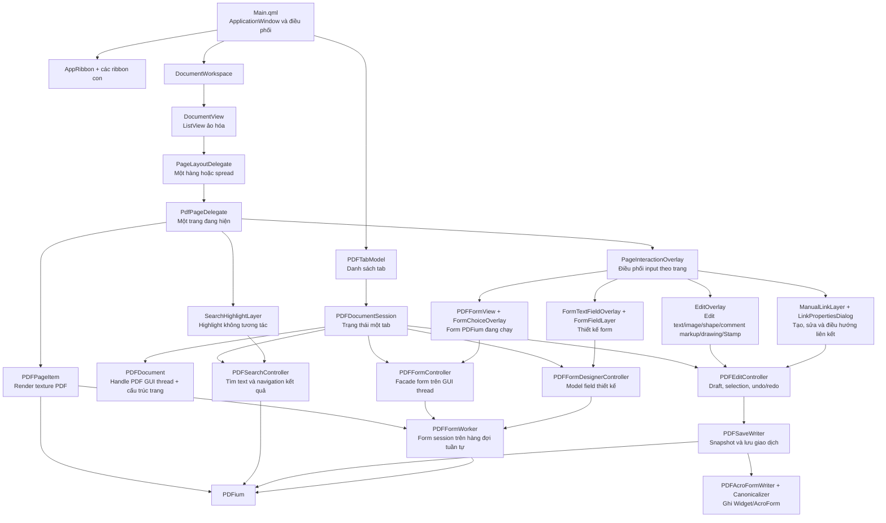

# Bản đồ mã nguồn TrePDF

Tài liệu này là điểm vào để hiểu mã nguồn TrePDF theo working tree hiện tại. Phạm
vi gồm toàn bộ mã do dự án quản lý trong `src/` và bài kiểm thử C++ trong
`tests/`; không tính `third_party/`, thư mục build, tệp dịch sinh ra hoặc tài
nguyên ảnh/phông chữ.

Các tệp QML được mô tả trong [Hướng dẫn tệp QML](qml-file-guide.md); phần triển
khai/header C++ và bộ kiểm thử được mô tả trong
[Hướng dẫn tệp C++](cpp-file-guide.md).

Tài liệu chuyên sâu về pipeline sửa text vẫn nằm ở
[text-editing-pipeline.md](text-editing-pipeline.md).

Cấu trúc chồng lớp trên từng trang — bao gồm `z`, hệ tọa độ, mode, input, render
texture và cleanup khi delegate được pool — được mô tả riêng trong
[overlay-architecture.md](overlay-architecture.md).

## Kiến trúc tổng thể



### Bốn lớp chính

| Lớp | Trách nhiệm | Tệp tiêu biểu |
|---|---|---|
| Vỏ ứng dụng | Cửa sổ, hộp thoại, ribbon, tab, phím tắt và điều phối hành động cấp ứng dụng | `Main.qml`, `AppRibbon.qml`, `DocumentTabBar.qml` |
| Trình bày trang | Bốn layout trang, spread một/hai trang, split view, ListView ảo hóa, texture PDF, highlight, overlay edit/form và xoay view | `DocumentView.qml`, `PageLayoutDelegate.qml`, `PdfPageDelegate.qml`, `SearchHighlightLayer.qml`, `PDFPageItem.cpp`, `EditOverlay.qml` |
| Trạng thái nghiệp vụ | Mỗi tab có document, search, draft edit, form runtime, form designer và trạng thái view độc lập | `PDFTabModel.cpp`, `PDFDocument.cpp`, `PDFSearchController.cpp`, `PDFEditController.cpp`, `PDFFormController.cpp`, `PDFFormDesignerController.cpp` |
| Hạ tầng PDF | Serialize PDFium, render worker, ghi nội dung/annotation/AcroForm, khóa PDFium toàn tiến trình | `PDFFormWorker.cpp`, `PDFSaveWriter.cpp`, `PDFAcroFormWriter.cpp`, `PDFAcroFormCanonicalizer.cpp`, `PDFiumSynchronization.h` |

## Ownership và vòng đời

1. `Main.qml` sở hữu một `PDFTabModel`.
2. Mỗi hàng trong model là một `PDFDocumentSession`.
3. Mỗi session sở hữu đúng một bộ `PDFDocument`, `PDFEditController`,
   `PDFSearchController`, `PDFFormController` và `PDFFormDesignerController`.
   Query, kết quả, current match, Page Display mode, cover/split và state của tối
   đa hai viewport vì vậy không rò giữa các tab.
4. Chỉ session đang active được gắn vào `DocumentWorkspace`. Khi đổi tab,
   workspace cũ được chuẩn bị ngắt rồi tạo lại để delegate, texture, editor và
   focus của tab cũ không tiếp tục sống ngầm.
5. `DocumentView` chỉ tạo `PageLayoutDelegate` cho hàng/spread đang thấy hoặc gần
   vùng nhìn; mỗi hàng giữ một hay hai `PdfPageDelegate`. Wrapper bị pool phải
   ngắt document/render state của cả hai child; khi tái sử dụng phải nạp lại state
   theo page mapping mới.
6. Save chỉ xóa draft/history sau khi tệp đích đã commit và mở lại thành công.

## Ranh giới thread và PDFium

| Thành phần | Thread/queue | Quy tắc quan trọng |
|---|---|---|
| QML, `PDFDocument`, các controller | GUI thread | Không đưa handle `FPDF_DOCUMENT` của `PDFDocument` sang worker; text markup chỉ hit-test geometry glyph normalized trong candidate cache. |
| Candidate scan của `PDFEditController` | Worker bất đồng bộ | Mở page/text handle riêng dưới PDFium lock và trả geometry glyph normalized, gồm OCR Invisible dạng hit-test-only; chỉ cache glyph ngang/upright và bỏ toàn bộ per-glyph geometry nếu page vượt 50.000 text characters. GUI/QML không truy cập các handle này. |
| Search của `PDFSearchController` | Pool riêng tối đa một worker | Debounce/controller giữ tối đa một snapshot pending mới nhất cho mỗi tab; query mở document riêng từ path, giữ PDFium lock khi dùng page/text handle và kiểm cancellation sau khi lấy lock; callback chỉ nhận khi token, path, revision và query còn khớp. |
| Render của `PDFPageItem` | Hàng đợi worker có giới hạn | Worker mở handle riêng từ đường dẫn, có cancellation và khóa chống kết quả cũ. |
| `PDFFormWorker` | Hàng đợi tuần tự dùng chung cho form session | Sở hữu document/form handle riêng; callback quay lại GUI bằng queued invocation. |
| `PDFSaveWriter` | Chuẩn bị snapshot ở GUI, ghi trên worker | Request không giữ con trỏ controller/document; writer mở document riêng. |
| Mọi giao dịch PDFium | Bất kỳ thread nào, nhưng tuần tự toàn tiến trình | Phải giữ `PDFiumProcessLock` ở biên ngoài cùng; không khóa lồng nhau, không giữ khóa khi phát signal hay chờ thread khác. |
| Scene graph texture | Render thread của Qt Quick | Tạo/thay texture trong `updatePaintNode()`; node sở hữu texture. |

## Các luồng chính

### Mở và render PDF

1. `Main.qml` nhận URL từ file dialog và gọi `PDFTabModel::open()`.
2. Model chuẩn hóa đường dẫn; nếu tệp đã mở thì chuyển sang tab đó, nếu chưa thì
   tạo `PDFDocumentSession` mới.
3. `PDFDocument::open()` mở handle GUI-thread, đọc metadata/kích thước trang và
   tăng revision. Nếu PDFium yêu cầu mật khẩu, model phát `passwordRequested`
   để `Main.qml` mở popup nhập mật khẩu; tab chỉ được thêm sau khi mở thành công.
   Mật khẩu được giữ trong bộ nhớ document và chụp vào request worker để các
   handle độc lập mở cùng tài liệu được bảo vệ.
4. `DocumentView` tạo `PdfPageDelegate` theo vùng nhìn.
5. `PDFPageItem` chụp render key gồm document, revision, trang nguồn, zoom, DPR,
   kích thước pixel, revision draft/form rồi đưa việc render sang worker.
6. Kết quả chỉ được nhận nếu request id và toàn bộ render key vẫn khớp; texture
   được upload trong `updatePaintNode()`.

### Tìm kiếm text toàn tài liệu

1. `SearchRibbonControl` đẩy text vào controller ngay; controller sở hữu debounce
   300 ms nên đổi ribbon/document tab không làm mất input. IME composition chỉ
   cập nhật pending text; Enter chạy ngay, Escape/Clear xóa state.
2. Controller chụp path, document revision và ánh xạ display/source page, hủy
   request trước rồi coalesce snapshot pending mới nhất trước pool search một
   thread.
3. Worker mở document PDFium riêng, tìm trên text layer của từng source page và
   đổi rectangle PDF thành normalized top-left geometry. Query và geometry được
   giữ bằng các cap cố định; chạm giới hạn trả state `Limited`.
4. Callback stale bị bỏ nếu controller/token/path/revision/query đã đổi. Kết quả
   hợp lệ phát `resultActivated(page, x, y, resultsRevision)`; `AppRibbon` chỉ
   forward khi View còn active. `Main.qml` và `DocumentWorkspace` giữ revision,
   chờ restore/fit ban đầu hoàn tất, rồi `DocumentView` chờ delegate ảo hóa sẵn
   sàng trước khi map điểm qua rotation và căn match vào giữa viewport.
5. `SearchHighlightLayer` của mỗi delegate đọc các rect thuộc display page; tất
   cả match hiện vàng, match hiện tại cam. Layer nằm trong `pageSurface`, xoay
   cùng trang và không nhận input. Previous/Next quay vòng qua danh sách.
6. Mỗi page chỉ materialize tối đa 512 rect QML và luôn ưu tiên current match.
   `sourceChanged`, `pageStructureChanged` hoặc edit-history change hủy/clear
   search; search chỉ đọc text nguồn đã lưu, không tham gia draft hoặc Save.

### Sửa nội dung trang

1. `AppRibbon` đồng bộ tool theo tab, rồi `EditRibbon` hoặc `CommentRibbon` đổi
   tool trên `PDFEditController`. Comment dùng `CommentSelectTool` mặc định;
   `syncEditTool()` đọc trực tiếp tab index mới để nút Select active ngay.
2. `EditOverlay` chuyển tọa độ pointer sang tỉ lệ chuẩn hóa của trang, hit-test
   candidate và gọi API của controller. Trong `CommentSelectTool`, overlay và
   controller chỉ nhận comment kind, nên text/image/Edit shape không thể bị
   chọn. Với Highlight, Underline, Squiggly và Strikeout, controller giao vùng
   kéo với glyph source-text không-whitespace trong cache scan bất đồng bộ, snap
   rectangle/QuadPoints theo từng dòng; nét gần-ngang dùng dải hit-test 3 px và
   gesture release khi cache chưa sẵn sàng được giữ pending cùng tool/màu, ưu
   tiên scan đúng page rồi tự materialize thành draft. Controller từ chối vùng chỉ có khoảng trắng hoặc
   không có glyph khả dụng. OCR Invisible được hit-test nhưng không select/edit;
   glyph xoay/dọc, page không có text layer khả dụng và page vượt safety cap
   50.000 ký tự không tạo text markup. Free Text nhận click/drag, tạo text-box
   comment và mở panel nội dung.
   Pencil sample point cách nhau tối thiểu 1 logical pixel, giữ tối đa 4.096 raw
   points và tiếp tục cập nhật endpoint cuối khi đã đầy, rồi controller
   validate/dedup/RDP-simplify khoảng 0,75 PDF point và
   cap output 1.024 điểm để tạo đúng một Ink annotation cho mỗi drag.
3. Controller giữ draft session-only và snapshot đầy đủ cho undo/redo. Texture
   gốc bị mask hoặc render lại tùy loại thay đổi.
   Ink nguồn chỉ rehydrate khi `/InkList` nằm trong giới hạn 64 stroke, 4.096
   điểm/stroke và 32.768 điểm tổng; dữ liệu malformed/oversized thành comment
   generic chỉ đọc.
4. Page text dùng editor rich text; image, shape, text markup, Free Text, Stamp
   và sáu drawing subtype Square/Circle/Line/Polygon/PolyLine/Ink dùng
   delegate/preview riêng. Nội dung Free Text được sửa trong CommentPanel.
   Sáu Edit shape mới hoặc `sourceShape` hợp lệ dùng tám handle và panel chung
   `DrawingCommentPropertiesPanel` với tiêu đề riêng, sửa stroke/fill/opacity
   qua `selectedDrawing*`. Path top-level có `TrePDFShape` hợp lệ hoặc hoàn toàn
   không có mark nhưng geometry/style khớp hình chữ nhật, tam giác hoặc hình
   thoi canonical có thể được rehydrate. Path có marker lỗi, path tùy ý hoặc lồng trong Form
   XObject không được chọn như Edit shape. Shape không marker nhận metadata
   khi được sửa và lưu lần đầu.
   Move/resize chỉ commit một command khi gesture kết thúc. Cả sáu drawing
   subtype mới hoặc source hợp lệ hỗ trợ translate endpoint, vertex hay toàn bộ
   stroke bằng bounding box/phím mũi tên, đồng thời scale toàn bộ geometry bằng
   tám resize handle ở cạnh/góc. Stamp mới và Stamp nguồn hợp lệ dùng cùng
   interaction frame; Save của Stamp nguồn vá `/Rect` nhưng giữ nguyên `/AP` và
   appearance `/BBox`. Source comment chỉ nhận geometry mutation
   khi annotation permission và các cờ ReadOnly/LockedContents/Locked cho phép;
   Stamp luôn giữ `/AP` khi move/resize. Với source drawing comment, move giữ
   `/AP`, còn resize chỉ tái tạo `/AP` TrePDF-managed khi provenance, properties
   và fingerprint vẫn an toàn.
5. `PDFSaveWriter` phân biệt thay đổi chỉ dịch chuyển với thay đổi cần thay object
   để giữ font, ma trận, resource và z-order khi có thể.
   Edit shape nguồn được xác thực rồi rebuild tại z-order cũ; style semantic
   dùng `Draft.commentProperties` với opacity riêng. Chúng vẫn là page-content
   path, không đi qua pipeline annotation `/AP` của drawing comment.

### Tương tác AcroForm có sẵn

1. `PDFFormView` chuyển mouse, keyboard, clipboard và IME từ Qt Quick sang
   `PDFFormController`.
2. Controller đóng gói `DocumentKey` có session id, đường dẫn và revision rồi
   gửi sang `PDFFormWorker`.
3. Worker xác thực lại session/page/annotation trong document riêng trước khi
   gọi PDFium.
4. Choice field thuộc tập an toàn được trình bày bằng `FormChoiceOverlay`; các
   field có action, editable combo hoặc hình học không an toàn vẫn đi đường
   native PDFium.
5. Thay đổi form tham gia draft guard của tab, nhưng PDFium không cung cấp lịch
   sử undo/redo cho choice field không editable.

### Thiết kế field mới

1. `FormRibbon` bật tool Text Field, Check Box, Radio Button, Dropdown,
   List Box hoặc Comb Field.
2. `FormTextFieldOverlay` thu click/drag và gọi
   `PDFFormDesignerController::addField()`/`addCombField()` bằng tọa độ chuẩn
   hóa.
3. `FormFieldLayer` vẽ model bằng scene graph, chọn/toggle/di chuyển field; QML
   quản lý editor text, ComboBox của Dropdown, ListView của List Box, resize handle và nút xóa nổi cho
   Text Field/Check Box transient. Chọn Text Field mở panel multi-line và giới
   hạn ký tự tùy chọn; chọn Comb Field mở panel riêng để đổi số ô/giới hạn ký tự
   bắt buộc hoặc xóa field. Panel Radio cho phép nhập Group ID; Dropdown, List Box và
   Radio transient hoặc source-backed do TrePDF tạo cũng được xóa từ panel.
4. Controller dùng Group ID làm tên field Radio, giữ mutual exclusion và
   rehydrate các field do TrePDF đã lưu để tiếp tục chỉnh sửa sau khi mở lại.
   Xóa Text Field/Dropdown/List Box/Radio source-backed tạo draft; Discard rehydrate lại
   field, còn Save/Save As mới gỡ Widget khỏi PDF.
5. Khi Save, snapshot designer được đổi thành thao tác add/update/normalize/remove;
   `PDFAcroFormWriter` tạo placeholder, `PDFAcroFormCanonicalizer` hoàn thiện
   dictionary/appearance/AcroForm, sau đó writer mở lại để kiểm chứng.

`Remove` nhận top-level, single-widget Text Field/Dropdown/List Box và member Radio trong
group do TrePDF tạo. Khi xóa Radio, writer dựng lại field cha với các member còn
lại; Check Box source-backed và cấu trúc AcroForm tùy ý vẫn được bảo vệ.

### Save và Save As

1. `PDFEditController` kết thúc editor đang mở và yêu cầu snapshot form.
2. `PDFSaveWriter::prepare()` sao chép toàn bộ dữ liệu cần thiết trên GUI thread:
   draft, page map, ảnh, font bytes, form snapshot và đường dẫn đích.
   System face dùng CoreText trên macOS hoặc `WindowsSystemFonts`/DirectWrite
   trên Windows; bộ dựng sfnt chung tạo bytes đơn-face kể cả nguồn TTC, không
   đưa handle nền tảng vào request. Windows chỉ nhận style thật, đủ glyph,
   static `glyf/loca` tối đa 64 MiB và quyền embedding Installable/Editable.
3. Worker mở bản nguồn riêng, áp dụng page operation, content object,
   annotation và form; ghi qua `PDFAtomicSaveFile`. `PDFiumDocument` giữ ownership
   reader, cho phép thay file đang mở trên Windows; xem `docs/windows-clion.md`.
4. Chỉ sau commit thành công, controller mở lại tệp đích. Mọi request render/form
   cũ bị loại bằng revision/generation mới.
5. Nếu bất kỳ bước nào thất bại, tệp đích không được thay nửa chừng và draft vẫn
   còn để người dùng thử lại.

## Chỉ mục QML

| Tệp | Vai trò ngắn |
|---|---|
| [`src/Main.qml`](../src/Main.qml) | Cửa sổ chính và điều phối toàn ứng dụng. |
| [`src/Components/AppTheme.qml`](../src/Components/AppTheme.qml) | Bảng màu dùng chung. |
| [`src/Components/AppRibbon.qml`](../src/Components/AppRibbon.qml) | Host của các tab ribbon và đồng bộ mode/tool. |
| [`src/Components/ViewRibbon.qml`](../src/Components/ViewRibbon.qml) | Lệnh file, điều hướng, zoom, fit, xoay view, Page Display theo session và host tìm kiếm. |
| [`src/Components/PageDisplayControl.qml`](../src/Components/PageDisplayControl.qml) | Dropdown cho bốn layout, toggle trang bìa và Split menu con dọc/ngang. |
| [`src/Components/ReaderControlBar.qml`](../src/Components/ReaderControlBar.qml) | Footer điều hướng trang/view, chọn nhanh layout và điều khiển zoom theo tab/pane active. |
| [`src/Components/SearchRibbonControl.qml`](../src/Components/SearchRibbonControl.qml) | Ô query, trạng thái, Previous/Next và Clear của tìm kiếm tài liệu. |
| [`src/Components/EditRibbon.qml`](../src/Components/EditRibbon.qml) | Tool sửa text/image/shape, history và page operation. |
| [`src/Components/CommentRibbon.qml`](../src/Components/CommentRibbon.qml) | Select chỉ dành cho comment, Sticky Note, Free Text, text markup, Pencil/Ink, Square/Circle/Line/Polygon/PolyLine, Stamp, quản lý comment và history. |
| [`src/Components/FormRibbon.qml`](../src/Components/FormRibbon.qml) | Tool đặt Text Field, Check Box, Radio Button, Dropdown, List Box và Comb Field. |
| [`src/Components/SignRibbon.qml`](../src/Components/SignRibbon.qml) | Chọn, chữ ký/ký tắt, ngày, check/cross, history và Save/Save As. |
| [`src/Components/SignatureDialog.qml`](../src/Components/SignatureDialog.qml) | Vẽ/nhập/import/chọn chữ ký đã lưu, chuẩn bị preview ngày và check/cross. |
| [`src/Components/DocumentTabBar.qml`](../src/Components/DocumentTabBar.qml) | Thanh tab PDF. |
| [`src/Components/DocumentWorkspace.qml`](../src/Components/DocumentWorkspace.qml) | Ghép một hoặc hai document view và lưu state riêng cho pane phụ. |
| [`src/Components/CommentPanel.qml`](../src/Components/CommentPanel.qml) | Chỉ mục/danh sách comment toàn tài liệu, phản hồi một cấp, điều hướng, xóa và sửa nội dung comment/reply được hỗ trợ; không chứa control appearance. |
| [`src/Components/DrawingCommentPropertiesPanel.qml`](../src/Components/DrawingCommentPropertiesPanel.qml) | Panel tab Edit dùng chung cho stroke, fill/no fill và opacity của Edit shape hoặc drawing comment; tiêu đề theo loại selection, source comment appearance không an toàn chỉ đọc. |
| [`src/Components/ImagePropertiesPanel.qml`](../src/Components/ImagePropertiesPanel.qml) | Panel Thuộc tính ảnh khi chọn ảnh trong Edit hoặc Sign; chứa xoay trái/phải 90° và khóa tỷ lệ transient riêng từng tab. |
| [`src/Components/TextFieldOptionsPanel.qml`](../src/Components/TextFieldOptionsPanel.qml) | Panel multi-line, giới hạn ký tự tùy chọn và xóa Text Field đang chọn. |
| [`src/Components/CombFieldOptionsPanel.qml`](../src/Components/CombFieldOptionsPanel.qml) | Panel số ô/giới hạn ký tự bắt buộc và xóa Comb Field đang chọn. |
| [`src/Components/DropdownOptionsPanel.qml`](../src/Components/DropdownOptionsPanel.qml) | Panel option dùng chung để cấu hình và xóa Dropdown hoặc List Box đang chọn. |
| [`src/Components/RadioButtonOptionsPanel.qml`](../src/Components/RadioButtonOptionsPanel.qml) | Panel Group ID và xóa Radio Button đang chọn. |
| [`src/Components/DocumentView.qml`](../src/Components/DocumentView.qml) | Một delegate active cho Single/Facing; ListView ảo hóa và dominant-page tracking cho hai mode Continuous. |
| [`src/Components/PageLayoutDelegate.qml`](../src/Components/PageLayoutDelegate.qml) | Hàng một trang hoặc spread hai trang, mapping cover, visible-area helper và pooling child. |
| [`src/Components/PdfPageDelegate.qml`](../src/Components/PdfPageDelegate.qml) | Ghép texture, search highlight, coordinator interaction, rotation và layout của một trang. |
| [`src/Components/SearchHighlightLayer.qml`](../src/Components/SearchHighlightLayer.qml) | Vẽ rect kết quả tìm kiếm normalized, không tương tác. |
| [`src/Components/WebLinkDraftLayer.qml`](../src/Components/WebLinkDraftLayer.qml) | Khung liên kết tự động chưa lưu trong Edit và hit target mở liên kết qua xác nhận trong Browse. |
| [`src/Components/PageInteractionOverlay.qml`](../src/Components/PageInteractionOverlay.qml) | Gom mode, z-order, choice handshake và cleanup của runtime/edit/form designer. |
| [`src/Components/EditOverlay.qml`](../src/Components/EditOverlay.qml) | Tương tác sửa nội dung trang, gesture và preview/draft comment; resize ảnh mới/nguồn đủ điều kiện với tám handle và tùy chọn khóa tỷ lệ. |
| [`src/Components/CommentDrawingView.qml`](../src/Components/CommentDrawingView.qml) | Renderer vector chung cho năm drawing-comment subtype. |
| [`src/Components/InkDrawingView.qml`](../src/Components/InkDrawingView.qml) | Renderer Qt Quick Shapes dùng chung cho gesture Pencil và các stroke Ink draft. |
| [`src/Components/SquigglyLine.qml`](../src/Components/SquigglyLine.qml) | Preview Squiggly theo đúng hình học 1pt/2pt của PDFium và scale trang. |
| [`src/Components/StampView.qml`](../src/Components/StampView.qml) | Preview nền màu/path trắng cho 24 Stamp trong palette, gesture và draft; Dynamic dùng snapshot tác giả/ngày giờ lúc đặt. |
| [`src/Components/FormChoiceOverlay.qml`](../src/Components/FormChoiceOverlay.qml) | Combo/list overlay cho choice field an toàn. |
| [`src/Components/FormTextFieldOverlay.qml`](../src/Components/FormTextFieldOverlay.qml) | Đặt và chỉnh field thiết kế. |
| [`src/Components/TextFormatPanel.qml`](../src/Components/TextFormatPanel.qml) | Panel font/style/color/alignment. |
| [`src/Components/ShapeDraftView.qml`](../src/Components/ShapeDraftView.qml) | Preview vector cho sáu loại shape. |
| [`src/Components/RibbonButton.qml`](../src/Components/RibbonButton.qml) | Nút ribbon dùng chung, có split-menu. |
| [`src/Components/RibbonGroup.qml`](../src/Components/RibbonGroup.qml) | Nhóm ribbon có tiêu đề và separator. |
| [`src/Components/RibbonTabButton.qml`](../src/Components/RibbonTabButton.qml) | Nút chọn tab ribbon. |
| [`src/Components/OrangeButton.qml`](../src/Components/OrangeButton.qml) | Nút hành động màu cam gọn. |

## Chỉ mục C++

| Tệp | Vai trò ngắn |
|---|---|
| [`src/main.cpp`](../src/main.cpp) | Khởi động Qt/QML, style, font và ngôn ngữ mặc định. |
| [`src/ApplicationFonts.cpp`](../src/ApplicationFonts.cpp) | Danh mục, kiểm tra, hiệu chuẩn và snapshot font. |
| [`src/WindowsSystemFonts.h`](../src/WindowsSystemFonts.h), [`src/WindowsSystemFonts.cpp`](../src/WindowsSystemFonts.cpp) | Adapter DirectWrite: chọn face hệ thống Windows thật, kiểm glyph và đọc bảng sfnt/TTC có giới hạn; `ApplicationFonts` kiểm quyền nhúng và dựng snapshot. |
| [`src/PDFTabModel.cpp`](../src/PDFTabModel.cpp) | Session mỗi tab và model nhiều tab. |
| [`src/PDFDocument.cpp`](../src/PDFDocument.cpp) | Document GUI-thread, kích thước và page map transient. |
| [`src/PDFPageItem.cpp`](../src/PDFPageItem.cpp) | Render trang bất đồng bộ và upload texture. |
| [`src/PDFSearchController.cpp`](../src/PDFSearchController.cpp) | Tìm text bất đồng bộ, giữ kết quả theo tab và điều hướng current match. |
| [`src/PDFEditController.cpp`](../src/PDFEditController.cpp) | Vòng đời controller, kết nối session, tool và selection thường/comment-only. |
| [`src/PDFEditControllerCandidates.cpp`](../src/PDFEditControllerCandidates.cpp) | Candidate cache/scan bất đồng bộ, khám phá text nguồn và font. |
| [`src/PDFEditControllerAnnotationScan.cpp`](../src/PDFEditControllerAnnotationScan.cpp) | Scan annotation nguồn, chỉ mục comment và trạng thái thread. |
| [`src/PDFEditControllerText.cpp`](../src/PDFEditControllerText.cpp) | Inline editor, chọn font và định dạng rich text. |
| [`src/PDFEditControllerComments.cpp`](../src/PDFEditControllerComments.cpp) | Tạo/sửa comment, text markup, reply, status/checkmark và appearance properties. |
| [`src/PDFEditControllerGeometry.cpp`](../src/PDFEditControllerGeometry.cpp) | Thêm text/image/shape, thao tác trang, di chuyển/resize draft và xoay ảnh. |
| [`src/PDFEditControllerDrafts.cpp`](../src/PDFEditControllerDrafts.cpp) | Snapshot, undo/redo/discard, dữ liệu trình bày và render draft. |
| [`src/PDFEditControllerSave.cpp`](../src/PDFEditControllerSave.cpp) | Điều phối Save/Save As đồng bộ và bất đồng bộ. |
| [`src/PDFEditControllerWebLinks.cpp`](../src/PDFEditControllerWebLinks.cpp) | Tạo/xóa link theo tab, scan bất đồng bộ, batch history, preview xóa và click draft qua xác nhận. |
| [`src/PDFWebLinkScanner.cpp`](../src/PDFWebLinkScanner.cpp) | Nhận diện HTTP(S) trong text và source annotation, kiểm URL/geometry/fingerprint dưới giới hạn quét. |
| [`src/PDFEditControllerSupport.cpp`](../src/PDFEditControllerSupport.cpp) | Helper dùng chung giữa các phần triển khai controller. |
| [`src/PDFEditController_p.h`](../src/PDFEditController_p.h) | Khai báo nội bộ dùng chung; API và state của controller vẫn ở `PDFEditController.h`. |
| [`src/PDFSaveWriter.cpp`](../src/PDFSaveWriter.cpp) | Ghi PDF giao dịch từ snapshot bất biến. |
| [`src/PDFAnnotationUtils.cpp`](../src/PDFAnnotationUtils.cpp) | Đọc chuỗi, chuẩn hóa nội dung và phân loại comment annotation dùng chung cho index, render và save. |
| [`src/PDFStampPresets.h`](../src/PDFStampPresets.h) | Catalogue 24 Stamp trong bốn nhóm, định dạng Dynamic detail và artwork icon/chữ Unicode dùng chung giữa preview và `/AP`. |
| [`src/PDFCommentAnnotation.h`](../src/PDFCommentAnnotation.h) | Contract geometry/common properties cho drawing/Ink comment và `/AP`; Ink giữ từng stroke `/InkList` riêng. |
| [`src/PDFShapeUtils.h`](../src/PDFShapeUtils.h) | Canonical builder và bounded validator cho geometry/style, metadata `TrePDFShape`; scanner và writer dùng chung để rehydrate/lưu Edit shape. |
| [`src/PDFSourceImageGeometry.h`](../src/PDFSourceImageGeometry.h) | Kiểm tra source-image resize/xoay an toàn và affine frame mapping dùng chung cho scanner, preview và Save; giữ pixels/resource/drawing order và phép xoay/lật/nghiêng gốc. |
| [`src/DraftImageItem.cpp`](../src/DraftImageItem.cpp) | Vẽ snapshot ảnh draft trong QML với góc xoay. |
| [`src/SignatureLibrary.cpp`](../src/SignatureLibrary.cpp) | Tạo PNG chữ ký/ngày/dấu có giới hạn, lưu thư viện cục bộ atomically và đặt qua added-image draft. |
| [`src/PDFFormController.cpp`](../src/PDFFormController.cpp) | Facade GUI-thread của form runtime. |
| [`src/PDFFormWorker.cpp`](../src/PDFFormWorker.cpp) | Session PDFium form trên hàng đợi tuần tự. |
| [`src/PDFFormView.cpp`](../src/PDFFormView.cpp) | Cầu input/IME và choice-field giữa QML với controller. |
| [`src/PDFFormDesignerController.cpp`](../src/PDFFormDesignerController.cpp) | Model field thiết kế, rehydrate và snapshot save. |
| [`src/FormFieldLayer.cpp`](../src/FormFieldLayer.cpp) | Scene graph và pointer interaction cho field thiết kế. |
| [`src/PDFAcroFormWriter.cpp`](../src/PDFAcroFormWriter.cpp) | Pipeline cấp cao để ghi field TrePDF. |
| [`src/PDFAcroFormCanonicalizer.cpp`](../src/PDFAcroFormCanonicalizer.cpp) | Hoàn thiện AcroForm, Free Text, text/drawing/Ink markup `/AP` và `/IRT` reply bằng incremental update. |
| [`src/PDFWidgetAnnotationSuppression.cpp`](../src/PDFWidgetAnnotationSuppression.cpp) | Ẩn Widget tạm thời và phục hồi patch khi render designer. |
| [`tests/tst_PDFEditController.cpp`](../tests/tst_PDFEditController.cpp) | Bộ test tích hợp/hồi quy của edit, search, save, form, font và tab. |
| [`tests/tst_PDFEditControllerSignatures.cpp`](../tests/tst_PDFEditControllerSignatures.cpp) | Preview/input chữ ký, thư viện atomic, history/discard và image Save/Save As/reopen. |

## Khi cần sửa một tính năng, bắt đầu ở đâu

| Nhu cầu | Điểm vào | Thường phải kiểm tra cùng |
|---|---|---|
| Ribbon, bố cục, dialog | `Main.qml`, ribbon tương ứng | `i18n/qml_vi.ts`, `AppTheme.qml` |
| Chữ ký hiển thị, ngày và check/cross | `SignRibbon.qml`, `SignatureDialog.qml`, `SignatureLibrary.cpp` | Pending placement theo session trong `Main.qml`, `addImageData()`, image history/save; không có ký số chứng thư hoặc gửi yêu cầu ký online |
| Scroll/zoom/rotation/Page Display/pooling | `DocumentView.qml`, `PageLayoutDelegate.qml`, `PdfPageDelegate.qml` | `DocumentWorkspace.qml`, `PDFPageItem.cpp`, state trong `PDFDocumentSession` |
| Tìm text tài liệu | `SearchRibbonControl.qml`, `PDFSearchController.cpp` | `SearchHighlightLayer.qml`, navigation trong `AppRibbon.qml`, translation và test async/stale |
| Chọn hoặc sửa text/image/shape/comment | `EditOverlay.qml` | `EditRibbon.qml` hoặc `CommentRibbon.qml`, `CommentPanel.qml`, `DrawingCommentPropertiesPanel.qml`, `PDFEditController.cpp`, `PDFSaveWriter.cpp`, test round-trip |
| Resize/xoay ảnh và khóa tỷ lệ | `EditOverlay.qml`, `ImagePropertiesPanel.qml`, `PDFEditControllerGeometry.cpp` | Điều kiện hiện panel trong `DocumentWorkspace.qml`, capability trong `PDFEditControllerCandidates.cpp`, `PDFSourceImageGeometry.h`, preview trong `PDFPageItem.cpp`, `PDFSaveWriter.cpp`, test geometry/history/round-trip |
| Font hiển thị hoặc nhúng | `TextFormatPanel.qml`, `ApplicationFonts.cpp`, `WindowsSystemFonts.cpp` | `PDFEditControllerText.cpp`, `PDFEditControllerCandidates.cpp`, `PDFSaveWriter.cpp` |
| Form PDF đang chạy | `PDFFormView.cpp`, `PDFFormController.cpp` | `PDFFormWorker.cpp`, `FormChoiceOverlay.qml` |
| Form designer | `FormTextFieldOverlay.qml`, `FormFieldLayer.cpp` | `PDFFormDesignerController.cpp`, AcroForm writer/canonicalizer |
| Lỗi render/texture | `PDFPageItem.cpp` | cancellation, revision, PDFium lock, delegate pooling |
| Lỗi Save/Save As | `PDFEditControllerSave.cpp`, `PDFSaveWriter.cpp` | `PDFTabModel.cpp`, form snapshot, reopen sau commit |

## Giữ tài liệu đồng bộ

Sau khi thêm/xóa tệp, có thể kiểm nhanh inventory bằng:

```sh
rg --files src -g '*.qml' | sort
rg --files src -g '*.cpp' | sort
rg --files tests -g '*.cpp' | sort
rg --files src -g '*.h' | sort
```

Khi trách nhiệm của một tệp thay đổi, cập nhật mô tả chi tiết trong guide tương
ứng trước, sau đó sửa bảng chỉ mục ở tài liệu này nếu vai trò ngắn không còn
đúng.
