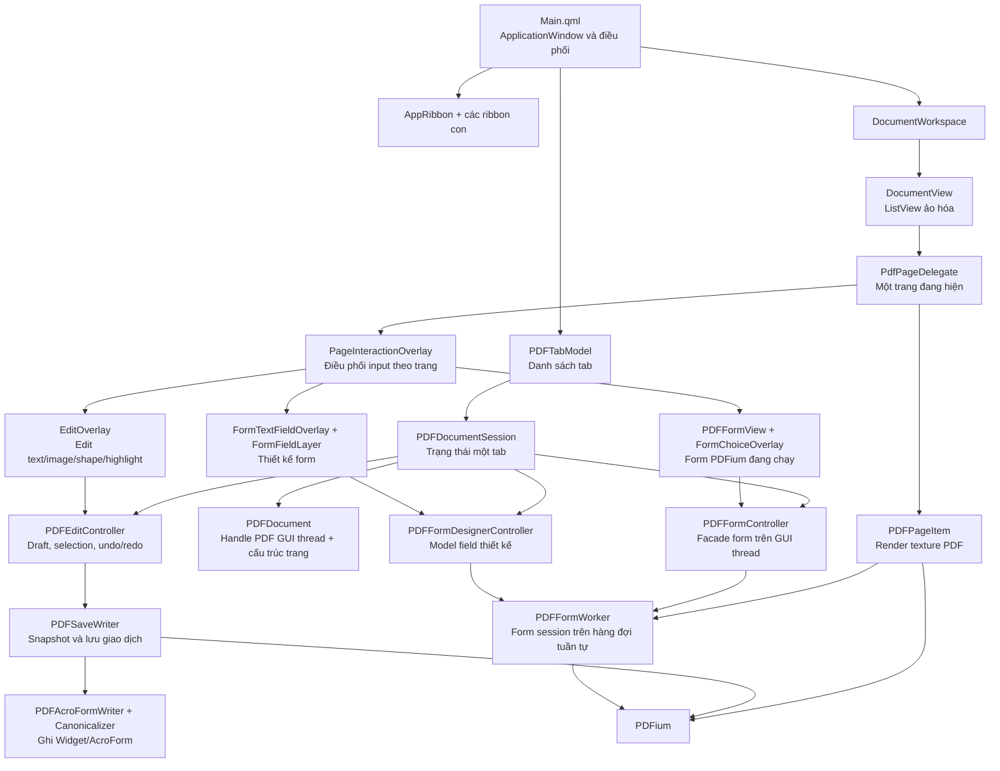

# Bản đồ mã nguồn TrePDF

Tài liệu này là điểm vào để hiểu mã nguồn TrePDF theo working tree hiện tại. Phạm
vi gồm toàn bộ mã do dự án quản lý trong `src/` và bài kiểm thử C++ trong
`tests/`; không tính `third_party/`, thư mục build, tệp dịch sinh ra hoặc tài
nguyên ảnh/phông chữ.

Tại thời điểm cập nhật, phạm vi có:

- 27 tệp QML: xem [Hướng dẫn tệp QML](qml-file-guide.md).
- 16 tệp triển khai C++ trong `src/` và 1 tệp kiểm thử C++: xem
  [Hướng dẫn tệp C++](cpp-file-guide.md).
- 17 header C++; trong đó 15 header đi cùng tệp triển khai và 2 header dùng
  chung không có `.cpp` riêng.

Tài liệu chuyên sâu về pipeline sửa text vẫn nằm ở
[text-editing-pipeline.md](text-editing-pipeline.md).

Cấu trúc chồng lớp trên từng trang — bao gồm `z`, hệ tọa độ, mode, input, render
texture và cleanup khi delegate được pool — được mô tả riêng trong
[overlay-architecture.md](overlay-architecture.md).

## Kiến trúc tổng thể



### Bốn lớp chính

| Lớp | Trách nhiệm | Tệp tiêu biểu |
|---|---|---|
| Vỏ ứng dụng | Cửa sổ, hộp thoại, ribbon, tab, phím tắt và điều phối hành động cấp ứng dụng | `Main.qml`, `AppRibbon.qml`, `DocumentTabBar.qml` |
| Trình bày trang | ListView ảo hóa, delegate trang, texture PDF, overlay edit/form và biến đổi xoay view | `DocumentView.qml`, `PdfPageDelegate.qml`, `PDFPageItem.cpp`, `EditOverlay.qml` |
| Trạng thái nghiệp vụ | Mỗi tab có document, draft edit, form runtime, form designer và trạng thái view độc lập | `PDFTabModel.cpp`, `PDFDocument.cpp`, `PDFEditController.cpp`, `PDFFormController.cpp`, `PDFFormDesignerController.cpp` |
| Hạ tầng PDF | Serialize PDFium, render worker, ghi nội dung/annotation/AcroForm, khóa PDFium toàn tiến trình | `PDFFormWorker.cpp`, `PDFSaveWriter.cpp`, `PDFAcroFormWriter.cpp`, `PDFAcroFormCanonicalizer.cpp`, `PDFiumSynchronization.h` |

## Ownership và vòng đời

1. `Main.qml` sở hữu một `PDFTabModel`.
2. Mỗi hàng trong model là một `PDFDocumentSession`.
3. Mỗi session sở hữu đúng một bộ `PDFDocument`, `PDFEditController`,
   `PDFFormController` và `PDFFormDesignerController`.
4. Chỉ session đang active được gắn vào `DocumentWorkspace`. Khi đổi tab,
   workspace cũ được chuẩn bị ngắt rồi tạo lại để delegate, texture, editor và
   focus của tab cũ không tiếp tục sống ngầm.
5. `DocumentView` chỉ tạo delegate cho trang đang thấy hoặc gần vùng nhìn.
   Delegate bị pool phải ngắt document/render state; khi được tái sử dụng phải
   nạp lại toàn bộ state theo trang mới.
6. Save chỉ xóa draft/history sau khi tệp đích đã commit và mở lại thành công.

## Ranh giới thread và PDFium

| Thành phần | Thread/queue | Quy tắc quan trọng |
|---|---|---|
| QML, `PDFDocument`, các controller | GUI thread | Không đưa handle `FPDF_DOCUMENT` của `PDFDocument` sang worker. |
| Render của `PDFPageItem` | Hàng đợi worker có giới hạn | Worker mở handle riêng từ đường dẫn, có cancellation và khóa chống kết quả cũ. |
| `PDFFormWorker` | Hàng đợi tuần tự dùng chung cho form session | Sở hữu document/form handle riêng; callback quay lại GUI bằng queued invocation. |
| `PDFSaveWriter` | Chuẩn bị snapshot ở GUI, ghi trên worker | Request không giữ con trỏ controller/document; writer mở document riêng. |
| Mọi giao dịch PDFium | Bất kỳ thread nào, nhưng tuần tự toàn tiến trình | Phải giữ `PDFiumProcessLock` ở biên ngoài cùng; không khóa lồng nhau, không giữ khóa khi phát signal hay chờ thread khác. |
| Scene graph texture | Render thread của Qt Quick | Tạo/thay texture trong `updatePaintNode()`; node sở hữu texture. |

## Các luồng chính

### Mở và render PDF

1. `Main.qml` nhận URL từ file dialog và gọi `PDFTabModel::open()`.
2. Model chuẩn hóa đường dẫn; nếu tệp đã mở thì chuyển sang tab đó, nếu chưa thì
   tạo `PDFDocumentSession` mới.
3. `PDFDocument::open()` mở handle GUI-thread, đọc metadata/kích thước trang và
   tăng revision.
4. `DocumentView` tạo `PdfPageDelegate` theo vùng nhìn.
5. `PDFPageItem` chụp render key gồm document, revision, trang nguồn, zoom, DPR,
   kích thước pixel, revision draft/form rồi đưa việc render sang worker.
6. Kết quả chỉ được nhận nếu request id và toàn bộ render key vẫn khớp; texture
   được upload trong `updatePaintNode()`.

### Sửa nội dung trang

1. `EditRibbon` hoặc `CommentRibbon` đổi tool trên `PDFEditController`.
2. `EditOverlay` chuyển tọa độ pointer sang tỉ lệ chuẩn hóa của trang, hit-test
   candidate và gọi API của controller.
3. Controller giữ draft session-only và snapshot đầy đủ cho undo/redo. Texture
   gốc bị mask hoặc render lại tùy loại thay đổi.
4. Text dùng editor rich text; image, shape và highlight dùng delegate/preview
   riêng. Move/resize chỉ commit một command khi gesture kết thúc.
5. `PDFSaveWriter` phân biệt thay đổi chỉ dịch chuyển với thay đổi cần thay object
   để giữ font, ma trận, resource và z-order khi có thể.

### Tương tác AcroForm có sẵn

1. `PDFFormView` chuyển mouse, keyboard, clipboard và IME từ Qt Quick sang
   `PDFFormController`.
2. Controller đóng gói `DocumentKey` có session id, đường dẫn và revision rồi
   gửi sang `PDFFormWorker`.
3. Worker xác thực lại session/page/annotation trong document riêng trước khi
   gọi PDFium.
4. Choice field thuộc tập an toàn được trình bày bằng `FormChoiceOverlay`; các
   field có action, editable combo hoặc hình học không an toàn vẫn đi đường
   native PDFium.
5. Thay đổi form tham gia draft guard của tab, nhưng PDFium không cung cấp lịch
   sử undo/redo cho choice field không editable.

### Thiết kế field mới

1. `FormRibbon` bật tool Text Field, Check Box, Radio Button, Dropdown,
   List Box hoặc Comb Field.
2. `FormTextFieldOverlay` thu click/drag và gọi
   `PDFFormDesignerController::addField()`/`addCombField()` bằng tọa độ chuẩn
   hóa.
3. `FormFieldLayer` vẽ model bằng scene graph, chọn/toggle/di chuyển field; QML
   quản lý editor text, ComboBox của Dropdown, ListView của List Box, resize handle và nút xóa nổi cho
   Text Field/Check Box transient. Chọn Text Field mở panel multi-line và giới
   hạn ký tự tùy chọn; chọn Comb Field mở panel riêng để đổi số ô/giới hạn ký tự
   bắt buộc hoặc xóa field. Panel Radio cho phép nhập Group ID; Dropdown, List Box và
   Radio transient hoặc source-backed do TrePDF tạo cũng được xóa từ panel.
4. Controller dùng Group ID làm tên field Radio, giữ mutual exclusion và
   rehydrate các field do TrePDF đã lưu để tiếp tục chỉnh sửa sau khi mở lại.
   Xóa Text Field/Dropdown/List Box/Radio source-backed tạo draft; Discard rehydrate lại
   field, còn Save/Save As mới gỡ Widget khỏi PDF.
5. Khi Save, snapshot designer được đổi thành thao tác add/update/normalize/remove;
   `PDFAcroFormWriter` tạo placeholder, `PDFAcroFormCanonicalizer` hoàn thiện
   dictionary/appearance/AcroForm, sau đó writer mở lại để kiểm chứng.

`Remove` nhận top-level, single-widget Text Field/Dropdown/List Box và member Radio trong
group do TrePDF tạo. Khi xóa Radio, writer dựng lại field cha với các member còn
lại; Check Box source-backed và cấu trúc AcroForm tùy ý vẫn được bảo vệ.

### Save và Save As

1. `PDFEditController` kết thúc editor đang mở và yêu cầu snapshot form.
2. `PDFSaveWriter::prepare()` sao chép toàn bộ dữ liệu cần thiết trên GUI thread:
   draft, page map, ảnh, font bytes, form snapshot và đường dẫn đích.
3. Worker mở bản nguồn riêng, áp dụng page operation, content object,
   annotation và form; ghi qua `QSaveFile`.
4. Chỉ sau commit thành công, controller mở lại tệp đích. Mọi request render/form
   cũ bị loại bằng revision/generation mới.
5. Nếu bất kỳ bước nào thất bại, tệp đích không được thay nửa chừng và draft vẫn
   còn để người dùng thử lại.

## Chỉ mục QML

| Tệp | Vai trò ngắn |
|---|---|
| [`src/Main.qml`](../src/Main.qml) | Cửa sổ chính và điều phối toàn ứng dụng. |
| [`src/Components/AppTheme.qml`](../src/Components/AppTheme.qml) | Bảng màu dùng chung. |
| [`src/Components/AppRibbon.qml`](../src/Components/AppRibbon.qml) | Host của các tab ribbon và đồng bộ mode/tool. |
| [`src/Components/ViewRibbon.qml`](../src/Components/ViewRibbon.qml) | Lệnh file, điều hướng, zoom, fit và xoay view. |
| [`src/Components/EditRibbon.qml`](../src/Components/EditRibbon.qml) | Tool sửa text/image/shape, history và page operation. |
| [`src/Components/CommentRibbon.qml`](../src/Components/CommentRibbon.qml) | Sticky Note, Highlight/Underline/Strikeout, quản lý comment và history. |
| [`src/Components/FormRibbon.qml`](../src/Components/FormRibbon.qml) | Tool đặt Text Field, Check Box, Radio Button, Dropdown, List Box và Comb Field. |
| [`src/Components/SignRibbon.qml`](../src/Components/SignRibbon.qml) | UI tab ký, hiện chủ yếu là điểm mở rộng. |
| [`src/Components/DocumentTabBar.qml`](../src/Components/DocumentTabBar.qml) | Thanh tab PDF. |
| [`src/Components/DocumentWorkspace.qml`](../src/Components/DocumentWorkspace.qml) | Ghép document view với panel comment/format/Text Field/Comb/Dropdown/List Box/Radio cho một session. |
| [`src/Components/CommentPanel.qml`](../src/Components/CommentPanel.qml) | Chỉ mục/danh sách comment toàn tài liệu, điều hướng và sửa nội dung Sticky Note mới. |
| [`src/Components/TextFieldOptionsPanel.qml`](../src/Components/TextFieldOptionsPanel.qml) | Panel multi-line, giới hạn ký tự tùy chọn và xóa Text Field đang chọn. |
| [`src/Components/CombFieldOptionsPanel.qml`](../src/Components/CombFieldOptionsPanel.qml) | Panel số ô/giới hạn ký tự bắt buộc và xóa Comb Field đang chọn. |
| [`src/Components/DropdownOptionsPanel.qml`](../src/Components/DropdownOptionsPanel.qml) | Panel option dùng chung để cấu hình và xóa Dropdown hoặc List Box đang chọn. |
| [`src/Components/RadioButtonOptionsPanel.qml`](../src/Components/RadioButtonOptionsPanel.qml) | Panel Group ID và xóa Radio Button đang chọn. |
| [`src/Components/DocumentView.qml`](../src/Components/DocumentView.qml) | ListView trang liên tục và ảo hóa. |
| [`src/Components/PdfPageDelegate.qml`](../src/Components/PdfPageDelegate.qml) | Ghép texture, coordinator interaction, rotation và layout của một trang. |
| [`src/Components/PageInteractionOverlay.qml`](../src/Components/PageInteractionOverlay.qml) | Gom mode, z-order, choice handshake và cleanup của runtime/edit/form designer. |
| [`src/Components/EditOverlay.qml`](../src/Components/EditOverlay.qml) | Tương tác sửa nội dung trang. |
| [`src/Components/FormChoiceOverlay.qml`](../src/Components/FormChoiceOverlay.qml) | Combo/list overlay cho choice field an toàn. |
| [`src/Components/FormTextFieldOverlay.qml`](../src/Components/FormTextFieldOverlay.qml) | Đặt và chỉnh field thiết kế. |
| [`src/Components/TextFormatPanel.qml`](../src/Components/TextFormatPanel.qml) | Panel font/style/color/alignment. |
| [`src/Components/ShapeDraftView.qml`](../src/Components/ShapeDraftView.qml) | Preview vector cho sáu loại shape. |
| [`src/Components/RibbonButton.qml`](../src/Components/RibbonButton.qml) | Nút ribbon dùng chung, có split-menu. |
| [`src/Components/RibbonGroup.qml`](../src/Components/RibbonGroup.qml) | Nhóm ribbon có tiêu đề và separator. |
| [`src/Components/RibbonTabButton.qml`](../src/Components/RibbonTabButton.qml) | Nút chọn tab ribbon. |
| [`src/Components/OrangeButton.qml`](../src/Components/OrangeButton.qml) | Nút hành động màu cam gọn. |

## Chỉ mục C++

| Tệp | Vai trò ngắn |
|---|---|
| [`src/main.cpp`](../src/main.cpp) | Khởi động Qt/QML, style, font và ngôn ngữ mặc định. |
| [`src/ApplicationFonts.cpp`](../src/ApplicationFonts.cpp) | Danh mục, kiểm tra, hiệu chuẩn và snapshot font. |
| [`src/PDFTabModel.cpp`](../src/PDFTabModel.cpp) | Session mỗi tab và model nhiều tab. |
| [`src/PDFDocument.cpp`](../src/PDFDocument.cpp) | Document GUI-thread, kích thước và page map transient. |
| [`src/PDFPageItem.cpp`](../src/PDFPageItem.cpp) | Render trang bất đồng bộ và upload texture. |
| [`src/PDFEditController.cpp`](../src/PDFEditController.cpp) | Candidate, selection, draft, edit, history và save orchestration. |
| [`src/PDFSaveWriter.cpp`](../src/PDFSaveWriter.cpp) | Ghi PDF giao dịch từ snapshot bất biến. |
| [`src/DraftImageItem.cpp`](../src/DraftImageItem.cpp) | Vẽ snapshot ảnh draft trong QML. |
| [`src/PDFFormController.cpp`](../src/PDFFormController.cpp) | Facade GUI-thread của form runtime. |
| [`src/PDFFormWorker.cpp`](../src/PDFFormWorker.cpp) | Session PDFium form trên hàng đợi tuần tự. |
| [`src/PDFFormView.cpp`](../src/PDFFormView.cpp) | Cầu input/IME và choice-field giữa QML với controller. |
| [`src/PDFFormDesignerController.cpp`](../src/PDFFormDesignerController.cpp) | Model field thiết kế, rehydrate và snapshot save. |
| [`src/FormFieldLayer.cpp`](../src/FormFieldLayer.cpp) | Scene graph và pointer interaction cho field thiết kế. |
| [`src/PDFAcroFormWriter.cpp`](../src/PDFAcroFormWriter.cpp) | Pipeline cấp cao để ghi field TrePDF. |
| [`src/PDFAcroFormCanonicalizer.cpp`](../src/PDFAcroFormCanonicalizer.cpp) | Hoàn thiện object/dictionary/appearance AcroForm bằng incremental update. |
| [`src/PDFWidgetAnnotationSuppression.cpp`](../src/PDFWidgetAnnotationSuppression.cpp) | Ẩn Widget tạm thời và phục hồi patch khi render designer. |
| [`tests/tst_PDFEditController.cpp`](../tests/tst_PDFEditController.cpp) | Bộ test tích hợp/hồi quy của edit, save, form, font và tab. |

## Khi cần sửa một tính năng, bắt đầu ở đâu

| Nhu cầu | Điểm vào | Thường phải kiểm tra cùng |
|---|---|---|
| Ribbon, bố cục, dialog | `Main.qml`, ribbon tương ứng | `i18n/qml_vi.ts`, `AppTheme.qml` |
| Scroll/zoom/rotation/pooling | `DocumentView.qml`, `PdfPageDelegate.qml` | `PDFPageItem.cpp`, state trong `PDFDocumentSession` |
| Chọn hoặc sửa text/image/shape/comment | `EditOverlay.qml` | `EditRibbon.qml` hoặc `CommentRibbon.qml`, `CommentPanel.qml`, `PDFEditController.cpp`, `PDFSaveWriter.cpp`, test round-trip |
| Font hiển thị hoặc nhúng | `TextFormatPanel.qml`, `ApplicationFonts.cpp` | `PDFEditController.cpp`, `PDFSaveWriter.cpp` |
| Form PDF đang chạy | `PDFFormView.cpp`, `PDFFormController.cpp` | `PDFFormWorker.cpp`, `FormChoiceOverlay.qml` |
| Form designer | `FormTextFieldOverlay.qml`, `FormFieldLayer.cpp` | `PDFFormDesignerController.cpp`, AcroForm writer/canonicalizer |
| Lỗi render/texture | `PDFPageItem.cpp` | cancellation, revision, PDFium lock, delegate pooling |
| Lỗi Save/Save As | `PDFEditController.cpp`, `PDFSaveWriter.cpp` | `PDFTabModel.cpp`, form snapshot, reopen sau commit |

## Giữ tài liệu đồng bộ

Sau khi thêm/xóa tệp, có thể kiểm nhanh inventory bằng:

```sh
rg --files src -g '*.qml' | sort
rg --files src -g '*.cpp' | sort
rg --files tests -g '*.cpp' | sort
rg --files src -g '*.h' | sort
```

Khi trách nhiệm của một tệp thay đổi, cập nhật mô tả chi tiết trong guide tương
ứng trước, sau đó sửa bảng chỉ mục ở tài liệu này nếu vai trò ngắn không còn
đúng.
