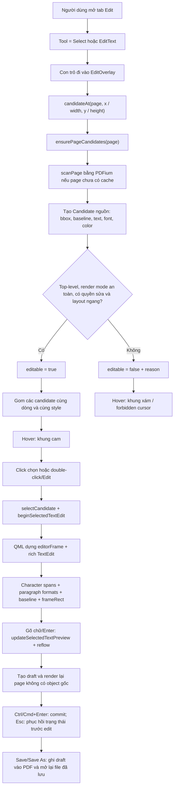

# Quy trình xác định và hiển thị text có thể chỉnh sửa

Tài liệu này mô tả đúng implementation hiện tại của TrePDF, từ lúc PDFium quét
nội dung trong PDF đến lúc người dùng chỉnh sửa và dùng Save/Save As. Thay đổi
được giữ dưới dạng **draft trong phiên làm việc** cho đến khi save thành công.

Các file chính:

- [`PDFEditController.cpp`](../src/PDFEditController.cpp): quét object, tính
  geometry/font, quyết định `editable`, selection và draft.
- [`PDFEditController.h`](../src/PDFEditController.h): cấu trúc `Candidate` và
  các property đưa sang QML.
- [`EditOverlay.qml`](../src/Components/EditOverlay.qml): hit test, hover box,
  selection box và rich `TextEdit` khi edit.
- [`PDFPageItem.cpp`](../src/PDFPageItem.cpp): render lại page mà tạm ẩn text
  object gốc khi đã có draft.
- [`PDFSaveWriter.cpp`](../src/PDFSaveWriter.cpp): thay object nguồn bằng các
  text run đã layout và ghi PDF theo transaction.
- [`PdfPageDelegate.qml`](../src/Components/PdfPageDelegate.qml) và
  [`PageInteractionOverlay.qml`](../src/Components/PageInteractionOverlay.qml):
  đặt `EditOverlay` trùng chính xác lên `PDFPageView`.

## 1. Tổng quan luồng xử lý



## 2. Các khái niệm geometry

### 2.1 PDF text object

Một PDF text object chứa font, font size, ma trận biến đổi, chuỗi/glyph và chế
độ render. Một dòng người dùng nhìn thấy có thể là một object, nhiều object,
hoặc một object nằm bên trong Form XObject.

TrePDF gán ID theo đường dẫn object:

```text
object:<top-level-index>/<child-index>/...
```

Ví dụ `object:3/1` là child số 1 bên trong Form XObject số 3.

Nếu nhiều text object editable nằm trên cùng baseline, gần nhau và có style
tương thích, TrePDF thay chúng bằng một candidate dòng có ID ổn định trong
phiên:

```text
line:<sha256-của-các-object-id-nguồn>
```

Candidate dòng giữ `CandidatePart` cho từng object nguồn, gồm `objectId`,
`objectPath`, bbox, origin, text và separator sau part. Vì vậy UI thao tác với
một dòng, nhưng renderer vẫn tìm và ẩn được từng PDF page object gốc.

### 2.2 Glyph bbox

`glyph bbox` là hình chữ nhật bao quanh phần glyph mà PDFium trả về cho từng ký
tự. TrePDF lấy `FPDFText_GetCharBox()` cho tất cả ký tự thuộc cùng text object,
sau đó hợp các hình chữ nhật để tạo source rect của candidate:

```text
glyphBBox = union(charBox[0], charBox[1], ..., charBox[n - 1])
```

Nếu có glyph bbox hợp lệ, nó được ưu tiên làm
`Candidate.geometry.sourceRect`. Nếu không có, TrePDF dùng bounds của cả page
object từ `FPDFPageObj_GetBounds()`. Kết quả scan đồng thời giữ geometry chuẩn
hóa của từng glyph source-text không phải whitespace trong cache page. Dữ liệu
chi tiết này phục vụ hit-test/snap text markup; nó không làm thay đổi source rect
union dùng cho text editing. Text render mode Invisible, thường là OCR ẩn, được
giữ dưới dạng hit-test-only: glyph của nó tham gia text markup nhưng record không
được trả về cho selection/editing.

Glyph bbox không phải line box của font. Nó không tự bao gồm toàn bộ ascent,
descent hoặc khoảng trống mà Qt cần để vẽ caret.

### 2.3 Ba lớp geometry của candidate

Geometry normalized theo page được tách giữa candidate nguồn và rich-text
draft:

- `Candidate.geometry.sourceRect`: bbox bất biến của nội dung PDF nguồn.
  Candidate dòng dùng union
  của các source part; mỗi `CandidatePart` vẫn giữ `sourceRect` riêng để mask và
  suppression chính xác.
- `Draft.frameRect`: box layout của draft/editor. Với text PDF có baseline, seed
  ban đầu là union của `sourceRect` và chiều rộng mà `QFontMetricsF` cần để vẽ
  chuỗi gốc từ origin, cộng 4 page point chống sai số làm tròn. Nhờ vậy candidate
  gộp không wrap ngay khi vừa mở editor. QML selection, draft delegate và editor
  đều đọc rectangle này; đây là geometry sẽ thay đổi khi có resize.
- `Draft.contentBounds`: bbox của nội dung sau layout. Ban đầu bằng `frameRect`;
  rich-text editor đo chiều cao reflow trong QML và gọi
  `updateSelectedContentBounds()`. Chiều rộng luôn theo `frameRect`, còn cạnh
  dưới có thể nở để chứa Enter/wrap. Giá trị này nằm trong cùng snapshot draft
  nên undo/redo phục hồi đúng chiều cao nội dung.

Khi mở inline editor cho text PDF có sẵn, controller tạo một bản hiển thị tạm
từ draft hiện tại và chỉ nới cạnh phải. Mép trái, cạnh trên và chiều cao không
đổi. Nếu có text candidate khác cùng visual row ở bên phải, biên edit dừng tại
trung điểm khoảng trắng trước candidate đó; nếu không có vật cản, biên edit đi
đến lề phải suy ra từ lề trái/nội dung của page. Frame này không thay đổi
`sourceRect`, vùng hit-test hoặc source masks. Nó chỉ được ghi vào draft khi
text thật sự đổi, paragraph format thay đổi hoặc người dùng resize rõ ràng; mở
rồi đóng editor không thay đổi gì, gửi lại đúng text và paragraph format cũ,
hoặc nhấn Esc đều phục hồi frame trước đó.

Midpoint được tính từ initial/source frame bất biến nên mở sửa nhiều lần không
làm cạnh phải bò dần sang cột kế. Với candidate cản đã có draft, thuật toán dùng
frame draft hiện tại; draft đã xóa hết text không còn chiếm biên cột.

`sourceRect` không thay đổi theo draft. `frameRect` và `contentBounds` nằm trong
rich-text draft. `Command` lưu snapshot draft before/after nên cancel, undo và
redo phục hồi geometry cùng text và định dạng. Overlay hiển thị bốn handle ở
giữa cạnh trái, phải, trên và dưới; mỗi lần kéo tạo một transaction geometry.

### 2.4 Origin và baseline

- `origin`: điểm bắt đầu của ký tự thật đầu tiên, lấy bằng
  `FPDFText_GetCharOrigin()`.
- `baseline`: đường đi qua origin mà glyph đứng trên đó.
- Trong `Candidate`, code hiện lưu điểm origin đã chuẩn hóa thành
  `originX` và `baselineY`.
- Khi resize làm đổi `frameRect.x/y`, layout origin của draft dịch cùng delta
  so với frame ban đầu. Vì vậy kéo cạnh trái/trên thật sự đổi vùng layout nhưng
  vẫn giữ offset baseline gốc bên trong box; source origin trong candidate không
  bị sửa.

Nếu lấy được origin, QML đặt baseline dòng đầu của `TextEdit` trùng với baseline PDF.
Nếu không lấy được, editor dùng căn giữa theo chiều dọc trong bbox.

### 2.5 Font size và chiều cao glyph là hai giá trị khác nhau

`FPDFTextObj_GetFontSize()` trả về **em-size** của font trong hệ tọa độ PDF.
Nó không phải chiều cao phần mực đen nhìn thấy.

Ví dụ cùng font size 20 pt:

- chữ `H` có thể chỉ chiếm phần phía trên baseline;
- chữ `g` có descender đi xuống dưới baseline;
- glyph bbox của `HI` và `gy` có thể cao khác nhau;
- line height/caret của Qt thường cao hơn cả hai glyph bbox.

## 3. Khi nào TrePDF bắt đầu quét text

Khi người dùng mở tab Edit, [`AppRibbon.qml`](../src/Components/AppRibbon.qml)
đổi tool từ `BrowseTool` sang `SelectTool`. `EditOverlay` chỉ tương tác khi:

```text
interactionActive = !pooled && tool != BrowseTool
```

Mỗi page delegate có một `PageInteractionOverlay` trùng vị trí và kích thước
với `PDFPageView`; `EditOverlay` fill coordinator này, vì vậy tọa độ normalized
của C++ có thể đổi trực tiếp sang pixel QML.

Candidate được quét theo nhu cầu khi QML gọi một trong các hàm như:

- `candidateAt(page, x, y)` khi hover/click;
- `candidatesForPage(page)` khi điều hướng bằng phím;
- `selectCandidate(page, objectId)`.

`ensurePageCandidates()` cache kết quả theo page. Cache bị xóa khi revision của
document thay đổi.

## 4. Quá trình quét một page

### 4.1 Load page và text page

`scanPage()`:

1. Lấy kích thước page đã cache từ `PDFDocument`.
2. Load `FPDF_PAGE` và `FPDF_TEXTPAGE`.
3. Duyệt từng ký tự trong text page.
4. Gom ký tự theo `FPDF_PAGEOBJECT`.
5. Duyệt page object để tạo candidate nguồn.
6. Duyệt thêm comment annotation (gồm FreeText) và Widget.
7. Gom các candidate text tương thích thành candidate dòng.

### 4.2 Gom text layout theo ký tự

Với mỗi ký tự:

- `FPDFText_GetTextObject()` xác định text object sở hữu ký tự;
- ký tự không phải generated character được nối vào chuỗi Unicode;
- origin của ký tự không-generated đầu tiên được lưu làm baseline origin;
- `FPDFText_GetCharBox()` được hợp vào glyph bbox của object và box normalized
  của glyph không-whitespace được giữ trong kết quả scan cho text markup nếu góc
  ký tự gần 0° (ngang/upright).

Nếu chuỗi gom từ ký tự rỗng, code fallback sang `FPDFTextObj_GetText()`.

Text rỗng hoặc chỉ chứa whitespace bị bỏ qua hoàn toàn:

```text
if trim(text) is empty -> không tạo Candidate
```

Trước vòng lặp, `FPDFText_CountChars()` áp safety cap 50.000 ký tự/page cho cache
per-glyph. Page vượt cap vẫn scan candidate/source text như trước nhưng không
giữ bất kỳ glyph rectangle text-markup nào; không lấy partial prefix để tránh tạo
markup thiếu và để giới hạn RAM.

Khi người dùng thả gesture Highlight/Underline/Squiggly/Strikeout, controller
giao rectangle kéo với các box glyph đã cache, nhóm phần giao theo visual line
rồi tạo các rectangle/QuadPoints đã snap theo dòng. QML mở nét kéo gần-ngang
thành dải hit-test tối thiểu 3 px. Nếu cache glyph chưa sẵn sàng lúc release,
controller giữ pending gesture theo document revision/page/selection/tool/màu,
ưu tiên page đó trong hàng scan và tự tạo đúng subtype khi geometry về; pending
gesture tham gia draft guard và bị xóa bởi Discard. Vùng chỉ có whitespace hoặc
không có glyph khả dụng trả về rỗng và không tạo draft. OCR Invisible vẫn có
geometry hit-test nhưng không thành candidate selectable/editable. Glyph
xoay/dọc bị loại vì rectangle axis-aligned chưa thể biểu diễn oriented
QuadPoints; page không có text layer khả dụng hoặc vượt safety cap cũng không
dùng được bốn text-markup tool. Toàn bộ `FPDF_PAGE` và `FPDF_TEXTPAGE` chỉ sống
trong worker scan dưới PDFium lock; QML/GUI chỉ đọc geometry normalized từ cache.

### 4.3 Duyệt page object và Form XObject

TrePDF xử lý đệ quy:

- `FPDF_PAGEOBJ_FORM`: ghép ma trận của form rồi duyệt các child;
- `FPDF_PAGEOBJ_TEXT`: có thể trở thành text candidate;
- `FPDF_PAGEOBJ_IMAGE`: tạo candidate hỗ trợ di chuyển/xóa; image top-level
  editable nếu PDF cho phép sửa nội dung, còn image trong Form XObject không
  editable;
- các loại path/shading khác: bỏ qua.

Ma trận parent `P` và ma trận local `L` được ghép thành `T = P × L`:

```text
T.a = P.a * L.a + P.c * L.b
T.b = P.b * L.a + P.d * L.b
T.c = P.a * L.c + P.c * L.d
T.d = P.b * L.c + P.d * L.d
T.e = P.a * L.e + P.c * L.f + P.e
T.f = P.b * L.e + P.d * L.f + P.f
```

Text có render mode `UNKNOWN`, `INVISIBLE` hoặc chỉ `CLIP` không được tạo
candidate.

### 4.4 Gom candidate thành dòng

`groupTextLineCandidates()` chỉ xét text candidate editable, có baseline, chưa
phải Add Text và đang chứa đúng một source part. Candidate được phân vào cùng
dòng khi chênh baseline không quá `0.25 em`.

Trong mỗi dòng, candidate được sắp từ trái sang phải rồi chỉ nối tiếp khi:

```text
-0.35 em <= horizontalGap <= 1.25 em
BaseFont identity đã bỏ subset prefix, fallback sang family đã resolve, giống nhau
font size chênh không quá max(0.5 pt, 8%)
font stretch chênh không quá 5
bold và color giống nhau
```

Khoảng cách được đổi về page unit trước khi so sánh:

```text
baselineDistance = abs(a.baselineY - b.baselineY) * pageHeight
horizontalGap = (b.left - a.right) * pageWidth
emSize = displayFontSizeRatio * pageHeight
```

Nếu hai chuỗi chưa có whitespace ở ranh giới và gap lớn hơn `0.20 em`, code
chèn một dấu cách. Gap lớn hơn giới hạn sẽ tách candidate để tránh nối nhầm hai
cột. Khác style nguồn cũng tách candidate. Rich-text draft có thể lưu nhiều
character span; `TextEdit` và draft overlay render từng span, còn các lệnh font,
color, bold, italic và underline áp dụng vào range đang bôi đen. Khi selection
collapse thành caret, Bold/Italic/Underline chỉ cập nhật typing format tạm để
các ký tự gõ tiếp theo nhận style mới; text hiện có không đổi. Font family và
color vẫn áp dụng cho toàn draft nếu không có range.

Candidate dòng nhận bbox union, baseline/origin và style của part đầu tiên.
`renderSuppressible` chỉ true khi mọi part đều suppress được. Candidate nguồn
không còn xuất hiện độc lập trong cache trang, nhưng toàn bộ provenance vẫn nằm
trong `parts`.

## 5. Đổi tọa độ PDF sang tọa độ normalized

PDF thường dùng gốc ở dưới-trái và trục Y hướng lên. QML dùng gốc trên-trái và
trục Y hướng xuống. TrePDF để `FPDF_PageToDevice()` thực hiện phép đổi này.

Để có độ chính xác ổn định mà không phụ thuộc zoom, code tạo một device mapping
ảo với cạnh dài nhất bằng `100000`:

```text
mapScale = 100000 / max(pdfPageWidth, pdfPageHeight)
mapWidth = round(pdfPageWidth * mapScale)
mapHeight = round(pdfPageHeight * mapScale)
```

Với mỗi bbox, bốn góc được biến đổi qua ma trận container, sau đó đổi sang
device coordinate. Rectangle normalized được tính:

```text
x = minDeviceX / mapWidth
y = minDeviceY / mapHeight
width = (maxDeviceX - minDeviceX) / mapWidth
height = (maxDeviceY - minDeviceY) / mapHeight
```

Kết quả được cắt trong `[0, 1] × [0, 1]`.

QML đổi ngược sang pixel đang hiển thị:

```text
pixelX = normalizedX * overlayWidth
pixelY = normalizedY * overlayHeight
pixelWidth = normalizedWidth * overlayWidth
pixelHeight = normalizedHeight * overlayHeight
```

Do overlay trùng với page view, công thức vẫn đúng khi zoom thay đổi.

Xoay chế độ xem không thay đổi các tọa độ normalized này. `PDFPageView` và
`PageInteractionOverlay` nằm trong cùng một page-surface container;
`EditOverlay` là child fill coordinator. Cả nhánh được xoay trên scene graph theo
trạng thái riêng của tab nên texture, hit-test, selection và draft vẫn trùng
nhau; `PDFDocument::pageSize()` và tọa độ Save giữ nguyên theo PDF nguồn.

## 6. Công thức quyết định text nào editable

Điều kiện hiện tại rất rõ:

```text
editable = editingAllowed
        && renderSuppressible
        && topLevelObject
        && inlineLayoutSupported
```

Việc có đọc được embedded font hoặc baseline **không phải** điều kiện bắt buộc
để `editable = true`.

### 6.1 Quyền sửa nội dung của PDF

```text
modifyContentsBit = 1 << 3

editingAllowed = permissions == 0xFFFFFFFF
                 || (permissions & modifyContentsBit) != 0
```

`permissions` được lấy từ `FPDF_GetDocPermissions()`.

### 6.2 Object PDF nguồn phải là một dòng nằm ngang

Gọi `T` là ma trận text đã ghép cả Form XObject. Sau khi đưa các điểm qua `T`
và `FPDF_PageToDevice()`, code tính:

```text
O = device(T(0, 0))
B = device(T(1, 0)) - O      // vector baseline
V = device(T(0, 1)) - O      // vector dọc của font

baselineLength = hypot(B.x, B.y)
verticalLength = hypot(V.x, V.y)
```

Layout được hỗ trợ khi đồng thời thỏa:

```text
baselineLength > 0
verticalLength > 0
B.x > 0
abs(B.y) <= baselineLength * 0.05
V.y < 0
abs(V.x) <= verticalLength * 0.10
text không chứa '\n'
text không chứa '\r'
```

Ý nghĩa:

- baseline phải chạy từ trái sang phải;
- độ nghiêng baseline tối đa khoảng 5%;
- trục dọc phải hướng lên trong PDF, tương ứng hướng Y âm trong device/QML;
- độ xiên ngang của trục dọc tối đa khoảng 10%;
- chỉ hỗ trợ một dòng.

Do đó text xoay, lật, skew mạnh hoặc multiline vẫn được phát hiện nhưng có
`editable = false` và kèm lý do không hỗ trợ inline editor.

### 6.3 Các loại candidate hiện tại

| Loại | Có candidate | Editable hiện tại | Lý do nếu không editable |
|---|---:|---:|---|
| Text top-level một dòng, ngang, Fill/Stroke/Fill+Stroke | Có | Có nếu PDF cho phép sửa | — |
| Nhiều text object cùng dòng và cùng style | Một candidate dòng | Có | Mỗi object gốc được giữ trong `parts` |
| Text cùng baseline nhưng khác style hoặc cách quá xa | Candidate riêng | Theo từng candidate | Không gom để tránh mất style/nối hai cột |
| Text dùng render mode clipping | Có | Không | Chưa thể bảo toàn text clipping khi save |
| Text nằm trong Form XObject | Có | Không | Chưa thể bảo toàn scope transform/clip khi save |
| Text xoay/skew/multiline | Có | Không | Layout chưa được hỗ trợ |
| Text vô hình hoặc chỉ dùng để clip | Không | Không | Bị bỏ qua khi scan |
| Image top-level | Có | Có, chỉ để xóa, nếu PDF cho phép sửa | Không mở text editor |
| Image trong Form XObject | Có | Không | Chưa thể bảo toàn scope transform/clip/resource khi save |
| FreeText annotation | Có | Không trong page `TextEdit`; `/Contents` sửa được trong CommentPanel | Là comment annotation, không phải page-content text |
| Widget/form field | Có | Không | Draft editor chưa hỗ trợ form field |
| Add Text do TrePDF tạo | Có | Có nếu PDF cho phép sửa | Không phải object gốc trong PDF |

`renderSuppressible` vừa bảo đảm renderer có thể tạo background sạch, vừa chặn
các render mode clipping khỏi luồng edit/save. Các mode được hỗ trợ là `FILL`,
`STROKE` và `FILL_STROKE`.

FreeText là ngoại lệ có chủ ý trong bảng: controller vẫn tạo candidate/draft để
selection, undo/redo, comment index và Save dùng chung, nhưng QML không đưa nó
vào rich-text editor của page content. Hộp được đặt bằng click/drag trong
`EditOverlay`; nội dung giới hạn 700 UTF-16 code unit được sửa trong
`CommentPanel` rồi lưu lại `/Contents`.

## 7. Các thuộc tính font và text được lấy như thế nào

### 7.1 Font family

TrePDF ưu tiên theo thứ tự:

1. Nếu font được embed, lấy bytes bằng `FPDFFont_GetFontData()`.
2. Đăng ký bytes bằng `QFontDatabase::addApplicationFontFromData()`.
3. Nếu embedded font không đủ glyph, tìm family tương ứng trong các font được
   bundle từ `src/assets/fonts`.
4. Chỉ khi không có bundled font phù hợp mới tìm trong danh sách font hệ thống
   được chụp trước lúc bundled fonts được đăng ký.
5. Kiểm tra từng family có đủ glyph cho toàn bộ text bằng `QFontMetricsF` với
   `QFont::NoFontMerging`.
6. Nếu tất cả đều thất bại, trả family rỗng để Qt dùng font mặc định/fallback.

Các file `.ttf`, `.otf` và `.ttc` dưới `src/assets/fonts` được đóng gói thành
resource và đăng ký lúc khởi động. Khi bundled font và system font có cùng
family, bundled font luôn được resolver xét trước.

Dropdown font family hiển thị bundled faces phù hợp với style hiện tại trước,
sau đó các system face vượt qua probe CoreText nhẹ: đúng family/style, không
phải color/composite, dùng outline `glyf/loca`, không phải CFF/CFF2 hoặc
variable, và `OS/2.fsType` cho phép Installable hoặc Editable embedding. Kết
quả được cache theo `(family, bold, italic)`; probe không dựng sfnt và không giữ
font bytes. Font nguồn PDF bị lọc vẫn được hiển thị trong ô hiện tại nhưng không
được chèn vào popup. API đổi family kiểm tra lại mọi style span trong range để
caller ngoài QML không bypass bộ lọc. Coverage theo text và giới hạn 64 MiB của
system face được writer kiểm tra chính xác lúc Save.

Popup vẫn là một dropdown duy nhất, với các bộ lọc `Tiếng Việt`, `Tiếng Anh`,
`Tiếng Trung`, `Tiếng Nhật` và `Tiếng Hàn`. Nhóm tiếng Việt đòi đủ bộ ký tự Việt
dựng sẵn. Nhóm tiếng Anh kết hợp metadata Latin với probe Basic Latin trên
exact face. Ba nhóm CJK dùng `QFontDatabase::writingSystems()` để phân loại
family rồi xác nhận một chuỗi glyph đại diện trên exact face. Mọi nhóm đều lọc
từ danh sách face đã qua kiểm tra khả năng Save, và một family có thể thuộc
nhiều nhóm. Nếu range có nhiều style, controller lấy giao của danh sách cho mọi
face regular/bold/italic thực sự xuất hiện; vì vậy popup không đưa ra family mà
setter sẽ từ chối sau khi người dùng chọn.

Khi người dùng chọn family mới, các
`Draft.characterSpans[].format.fontFamily` giao với range đang chọn được cập
nhật để editor và draft overlay dùng cùng font; nếu không có range thì áp dụng
cho toàn draft. `Command` lưu toàn bộ draft before/after nên cancel, undo và
redo khôi phục text, spans, paragraph formats và geometry cùng lúc. Thay đổi chỉ
tồn tại trong session cho đến khi Save hoặc Save As thành công.

Giới hạn an toàn hiện tại:

```text
mỗi embedded font <= 32 MiB
tổng font đăng ký trong session <= 64 MiB
```

Font bytes được cache bằng SHA-256 để không đăng ký trùng.

### 7.2 Bold

`fontBold = true` nếu một trong các điều kiện đúng:

```text
FPDFFont_GetWeight(font) >= QFont::Bold     // tương đương weight 700
hoặc FPDFFont_GetFlags(font) có ForceBold   // bit 1 << 18
hoặc BaseFont name chứa "bold", "black" hoặc "heavy" (không phân biệt hoa thường)
```

Fallback theo tên cần thiết vì có PDF khai báo font bold nhưng weight vẫn trả
về 400. Trong inline editor, nút Bold đổi format của range đang chọn hoặc typing
format tại caret. Chỉ ký tự được gõ sau đó mới materialize typing format thành
character span và draft.

### 7.3 Italic

`fontItalic = true` nếu italic angle khác `0`, descriptor flags có bit Italic
(`1 << 6`), hoặc BaseFont name chứa `italic`, `oblique` hay `slanted`. Khi người
dùng đổi style, draft cập nhật cờ này và `QFont::setItalic()` đổi editor ngay.

### 7.4 Underline

PDF text object không có thuộc tính underline tương đương QFont; Save tạo một
path riêng ngay sau từng text run có gạch chân. Cặp TEXT/PATH có content mark
`TrePDFUnderline` và cùng UUID trong `/Id`. Candidate scan xác minh cặp này,
khôi phục `fontUnderline` và giữ `CandidatePart.underlineObjectPath` cùng
`underlineRect`, tách khỏi source text bounds bất biến.

Với file TrePDF cũ chưa có mark, chỉ nhận path ngay sau TEXT khi đúng cấu trúc
hai điểm, stroke solid không fill, màu, origin, baseline offset, độ dày và chiều
rộng của underline do writer tạo. Đường kẻ không khớp vẫn giữ nguyên. Khi sửa
hoặc xóa text, mask/suppression và Save xử lý cả path nguồn; bỏ Underline không
tạo path thay thế. Move-only dịch cả hai matrix, còn undo/redo/discard giữ cùng
ownership. Qt preview vẫn dùng `QFont::setUnderline()` trên character spans.

### 7.5 Font size

Gọi `fontSize` là giá trị từ `FPDFTextObj_GetFontSize()` và `D(p)` là điểm `p`
sau khi qua text transform rồi đổi sang device coordinate:

```text
fontSizeRatio = length(D(0, fontSize) - D(0, 0)) / mapHeight
```

Trong QML:

```text
baseFontPixelSize = selectedDisplayFontSizeRatio * displayedPageHeight
```

Với PDF text hiện tại:

```text
displayFontSizeRatio = fontSizeRatio
```

Hai property được giữ riêng để sau này có thể hiệu chỉnh riêng kích thước nhìn
thấy mà không làm mất em-size đọc từ PDF. Khi `displayFontSizeRatio <= 0`, code
fallback về `fontSizeRatio`.

Với text có sẵn trong PDF và Add Text, giá trị tối thiểu là 1 px.
`fontForDisplay()` làm tròn và chặn lần cuối:

```text
QFont.pixelSize = max(1, round(baseFontPixelSize))
```

Đây vẫn là em-size quy đổi sang pixel, không phải glyph bbox height.

Ô cỡ chữ nhận số nguyên từ 1 đến 512 pt. Khi editor đóng, thay đổi áp dụng cho
toàn bộ object được chọn; khi đang edit, nó áp dụng cho vùng bôi đen hoặc trở
thành cỡ gõ tiếp tại caret. Vùng có nhiều cỡ chữ hiển thị ô trống. Controller
đổi point sang ratio theo chiều cao trang PDF, không theo zoom. Đổi size thật
trong editor cũng giữ frame đã mở rộng để text reflow; undo size về ban đầu rồi
đóng editor không tạo draft geometry nếu không có thay đổi khác.

Sau khi load rich HTML, controller gắn semantic size ratio vào custom properties
của từng `QTextCharFormat` và cố định pixel size theo chiều cao trang hiển thị.
Khi đổi size, `QTextCursor` chỉ merge size và stretch đã hiệu chỉnh vào range.
Local undo/redo đọc lại các ratio này, tránh suy ngược point từ pixel đã làm tròn
hoặc để size mặc định mới làm thay đổi những ký tự ngoài vùng chọn.
Đổi zoom ở pane chính commit editor trước khi đổi kích thước trang hiển thị;
draft sau đó được dựng lại theo zoom mới.

### 7.6 Font stretch

Stretch bù cho scale ngang/dọc của text transform:

```text
horizontalScale = baselineLength / verticalLength
fontStretch = round(horizontalScale * 100)
fontStretch = clamp(fontStretch, 50, 200)
```

`100` là `QFont::Unstretched`; `50` là UltraCondensed và `200` là
UltraExpanded. `Candidate` giữ thêm `horizontalScale` dạng `qreal` không làm
tròn để writer có thể bảo toàn chính xác ma trận PDF nguồn; `fontStretch` đã
clamp là tỷ lệ đích dùng cho layout/preview bằng QFont.

`QFont::setStretch()` không cho tỷ lệ advance tuyến tính trên mọi font/backend;
ví dụ cùng giá trị `89`, Didot trên macOS có thể chỉ còn khoảng 79% chiều rộng.
Trước khi tạo QFont, `ApplicationFonts::calibratedFontStretch()` đo advance thực
tế của một probe ASCII ở các giá trị Qt từ 50 đến 200 và chọn giá trị gần tỷ lệ
PDF đích nhất. Kết quả được cache theo family, bold/italic, pixel size và tỷ lệ
đích. Cùng phép hiệu chỉnh được dùng cho base font, từng rich-text span trong
QML và `QTextLayout` của writer; giá trị logic trong draft và matrix PDF vẫn là
`fontStretch`/`horizontalScale` ban đầu, không phải giá trị Qt đã hiệu chỉnh.

Khi người dùng chọn một family khác, stretch của range được đổi về `100` để
không mang scale của font nguồn sang font mới. Chọn lại chính family hiện tại
khi stretch khác `100` cũng là thao tác normalize rõ ràng; cách này cho phép
sửa một object đã bị kéo ngang do file được lưu bởi phiên bản cũ.

### 7.7 Màu chữ

- Với render mode chỉ stroke: lấy stroke color.
- Các mode còn lại: lấy fill color.
- Nếu PDFium không trả được màu: fallback sang đen.
- Color picker hiển thị màu của candidate hoặc draft đang chọn. Khi xác nhận
  màu mới, màu trong mọi character span của draft được cập nhật ngay; thay đổi
  hỗ trợ cancel, undo và redo.

### 7.8 Tạo QFont cho overlay/editor

`fontForDisplay()` tạo QFont theo thứ tự:

```text
family = resolved font family, nếu có
bold = fontBold
italic = fontItalic
underline = fontUnderline
pixelSize = max(1, round(requestedPixelSize))
stretch = calibratedFontStretch(family, fontStretch, bold, italic, pixelSize)
```

HTML rich text không ghi trực tiếp tỷ lệ PDF vào CSS `font-stretch`; mỗi span
gọi cùng bộ hiệu chỉnh theo family/style/pixel size của chính span đó. Vì vậy
caret, selection và wrap vẫn do `TextEdit` xử lý nhưng dùng cùng metric với
layout khi save.

Character spacing và word spacing chưa được lấy từ PDF. Underline nguồn được
nhận diện cho cặp TEXT/PATH do TrePDF tạo theo quy tắc ở mục 7.4.

### 7.9 Rich-text draft

Mỗi thay đổi trong session dùng một `Draft`:

```text
Draft
  candidate            // provenance và sourceRect bất biến
  text                  // QString, range dùng UTF-16 index
  characterSpans[]      // start, length và CharacterFormat
  paragraphFormats[]    // start, length, alignment và list metadata
  frameRect             // box layout normalized theo page
  contentBounds         // bbox kết quả layout normalized theo page
```

`CharacterFormat` hiện chứa family, font size ratio, display size ratio,
stretch, bold, italic, underline và color. `ParagraphFormat` chứa alignment,
list style (`none`, `bullet`, `decimal`), list level và số bắt đầu.

Controller giữ thêm typing format tạm khi selection có length bằng `0`. Bấm
Bold/Italic/Underline hoặc cỡ chữ chỉ thay trạng thái này, không tạo draft hoặc undo command.
Khi text mới được chèn đúng caret, `setDraftText()` dùng typing format cho range
vừa chèn; di chuyển caret hoặc tạo selection sẽ trở về format tại vị trí mới.
QML truyền cả vị trí caret sau edit để controller neo delta quanh vị trí gõ,
tránh suy sai range khi chuỗi có ký tự lặp. Range mới chèn được merge B/I/U và cỡ chữ trực
tiếp vào `QQuickTextDocument` bằng `QTextCursor` và nối với edit block trước đó;
với phím gõ hoặc IME, event filter mở block trước khi Qt chèn text và đóng sau
input event. QML đồng bộ text/format sau khi block đóng để đọc đúng nội dung và
giữ cả ký tự lẫn định dạng trong cùng bước undo. Filter chỉ hoạt động khi có
typing format tạm.
Block kết thúc bằng một custom undo item không đổi nội dung để Qt khôi phục
caret theo vùng text thay đổi, tránh cộng đôi độ dài insertion và format khi redo.
Không reload toàn bộ rich HTML nên undo nội bộ của `TextEdit` vẫn xóa thao tác gõ
và format trong một lần. Format cho range bôi đen cũng được merge trực tiếp bằng
`QTextCursor` nhưng dùng edit block riêng. Sau undo/redo local, `onTextChanged`
đọc lại B/I/U và semantic size ratio từ document vào character spans của controller, nên preview và dữ
liệu Save không bị lệch nhau.

Draft khởi tạo với một character span phủ toàn bộ text và một paragraph format
cho mỗi đoạn phân tách bởi `\n`. Khi `TextEdit` gửi plain text mới, controller tìm
prefix/suffix không đổi, giữ format của các ký tự đó, cho phần chèn kế thừa
format liền kề rồi merge các span liên tiếp cùng style. Paragraph formats được
tạo lại cho từng đoạn nên Enter tạo paragraph mới thay vì kết thúc editor.

QML nhận `characterSpans` và `paragraphFormats` trong candidate/draft map, đồng
thời có `selectedCharacterSpans` và `selectedParagraphFormats` trên controller.
QML chuyển model semantic này thành rich HTML nội bộ cho `TextEdit`/`Text`, còn
controller tiếp tục lưu plain text và range UTF-16 thay vì phụ thuộc HTML của Qt.

## 8. Hit test: con trỏ đang nằm trên text nào

QML gửi tọa độ normalized:

```text
normalizedPointerX = mouseX / overlayWidth
normalizedPointerY = mouseY / overlayHeight
```

C++ nới hit rectangle mỗi phía `0.0025` theo kích thước page normalized:

```text
hitRect = candidate.geometry.sourceRect adjusted by ±0.0025
```

Nếu nhiều candidate chồng nhau, ưu tiên:

1. `addedText` hơn object gốc;
2. editable hơn non-editable;
3. candidate có diện tích nhỏ hơn.

Diện tích dùng để so sánh:

```text
area = normalizedWidth * normalizedHeight
```

Với candidate dòng, hit rect dùng bbox union nên khoảng trắng nhỏ giữa các part
cũng chọn được cả dòng. Giới hạn gap `1.25 em` ngăn hit rect kéo qua khoảng cách
lớn giữa hai cột.

Sau khi candidate đã có active draft, delegate của draft tự bắt chuột trên
toàn bộ kích thước text đã render. Vì vậy phần chữ mới dài hơn bbox gốc vẫn có
thể hover và click được; `candidateAt()` chỉ còn phụ trách vùng candidate gốc
khi con trỏ chưa đi vào delegate này.

## 9. Hover và selection hiển thị như thế nào

Các hằng số QML hiện tại:

```text
editBoxRadius = 4 px
editBoxColor = #f5a55a
editBoxLeftBleed = 3 px
editBoxRightBleed = 3 px
editBoxVerticalBleed = 3 px
boundingBoxPadding = 3 px
resizeHandleSize = 8 px
resizeHandleHitSize = 24 px
fallbackBleed = 2 px
borderWidth = 2 px
```

### 9.1 Hover box

Hover box lấy effective bounds theo pixel `(fx, fy, fw, fh)` rồi nới đều bốn
phía 3 px:

```text
hoverX = fx - 3
hoverY = fy - 3
hoverWidth = max(1, fw) + 6
hoverHeight = max(1, fh) + 6
```

Khung có nền trong suốt, radius 4 px:

- `#f5a55a` nếu candidate editable;
- xám nếu candidate không editable;
- con trỏ là I-beam nếu editable, forbidden nếu không editable.

### 9.2 Selection box

Sau khi click chọn candidate editable, `resizeOverlay` là nguồn duy nhất vẽ
selection box và bốn edge handles. Layout geometry vẫn đọc đúng `frameRect` và
`contentBounds`; chỉ phần trang trí được nới đều bốn phía 3 px:

```text
selectionX = fx - 3
selectionY = fy - 3
selectionWidth = max(1, fw) + 6
selectionBottom = max(frameBottom, contentBoundsBottom)
selectionHeight = max(1, selectionBottom - fy) + 6
```

Mỗi edge handle là hình tròn cam đặc đường kính 8 px, viền trắng 1 px. Vùng
bắt chuột là một item trong suốt 24×24 px đặt đồng tâm với hình tròn để dễ kéo
mà không làm handle trông nặng.

Selection box có nền cam rất nhạt `#14d97a32`, border `#f5a55a` và radius
4 px. Nó vẫn là box duy nhất khi editor mở hoặc active draft đang được chọn;
border của editor host và selection decoration cũ không được vẽ chồng lên nó.

Draft/editor host nở chiều cao theo rich text để multiline không bị mất. Chiều
cao đó được lưu vào `contentBounds`; nền editor, hover decoration, selection và
handles đều dùng effective bounds từ `frameRect` đến cạnh dưới lớn hơn của
`frameRect`/`contentBounds`, sau đó cùng áp dụng `boundingBoxPadding = 3`. Padding
trang trí này không tham gia tính wrap width. Draft delegate giữ chiều rộng
layout như sau:

```text
draftLeft = min(originalX, originX)
draftRight = frameRight
layoutWidth = draftRight - draftLeft
visibleContentWidth = min(pageWidth, layoutWidth)
contentX = max(0, min(draftLeft, pageRight - visibleContentWidth))
leftBoxBleed = min(3, contentX)
rightBoxBleed = min(3, max(0, pageRight - contentX - visibleContentWidth))
draftX = contentX - leftBoxBleed
draftWidth = leftBoxBleed + visibleContentWidth + rightBoxBleed
draftHeight = max(frameBottom, textTop + richTextImplicitHeight + bottomBleed)
```

Text dài wrap xuống dòng trong chiều rộng này thay vì làm draft nở ngang. Khi
origin của ký tự đầu nằm bên trái bbox glyph, draft vẫn mở rộng sang trái tới
origin để dòng đầu không bị dịch phải sau khi commit. Chiều cao delegate nở
theo implicit height của rich text và bị cắt ở mép page.

Trong Select tool, click text editable mở popup Edit/Delete. Trong Edit Text
tool, double-click mở editor trực tiếp. Nhấn Enter trên candidate đang chọn
cũng mở editor.

`CommentSelectTool` dùng chung hạ tầng pointer/keyboard selection nhưng lọc mọi
candidate không phải comment ở cả QML và controller. Vì vậy khi tab Comment
active, text page không thể bị hover/chọn trực tiếp, qua traversal, hoặc được
phục hồi thành selection bởi undo/redo.

Click image top-level trong Select tool mở popup chỉ có Delete. Khi image đang
được chọn, Backspace hoặc Delete tạo draft xóa; image nguồn không có resize
handle và không mở inline text editor.

## 10. Khi người dùng bấm Edit

### 10.1 Trạng thái C++

`beginSelectedTextEdit()` chỉ chạy khi:

```text
textEditActive == false
hasSelection == true
selectedCandidate.editable == true
```

Controller lưu snapshot rich-text draft trước edit vào `m_textEditCommand`, sau
đó tạo display draft với frame tạm mở rộng theo phần còn lại của cột/trang và
đặt `textEditActive = true`. Display draft chưa phải session draft. Chưa có
draft mới cho đến khi text, spans, paragraph formats hoặc geometry thực sự thay
đổi; nếu text và paragraph formats cuối cùng vẫn bằng snapshot và không resize,
geometry tự mở rộng bị loại bỏ khi kết thúc edit.

Candidate dòng vẫn dùng đúng một draft key `page|lineObjectId`. Rich-text spans
không được chia ngược về từng source part trong session; `CandidatePart` giữ
toàn bộ nguồn để mask, suppression và để writer xóa đúng mọi object khi save.

### 10.2 Trạng thái QML

`beginEditing()`:

1. Gọi `selectCandidate()`.
2. Ẩn con trỏ chọn tùy biến.
3. Gọi `beginSelectedTextEdit()`.
4. Đặt `editing = true`.
5. Chuyển `text`, `characterSpans` và `paragraphFormats` thành rich HTML nội bộ
   rồi nạp vào `TextEdit`.
6. Ở event loop kế tiếp, focus `TextEdit`, bỏ selection cũ và đặt caret ở cuối
   document.

Khi vừa mở editor, toàn bộ dòng không bị chọn tự động. Người dùng có thể kéo
chuột hoặc dùng Shift + phím mũi tên để chọn một đoạn; đoạn đang chọn có nền
xanh nhạt (`#DCEBFF`) và chữ tối theo màu text của ribbon.

Trong lúc `editing = true`, con trỏ chọn tùy biến bị vô hiệu hóa và `TextEdit`
dùng con trỏ I-beam gốc của Qt. Vì vậy khi giữ chuột rồi kéo để bôi đen, con trỏ
di chuyển liên tục theo vị trí kéo thay vì chỉ cập nhật sau khi thả chuột.
Range selection của `TextEdit` được gửi về controller bằng UTF-16 start/length.
Lệnh formatting tách span ở hai biên range, cập nhật phần giữa rồi merge lại
những span kề nhau có cùng format. Khi range collapse, trạng thái checked của
Bold/Italic/Underline đọc format tại caret; thao tác toggle chuẩn bị style cho
text gõ tiếp theo thay vì sửa toàn draft. Nếu editor chưa mở, bấm một trong ba
nút sẽ mở editor của text đang chọn, đặt caret ở cuối rồi mới chuẩn bị style.

## 11. Công thức kích thước editor frame

### 11.1 Text có sẵn trong PDF

```text
leftBleed = 3
rightBleed = 3
verticalBleed = 3

layoutX = hasBaseline ? min(frameX, textOriginX) : frameX
layoutWidth = frameRight - layoutX
editorWidth = visibleLeftBleed + layoutWidth + visibleRightBleed

editorY = hasBaseline
  ? max(0, min(frameY - verticalBleed,
               baselineY - TextEdit.baselineOffset))
  : max(0, frameY - verticalBleed)

contentTop = hasBaseline
  ? baselineY - editorY - TextEdit.baselineOffset
  : inputMargin
desiredHeight = max(17,
                    frameBottom - editorY,
                    contentTop + TextEdit.contentHeight + bottomMargin)
editorHeight = min(pageHeight - editorY, desiredHeight)
```

Chiều rộng layout lấy đúng từ mép content trái tới mép phải của `frameRect`;
bleed và border không làm tăng hoặc giảm wrap width. Seed frame có thể rộng hơn
`sourceRect` để vừa chuỗi PDF gốc. Khi bắt đầu edit, effective `frameRect` được
nới tạm từ mép trái hiện tại tới biên cột gần nhất hoặc lề phải page; nó không
bắt đầu lại từ `x = 0` và không thu nhỏ frame đã có. Khi text đổi, chính frame
đang thấy này được materialize để preview, undo/redo và Save dùng cùng một wrap
width. `TextEdit.WrapAtWordBoundaryOrAnywhere` tự reflow và `contentHeight` làm
editor nở xuống dưới. `max(17, ...)` vẫn giữ caret đủ cao cho bbox glyph rất thấp.

Editor có border cam nhạt `#f5a55a` dày 2 px, radius 4 px. Nền của editor:

- trong suốt nếu renderer đã tạo clean texture không còn object gốc;
- `#fffdfb` nếu vẫn cần che text gốc.

### 11.2 Add Text

Add Text dùng công thức riêng:

```text
leftBleed = 0
rightBleed = 0
verticalBleed = 0
editorWidth = frameWidth
editorHeight = max(frameHeight,
                   inputMargin + TextEdit.contentHeight + inputMargin)
```

Add Text vì vậy cũng wrap trong frame mặc định 25% chiều rộng page và nở chiều
cao theo số dòng.

Khung mặc định khi tạo Add Text:

```text
widthRatio = min(0.25, 1 - frameX)
heightRatio = 0.04
fontSizeRatio = 0.022
frameX <= 1 - 0.02
frameY = clamp(clickY - 0.04 / 2, 0, 1 - 0.04)
```

## 12. Đặt chữ theo baseline

Với text PDF có baseline:

```text
textOriginX = selectedOriginX * pageWidth
textBaselineY = selectedBaselineY * pageHeight

TextEdit.x = 0
TextEdit.y = textBaselineY - editorFrame.y - TextEdit.baselineOffset
TextEdit.leftPadding = max(0, textOriginX - editorFrame.x)
```

Do đó baseline toàn cục của Qt bằng baseline PDF:

```text
editorFrame.y + TextEdit.y + TextEdit.baselineOffset
= textBaselineY
```

Và vị trí bắt đầu ngang là:

```text
editorFrame.x + TextEdit.leftPadding = textOriginX
```

Khi không có baseline, `TextEdit` dùng margin 2 px và `AlignTop` trong editor
frame.

## 13. Vì sao caret có thể cao hơn chữ

Caret thuộc `TextEdit`, nên chiều cao của nó theo line metrics của QFont mà Qt
đang dùng, không theo glyph bbox của chuỗi hiện tại.

```text
caretHeight ≈ Qt font line height
glyphBBoxHeight = union của các glyph đang nhìn thấy
```

Line height còn chừa ascent/descent cho các ký tự khác trong font. Vì vậy caret
cao hơn chữ `BIM Handbook` không tự động có nghĩa là font size bị đọc sai.
Sai font family hoặc Qt fallback vẫn có thể làm chênh lệch lớn hơn.

## 14. Che text gốc và render draft

Nếu vẽ `TextEdit` trực tiếp lên page texture gốc, người dùng sẽ thấy hai lớp
chữ chồng nhau. TrePDF xử lý theo hai giai đoạn.

### 14.1 Fallback mask tức thời

Trong lúc chưa có clean texture, QML tạo một fallback mask cho mỗi source rect,
thay vì che toàn bộ bbox union của candidate dòng. Mỗi mask dùng màu `#fffdfb`,
nới 2 px mỗi phía và cắt trong page:

```text
maskX = max(0, originalX - 2)
maskY = max(0, originalY - 2)
maskRight = min(pageWidth, originalX + originalWidth + 2)
maskBottom = min(pageHeight, originalY + originalHeight + 2)
```

Các mask xuất hiện ngay khi editor mở, kể cả trước khi user gõ ký tự đầu tiên.
Editor của candidate dòng có nền trong suốt để không phủ trắng khoảng trống
giữa các part.

### 14.2 Clean texture từ PDFium

Khi text thay đổi:

1. `updateSelectedTextPreview()` tạo/cập nhật draft.
2. Revision của draft page tăng.
3. `PDFPageItem` debounce render trong 250 ms khi đang gõ.
4. Worker mở một document PDFium riêng.
5. Flatten mọi `parts[].objectPath` của draft.
6. Tìm tất cả object gốc theo các path này.
7. Tạm đặt từng object thành inactive bằng `FPDFPageObj_SetIsActive(false)`.
8. Render page không có các object gốc.
9. Khôi phục mọi object thành active.
10. Upload texture mới lên scene graph.

Khi texture đúng revision và suppression thành công:

```text
draftTextureCurrent = true
draftTextureReady = true
editorUsesCleanTexture = true nếu object đang edit có active draft
```

Lúc đó fallback mask và nền trắng của editor biến mất; chỉ còn page sạch,
`TextEdit` và border cam.

Nếu render mode không suppress được hoặc suppression thất bại,
`draftTextureReady = false` và mask trắng tiếp tục được dùng.

## 15. Khi user gõ, Enter, Ctrl/Cmd+Enter hoặc Esc

### 15.0 Resize frame

Box text đang chọn có bốn resize handle ở giữa các cạnh. Khi bắt đầu kéo,
`beginSelectedFrameResize()` chụp `Draft` hiện tại. Trong lúc kéo, QML chuẩn hóa
delta theo kích thước page, giới hạn frame trong `[0, 1]`, giữ kích thước tối
thiểu và gọi `updateSelectedFrameRect()`; binding chiều rộng của `TextEdit` và
draft text làm nội dung reflow ngay. Sau reflow, QML gọi
`updateSelectedContentBounds()` để cập nhật cạnh dưới thực tế; handles không
nhảy về chiều cao frame cũ.

Khi thả chuột, `finishSelectedFrameResize()` tạo đúng một undo command nếu
resize được bắt đầu ngoài editor. Nếu editor đang mở, geometry được gộp vào
chính transaction text đang hoạt động. Hủy thao tác phục hồi geometry lúc bắt
đầu kéo mà không làm mất text đã gõ trước đó; undo/redo phục hồi nguyên snapshot
gồm text, character spans, paragraph formats, `frameRect` và `contentBounds`.

### 15.1 Trong lúc gõ

`TextEdit.onTextEdited` lấy plain text bằng `getText(0, length)`, chuẩn hóa ký tự
paragraph separator của Qt thành `\n`, rồi gọi `updateSelectedTextPreview()`:

- cập nhật `Draft.text` và điều chỉnh character spans theo prefix/suffix;
- nếu caret có typing format tạm, áp format đó chỉ cho range ký tự vừa chèn;
- tái tạo range paragraph cho text hiện tại;
- đo lại `TextEdit.contentHeight` và đồng bộ `Draft.contentBounds`, nên Enter
  làm box/handles nở xuống để chứa dòng mới;
- toàn bộ rich-text draft bằng trạng thái nguồn: xóa draft nếu có;
- khác trạng thái nguồn: lưu rich-text draft;
- cập nhật `selectedText`;
- phát signal để overlay và page renderer cập nhật.

### 15.2 Enter

Enter chèn `\n`, tạo paragraph format mới và làm document reflow trong
`frameRect`. Nó không kết thúc editor.

### 15.3 Ctrl/Cmd+Enter

Ctrl/Cmd+Enter gọi `finishSelectedTextEdit()`:

- kết thúc trạng thái edit;
- so sánh before/after;
- nếu có thay đổi, thêm một command vào undo stack;
- xóa redo stack;
- yêu cầu render draft ngay;
- file PDF trên ổ đĩa vẫn không đổi cho đến khi người dùng Save/Save As.

### 15.4 Esc

Esc gọi `cancelSelectedTextEdit()` và phục hồi trạng thái draft đã có trước khi
bắt đầu edit.

Đổi tool, đổi page hoặc delegate bị pooled sẽ tự commit edit đang mở.

### 15.5 Save và Save As

`PDFEditController::save()` ghi đè đường dẫn hiện tại; `saveAs()` nhận một đường
dẫn local mới. Cả hai kết thúc edit đang mở rồi chuyển snapshot draft cho
`PDFSaveWriter`:

UI dùng `requestSave()`/`requestSaveAs()` để tạo request trên GUI thread rồi chạy
writer qua thread pool. Mỗi tab có controller và draft history riêng. Trong lúc
một tab save, `saving = true`, vùng tài liệu, ribbon và thanh tab bị khóa để
snapshot không bị thay đổi và không có save thứ hai chạy đồng thời; badge vẫn
được render. Pending Close Tab/Quit của đúng session chỉ tiếp tục sau signal
`saveFinished(true)`. Open tạo tab mới và không làm mất draft của tab hiện tại.

1. Mở lại file nguồn bằng một `FPDF_DOCUMENT` riêng, không sửa handle đang dùng
   để render trên GUI thread.
2. Gom draft theo page và resolve toàn bộ `parts[].objectPath` trước khi thay đổi
   object tree.
3. Dùng `QTextLayout` để wrap/reflow theo `frameRect`, tách từng line/style run,
   rồi dùng `FPDF_DeviceToPage()` để đổi tọa độ editor sang page coordinates.
   QFont của layout dùng cùng stretch đã hiệu chỉnh như overlay/editor, nên
   điểm wrap và chiều rộng run không đổi chỉ vì save/reopen. Cách này giữ đúng
   CropBox offset và page rotation.
4. Chuẩn hóa text đã sửa về Unicode NFC theo grapheme cluster và remap lại các
   character span UTF-16. Writer có thể tái sử dụng font PDF gốc khi
   family/style phù hợp và replacement run chỉ chứa các ký tự đã có trong text
   nguồn, kể cả dấu cách. Bộ ký tự nguồn lấy từ text thực của từng source part,
   không tính separator được suy ra khi ghép các object cùng dòng. Chỉ LF được
   bỏ qua vì layout xử lý xuống dòng riêng và không ghi nó thành glyph. Nhờ đó
   dấu cách đầu tiên được thêm vào một font subset cũng buộc writer chọn font
   có đủ glyph, tránh ghi CID 0 và hiện ô vuông sau Save. Thao tác chỉ đổi
   màu/gạch chân trên text Unicode không thay font vẫn có thể tái sử dụng font
   nguồn. Ký tự Unicode mới không dùng font nguồn vì đó có
   thể là subset thiếu glyph hoặc ToUnicode mapping. Family Arial/Helvetica kế
   thừa từ nguồn được chuyển sang đúng face Arial bundled, kiểm tra coverage rồi
   nhúng dạng CID Unicode. Với family hệ thống khác do người dùng chọn, prepare
   resolve đúng face Regular/Bold/Italic bằng CoreText trên GUI thread, lấy từng
   bảng của face đó và dựng một sfnt TrueType đơn-face. Cách này hỗ trợ cả font
   nằm trong TTC mà không để PDFium mặc định lấy face 0; bytes được snapshot vào
   save request trước khi worker chạy. Writer chỉ chấp nhận outline `glyf/loca`,
   đủ glyph, không quá 64 MiB và `OS/2.fsType` cho phép Installable hoặc Editable
   embedding. Font CFF/CFF2, variable, color hoặc bitmap-only, Preview & Print-only hoặc
   Restricted sẽ làm save thất bại thay vì bị thay thế âm thầm. Các object không
   sửa vẫn giữ font resource cũ. Khi serialize, PDFium subset mỗi font mới nhúng
   xuống tập glyph thực sự được các text object mới sử dụng; font resource gốc
   của PDF không bị subset lại. Underline được tạo thành path.
   Resolver đồng thời đánh dấu font của từng run là font PDF nguồn, font nhúng
   mới hay PDF standard. Nếu run thật sự tái sử dụng font nguồn và stretch chưa
   bị người dùng đổi, writer ghi lại đúng `horizontalScale` ban đầu. Với font
   mới, writer chỉ tính một lần hệ số bù metric từ chiều rộng `QTextLayout` và
   bounds PDFium; sau khi mở lại, hệ số đó trở thành scale nguồn được bảo toàn.
   Vì vậy chuỗi Save/reopen không lấy phần bù cũ nhân thêm ở mỗi lần lưu, còn
   text PDF vốn condensed/expanded có chủ ý vẫn giữ nguyên scale.
5. Xóa mọi source object của draft, insert replacement tại z-order sớm nhất của
   các object nguồn nếu draft có nội dung thay thế, rồi gọi
   `FPDFPage_GenerateContent()` cho từng page đã đổi. Draft xóa image không tạo
   replacement object.
6. Serialize bằng `FPDF_SaveAsCopy()` với
   `FPDF_NO_INCREMENTAL | FPDF_SUBSET_NEW_FONTS` qua `QSaveFile`; chỉ commit file
   đích khi toàn bộ quá trình thành công.
7. Mở lại file đã lưu bằng `PDFDocument::open()`. Các signal đổi document/revision
   reset draft và undo/redo chỉ sau khi reopen thành công.

FreeText không đi qua các bước thay page object ở trên. Writer tạo/cập nhật
`FPDF_ANNOT_FREETEXT`, giữ geometry và metadata comment, rồi canonicalizer dựng
appearance Unicode có wrap trong file staging. Page chỉ đổi FreeText annotation
không gọi `FPDFPage_GenerateContent()`.

Nếu bất kỳ bước nào trước commit lỗi, document đang mở, file nguồn, draft và
lịch sử undo/redo vẫn được giữ nguyên. Save As không sửa file nguồn. Text nằm
trong Form XObject hoặc dùng render mode clipping không được đánh dấu editable,
vì writer chưa thể bảo toàn scope transform/clip của chúng một cách an toàn.

## 16. Vì sao text Qt vẫn có thể lệch text PDF

TrePDF hiện đã lấy và áp dụng:

- Unicode text;
- glyph bbox;
- origin/baseline;
- em-size;
- transform stretch ngang/dọc;
- embedded/installed font family nếu Qt dùng được;
- bold và italic;
- underline do người dùng áp dụng cho draft;
- màu chữ.

Nhưng PDF renderer và Qt text layout vẫn là hai hệ thống khác nhau. Các dữ liệu
sau chưa được tái tạo đầy đủ trong `TextEdit`:

- glyph ID gốc và glyph positioning từng ký tự;
- character spacing (`Tc`);
- word spacing (`Tw`);
- kerning/position adjustment trong mảng `TJ`;
- horizontal scaling riêng của text state nếu không thể hiện đủ qua object
  transform;
- italic angle chính xác, synthetic slant và underline path của PDF gốc;
- font hinting/rendering của PDFium;
- subset font không đăng ký được hoặc không map Unicode đúng trong Qt;
- line metrics/ascent/descent riêng của font Qt.

Qt nhận một chuỗi Unicode rồi tự shape và bố trí lại. Vì vậy có thể xuất hiện:

- khoảng cách từ rộng hơn hoặc hẹp hơn bản PDF;
- chữ to/nhỏ khác dù em-size giống nhau;
- baseline đúng nhưng phần mực đen vẫn cao/thấp khác;
- chiều rộng cả dòng khác, dẫn đến frame bị clamp hoặc text bị fit;
- caret cao hơn glyph.

## 17. Ví dụ số học

Giả sử page đang hiển thị có kích thước `1000 × 1400 px`, candidate có:

```text
x = 0.20
y = 0.30
width = 0.25
height = 0.01
originX = 0.20
baselineY = 0.32
```

Bbox gốc theo pixel:

```text
originalX = 0.20 * 1000 = 200 px
originalY = 0.30 * 1400 = 420 px
originalWidth = 0.25 * 1000 = 250 px
originalHeight = 0.01 * 1400 = 14 px
```

Hover box:

```text
x = 200 - 3 = 197 px
y = 420 - 3 = 417 px
width = 250 + 2 * 3 = 256 px
height = 14 + 2 * 3 = 20 px
```

Editor frame cho text có sẵn:

```text
baseWidth = max(80, 250) = 250 px
width = 250 + 2 * 3 = 256 px

baseHeight = max(17, 14) = 17 px
height = 17 + 2 * 3 = 23 px

x = 197 px
y = 417 px
```

Editor cao 23 px dù glyph bbox chỉ cao 14 px. Phần chênh này dành cho line
metrics/caret và là lý do có thể thấy nền trắng dư.

Baseline và origin:

```text
textOriginX = 0.20 * 1000 = 200 px
textBaselineY = 0.32 * 1400 = 448 px
leftPadding = 200 - 197 = 3 px
TextEdit.y = 448 - 417 - baselineOffset
```

## 18. Điểm debug quan trọng

Khi text không được edit:

- `PDFEditController::scanPage()` — page/text object có được phát hiện không;
- `PDFEditController::appendPageObjectCandidates()` — xem `renderMode`,
  `textTransform`, `editingAllowed`, `inlineLayoutSupported` và `reason`;
- `PDFEditController::documentAllowsEditing()` — kiểm tra permissions.

Khi bbox/baseline lệch:

- vòng `FPDFText_GetCharBox()` và `FPDFText_GetCharOrigin()` trong
  `scanPage()`;
- `normalizedRect()` và `normalizedPagePoint()`;
- `candidate.geometry.sourceRect`, `draft.frameRect`, `draft.contentBounds`,
  `candidate.origin` và `candidate.hasBaseline`.

Khi font/cỡ chữ lệch:

- `resolvedFontFamily()` và `registerEmbeddedFont()`;
- `FPDFFont_GetIsEmbedded()`, family/BaseFont name;
- `FPDFTextObj_GetFontSize()`;
- `normalizedFontSize()` và `fontStretchForTransform()`;
- `pdfFontIsBold()` và `pdfFontIsItalic()`;
- QML `editorFrame.baseFontPixelSize` và `editorFrame.displayFont`.

Khi nền trắng hoặc chữ gốc chưa biến mất:

- `PDFEditController::draftedTextObjectPathsForPage()`;
- `ScopedPageObjectSuppression::suppress()`;
- `PDFPageItem::markTextureReady()`;
- `draftTextureCurrent`, `draftTextureReady` và
  `editorUsesCleanTexture` trong QML.

## 19. Tóm tắt điều kiện cốt lõi

```text
Text được phát hiện
  = page object là TEXT
    + render mode không UNKNOWN/INVISIBLE/CLIP
    + có bbox hợp lệ
    + text không rỗng

Text được edit
  = text được phát hiện
    + PDF cho phép modify contents
    + object text nằm trực tiếp ở page root, không nằm trong Form XObject
    + render mode là Fill, Stroke hoặc Fill+Stroke, không có clipping
    + transform gần như nằm ngang, không lật/skew mạnh
    + text chỉ có một dòng

Text được gom thành candidate dòng
  = các text candidate editable có baseline gần nhau trong 0.25 em
    + gap liên tiếp nằm trong [-0.35 em, 1.25 em]
    + family/size/stretch/bold/color tương thích
    + giữ từng objectId, objectPath và sourceRect trong CandidatePart

Text hiển thị khi edit
  = Unicode text do Qt layout lại
    + QFont đã áp family/stretch/bold/em-size nếu lấy được
    + baseline PDF nếu có
    + sourceRect bất biến cho hit-test/mask/suppression
    + rich-text draft gồm text, characterSpans và paragraphFormats
    + Draft.frameRect seed bằng max(sourceRect, chiều rộng layout Qt của text gốc)
    + edit frame tạm nới cạnh phải tới biên cột hoặc lề phải page
    + Draft.contentBounds ban đầu bằng frameRect
    + editor/draft wrap theo chiều rộng frameRect và nở chiều cao theo reflow
    + một fallback mask cho mỗi source part đến khi page texture sạch sẵn sàng
    + một draft/undo command có thể suppress nhiều PDF text object nguồn

Text được lưu
  = resolve toàn bộ objectPath nguồn trên writer document riêng
    + QTextLayout tách line và character-format run
    + font gốc/bundled/standard có thể ghi vào PDF
    + đổi top-left Qt sang bottom-left PDF
    + GenerateContent cho mọi page đã sửa
    + QSaveFile commit thành công
    + PDFDocument mở lại file kết quả thành công
```

## 20. Luồng Add Image

Nút `Hình ảnh` đặt controller vào `AddImageTool`. `EditOverlay` dùng cùng con
trỏ dấu cộng của Add Text; click trên page gọi `requestAddImage(page, x, y)` và
`Main.qml` mở một `FileDialog` chọn ảnh local.

Controller đọc ảnh bằng `QImageReader` với auto-transform, giới hạn file ở
64 MiB và ảnh decode ở 40 megapixel, rồi snapshot `QImage::Format_ARGB32` vào
candidate `addedImage`. Frame ban đầu có cạnh lớn nhất bằng 25% page, giữ đúng
tỷ lệ ảnh theo kích thước page và được đặt quanh điểm click. Draft ảnh dùng
cùng `frameRect`, bốn edge resize handle, thao tác kéo để đổi vị trí, command
snapshot, undo/redo, discard và selection với draft text; `contentBounds` của
ảnh luôn bằng `frameRect`. Mỗi lần kéo mở một geometry transaction và chỉ tạo
một undo command khi thả chuột.

QML hiển thị draft bằng `DraftImageView`, một `QQuickPaintedItem` vẽ trực tiếp
QImage snapshot thay vì mở lại đường dẫn file gốc. Vì vậy preview và nội dung
Save không thể lệch nhau nếu file được đổi tên, thay nội dung hoặc bị xóa. Khi
Save/Save As, `PDFSaveWriter::prepare()` copy QImage vào request trước khi worker
chạy. Writer tạo `FPDF_PAGEOBJ_IMAGE`, copy pixel BGRA vào bitmap do PDFium sở
hữu và giữ bitmap sống đến sau `FPDFPage_GenerateContent()`.

Ma trận ảnh được dựng từ ba điểm đã đổi bằng `FPDF_DeviceToPage()`:

```text
bottomLeft  = pagePoint(frame.left,  frame.bottom)
bottomRight = pagePoint(frame.right, frame.bottom)
topLeft     = pagePoint(frame.left,  frame.top)
```

Hai vector `bottomRight - bottomLeft` và `topLeft - bottomLeft` cùng origin
`bottomLeft` tạo matrix của image object. Nhờ vậy ảnh lưu lại đúng vị trí trên
page có CropBox offset hoặc rotation. Ảnh mới được append theo `addedOrder`, gọi
`FPDFPage_GenerateContent()` chung với các draft khác và chỉ xuất hiện trong
file đích sau khi transaction `QSaveFile` commit thành công.

## 21. Luồng di chuyển và xóa image có sẵn

Image top-level được scan với `kind = "image"`, giữ `objectPath` và source rect
và hỗ trợ kéo đổi vị trí mà không đổi kích thước. Trong lúc kéo, draft cập nhật
`frameRect` còn source rect bất biến để fallback mask vẫn che đúng vị trí gốc.
Hit-test dùng frame mới, và cả một gesture chỉ tạo một command undo/redo.

Preview không decode hoặc giữ thêm bitmap của image nguồn trên GUI thread.
`PDFPageItem` copy `objectPath`, source rect và frame rect vào render request;
worker tạm cộng độ dịch chuyển vào `e/f` của matrix image, render page, rồi khôi
phục matrix trước khi tái sử dụng worker document. Khi Save/Save As, writer áp
dụng cùng phép dịch lên image object trong document riêng và không remove/recreate
object, nên giữ nguyên pixel resource, rotation/skew, kích thước và z-order.

Backspace, Delete và contextual Delete tạo một `Draft` có `deleted = true`;
candidate bị loại khỏi hit-test/candidate list, selection được clear và command
đầy đủ được đưa vào undo stack.

Trong lúc chưa save, `PDFPageItem` suppress image object theo `objectPath` trên
worker document để render page sạch. Fallback mask che source rect cho đến khi
clean texture đúng revision sẵn sàng. Undo gỡ draft và render lại image nguồn;
redo áp draft xóa trở lại.

Khi Save/Save As, writer resolve toàn bộ source path trước khi thay đổi page,
gọi `FPDFPage_RemoveObject()` rồi destroy image object, không tạo replacement,
và chạy `FPDFPage_GenerateContent()`. File chỉ được commit qua `QSaveFile` sau
khi toàn bộ page thành công; draft/history chỉ clear sau khi file kết quả mở
lại được. Image trong Form XObject không được đánh dấu editable.

## 22. Luồng vẽ hình dạng

Nút `Hình dạng` mở dropdown gồm hình chữ nhật, oval, đường thẳng, mũi tên, tam
giác và hình thoi. Chọn một mục đặt controller vào `AddShapeTool`; kéo trên
`EditOverlay` tạo preview bằng `ShapeDraftView` dùng `QtQuick.Shapes`, không dùng
Canvas hoặc ảnh raster.

Controller nhận hai đầu kéo ở tọa độ normalized và tạo candidate
`kind = "addedShape"`. `frameRect` là box chọn/resize; với đường thẳng hoặc mũi
tên, `shapeStartRatio` và `shapeEndRatio` giữ hướng kéo bên trong frame. Frame
mỏng theo một trục được nới tối thiểu để vẫn hit-test và resize được nhưng hai
đầu đường vẫn nằm đúng tại điểm nhấn/thả. Đường thẳng và mũi tên gần ngang hoặc
gần dọc được controller snap về đúng trục; preview gọi cùng hàm constraint nên
không nhảy vị trí lúc thả chuột. Sau khi tạo, tool trở về `SelectTool`; shape hỗ
trợ kéo, tám handle cạnh/góc, phím mũi tên, Delete, undo/redo và discard qua cùng
snapshot `Draft` với text và image.

Chọn `addedShape` hoặc `sourceShape` trong Edit mở
`DrawingCommentPropertiesPanel` với tiêu đề riêng **Thuộc tính hình vẽ**.
Panel dùng API `selectedDrawing*` chung để đổi stroke, fill/no fill của hình
đóng và opacity; mỗi thay đổi là một command. Style semantic nằm trong
`Draft.commentProperties`: màu stroke/interior và opacity độc lập, chỉ ghép
alpha khi tạo dữ liệu preview hoặc ghi PDF để không nhân opacity lặp qua Save.

Khi Save/Save As, `PDFSaveWriter` đổi các điểm từ editor sang page bằng
`FPDF_DeviceToPage()` rồi dùng canonical builder trong `PDFShapeUtils.h` tạo
top-level `FPDF_PAGEOBJ_PATH`:

- hình chữ nhật, tam giác và hình thoi là path đóng;
- oval dùng bốn cubic Bézier, nên vẫn là vector;
- đường thẳng là path mở;
- mũi tên là đường chính cộng hai cạnh đầu mũi tên trong cùng path.

Mặc định fill trong suốt và stroke đen được ghi bằng màu RGBA; line cap và line
join dùng kiểu tròn. Shape mới được chèn theo `addedOrder`, gọi
`FPDFPage_GenerateContent()` cùng các draft page-object khác và chỉ tồn tại
trong file sau khi transaction `QSaveFile` commit thành công.

Writer gắn metadata `TrePDFShape` cho shape mới. Page scan chỉ rehydrate thành
`kind = "sourceShape"` khi path top-level có marker này và geometry/style khớp
contract canonical qua bộ đọc có giới hạn trong `PDFShapeUtils.h`. Path tùy ý,
shape TrePDF cũ chưa có marker và path lồng trong Form XObject không được nhận
là Edit shape. Shape nguồn hợp lệ hỗ trợ chọn, style, move/resize, xóa,
undo/redo/discard và Save/reopen như draft mới. Worker suppress path nguồn để
QML vẽ preview draft; undo/discard phục hồi preview gốc trong lúc chờ texture.
Save xác thực lại path nguồn, thay shape đã sửa tại z-order cũ hoặc gỡ shape bị
xóa, rồi regenerate page content. Pipeline này ghi page-content path, độc lập
với `/Subtype`, `/Rect` và `/AP` của drawing-comment annotation.
