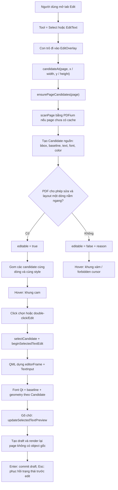

# Quy trình xác định và hiển thị text có thể chỉnh sửa

Tài liệu này mô tả đúng implementation hiện tại của TrePDF, từ lúc PDFium quét
nội dung trong PDF đến lúc người dùng mở `TextInput` để chỉnh sửa. Tính năng
hiện tại chỉ tạo **draft trong phiên làm việc**; nội dung chưa được ghi ngược
vào file PDF.

Các file chính:

- [`PDFEditController.cpp`](../src/PDFEditController.cpp): quét object, tính
  geometry/font, quyết định `editable`, selection và draft.
- [`PDFEditController.h`](../src/PDFEditController.h): cấu trúc `Candidate` và
  các property đưa sang QML.
- [`EditOverlay.qml`](../src/Components/EditOverlay.qml): hit test, hover box,
  selection box và `TextInput` khi edit.
- [`PDFPageItem.cpp`](../src/PDFPageItem.cpp): render lại page mà tạm ẩn text
  object gốc khi đã có draft.
- [`PdfPageDelegate.qml`](../src/Components/PdfPageDelegate.qml): đặt
  `EditOverlay` trùng chính xác lên `PDFPageView`.

## 1. Tổng quan luồng xử lý



## 2. Các khái niệm geometry

### 2.1 PDF text object

Một PDF text object chứa font, font size, ma trận biến đổi, chuỗi/glyph và chế
độ render. Một dòng người dùng nhìn thấy có thể là một object, nhiều object,
hoặc một object nằm bên trong Form XObject.

TrePDF gán ID theo đường dẫn object:

```text
object:<top-level-index>/<child-index>/...
```

Ví dụ `object:3/1` là child số 1 bên trong Form XObject số 3.

Nếu nhiều text object editable nằm trên cùng baseline, gần nhau và có style
tương thích, TrePDF thay chúng bằng một candidate dòng có ID ổn định trong
phiên:

```text
line:<sha256-của-các-object-id-nguồn>
```

Candidate dòng giữ `CandidatePart` cho từng object nguồn, gồm `objectId`,
`objectPath`, bbox, origin, text và separator sau part. Vì vậy UI thao tác với
một dòng, nhưng renderer vẫn tìm và ẩn được từng PDF page object gốc.

### 2.2 Glyph bbox

`glyph bbox` là hình chữ nhật bao quanh phần glyph mà PDFium trả về cho từng ký
tự. TrePDF lấy `FPDFText_GetCharBox()` cho tất cả ký tự thuộc cùng text object,
sau đó hợp các hình chữ nhật:

```text
glyphBBox = union(charBox[0], charBox[1], ..., charBox[n - 1])
```

Nếu có glyph bbox hợp lệ, nó được ưu tiên làm `Candidate.rect`. Nếu không có,
TrePDF dùng bounds của cả page object từ `FPDFPageObj_GetBounds()`.

Glyph bbox không phải line box của font. Nó không tự bao gồm toàn bộ ascent,
descent hoặc khoảng trống mà Qt cần để vẽ caret.

### 2.3 Origin và baseline

- `origin`: điểm bắt đầu của ký tự thật đầu tiên, lấy bằng
  `FPDFText_GetCharOrigin()`.
- `baseline`: đường đi qua origin mà glyph đứng trên đó.
- Trong `Candidate`, code hiện lưu điểm origin đã chuẩn hóa thành
  `originX` và `baselineY`.

Nếu lấy được origin, QML đặt baseline của `TextInput` trùng với baseline PDF.
Nếu không lấy được, editor dùng căn giữa theo chiều dọc trong bbox.

### 2.4 Font size và chiều cao glyph là hai giá trị khác nhau

`FPDFTextObj_GetFontSize()` trả về **em-size** của font trong hệ tọa độ PDF.
Nó không phải chiều cao phần mực đen nhìn thấy.

Ví dụ cùng font size 20 pt:

- chữ `H` có thể chỉ chiếm phần phía trên baseline;
- chữ `g` có descender đi xuống dưới baseline;
- glyph bbox của `HI` và `gy` có thể cao khác nhau;
- line height/caret của Qt thường cao hơn cả hai glyph bbox.

## 3. Khi nào TrePDF bắt đầu quét text

Khi người dùng mở tab Edit, [`AppRibbon.qml`](../src/Components/AppRibbon.qml)
đổi tool từ `BrowseTool` sang `SelectTool`. `EditOverlay` chỉ tương tác khi:

```text
interactionActive = !pooled && tool != BrowseTool
```

Mỗi page delegate có một `EditOverlay` trùng vị trí và kích thước với
`PDFPageView`, vì vậy tọa độ normalized của C++ có thể đổi trực tiếp sang pixel
QML.

Candidate được quét theo nhu cầu khi QML gọi một trong các hàm như:

- `candidateAt(page, x, y)` khi hover/click;
- `candidatesForPage(page)` khi điều hướng bằng phím;
- `selectCandidate(page, objectId)`.

`ensurePageCandidates()` cache kết quả theo page. Cache bị xóa khi revision của
document thay đổi.

## 4. Quá trình quét một page

### 4.1 Load page và text page

`scanPage()`:

1. Lấy kích thước page đã cache từ `PDFDocument`.
2. Load `FPDF_PAGE` và `FPDF_TEXTPAGE`.
3. Duyệt từng ký tự trong text page.
4. Gom ký tự theo `FPDF_PAGEOBJECT`.
5. Duyệt page object để tạo candidate nguồn.
6. Duyệt thêm annotation FreeText và Widget.
7. Gom các candidate text tương thích thành candidate dòng.

### 4.2 Gom text layout theo ký tự

Với mỗi ký tự:

- `FPDFText_GetTextObject()` xác định text object sở hữu ký tự;
- ký tự không phải generated character được nối vào chuỗi Unicode;
- origin của ký tự không-generated đầu tiên được lưu làm baseline origin;
- `FPDFText_GetCharBox()` được hợp vào glyph bbox của object.

Nếu chuỗi gom từ ký tự rỗng, code fallback sang `FPDFTextObj_GetText()`.

Text rỗng hoặc chỉ chứa whitespace bị bỏ qua hoàn toàn:

```text
if trim(text) is empty -> không tạo Candidate
```

### 4.3 Duyệt page object và Form XObject

TrePDF xử lý đệ quy:

- `FPDF_PAGEOBJ_FORM`: ghép ma trận của form rồi duyệt các child;
- `FPDF_PAGEOBJ_TEXT`: có thể trở thành text candidate;
- `FPDF_PAGEOBJ_IMAGE`: tạo candidate không editable để báo cần OCR;
- các loại path/shading khác: bỏ qua.

Ma trận parent `P` và ma trận local `L` được ghép thành `T = P × L`:

```text
T.a = P.a * L.a + P.c * L.b
T.b = P.b * L.a + P.d * L.b
T.c = P.a * L.c + P.c * L.d
T.d = P.b * L.c + P.d * L.d
T.e = P.a * L.e + P.c * L.f + P.e
T.f = P.b * L.e + P.d * L.f + P.f
```

Text có render mode `UNKNOWN`, `INVISIBLE` hoặc chỉ `CLIP` không được tạo
candidate.

### 4.4 Gom candidate thành dòng

`groupTextLineCandidates()` chỉ xét text candidate editable, có baseline, chưa
phải Add Text và đang chứa đúng một source part. Candidate được phân vào cùng
dòng khi chênh baseline không quá `0.25 em`.

Trong mỗi dòng, candidate được sắp từ trái sang phải rồi chỉ nối tiếp khi:

```text
-0.35 em <= horizontalGap <= 1.25 em
BaseFont identity đã bỏ subset prefix, fallback sang family đã resolve, giống nhau
font size chênh không quá max(0.5 pt, 8%)
font stretch chênh không quá 5
bold và color giống nhau
```

Khoảng cách được đổi về page unit trước khi so sánh:

```text
baselineDistance = abs(a.baselineY - b.baselineY) * pageHeight
horizontalGap = (b.left - a.right) * pageWidth
emSize = displayFontSizeRatio * pageHeight
```

Nếu hai chuỗi chưa có whitespace ở ranh giới và gap lớn hơn `0.20 em`, code
chèn một dấu cách. Gap lớn hơn giới hạn sẽ tách candidate để tránh nối nhầm hai
cột. Khác style cũng tách candidate vì `TextInput` hiện chỉ áp dụng một QFont và
một màu cho toàn bộ draft.

Candidate dòng nhận bbox union, baseline/origin và style của part đầu tiên.
`renderSuppressible` chỉ true khi mọi part đều suppress được. Candidate nguồn
không còn xuất hiện độc lập trong cache trang, nhưng toàn bộ provenance vẫn nằm
trong `parts`.

## 5. Đổi tọa độ PDF sang tọa độ normalized

PDF thường dùng gốc ở dưới-trái và trục Y hướng lên. QML dùng gốc trên-trái và
trục Y hướng xuống. TrePDF để `FPDF_PageToDevice()` thực hiện phép đổi này.

Để có độ chính xác ổn định mà không phụ thuộc zoom, code tạo một device mapping
ảo với cạnh dài nhất bằng `100000`:

```text
mapScale = 100000 / max(pdfPageWidth, pdfPageHeight)
mapWidth = round(pdfPageWidth * mapScale)
mapHeight = round(pdfPageHeight * mapScale)
```

Với mỗi bbox, bốn góc được biến đổi qua ma trận container, sau đó đổi sang
device coordinate. Rectangle normalized được tính:

```text
x = minDeviceX / mapWidth
y = minDeviceY / mapHeight
width = (maxDeviceX - minDeviceX) / mapWidth
height = (maxDeviceY - minDeviceY) / mapHeight
```

Kết quả được cắt trong `[0, 1] × [0, 1]`.

QML đổi ngược sang pixel đang hiển thị:

```text
pixelX = normalizedX * overlayWidth
pixelY = normalizedY * overlayHeight
pixelWidth = normalizedWidth * overlayWidth
pixelHeight = normalizedHeight * overlayHeight
```

Do overlay trùng với page view, công thức vẫn đúng khi zoom thay đổi.

## 6. Công thức quyết định text nào editable

Điều kiện hiện tại rất rõ:

```text
editable = editingAllowed && inlineLayoutSupported
```

Việc có đọc được embedded font hoặc baseline **không phải** điều kiện bắt buộc
để `editable = true`.

### 6.1 Quyền sửa nội dung của PDF

```text
modifyContentsBit = 1 << 3

editingAllowed = permissions == 0xFFFFFFFF
                 || (permissions & modifyContentsBit) != 0
```

`permissions` được lấy từ `FPDF_GetDocPermissions()`.

### 6.2 Layout phải phù hợp editor một dòng nằm ngang

Gọi `T` là ma trận text đã ghép cả Form XObject. Sau khi đưa các điểm qua `T`
và `FPDF_PageToDevice()`, code tính:

```text
O = device(T(0, 0))
B = device(T(1, 0)) - O      // vector baseline
V = device(T(0, 1)) - O      // vector dọc của font

baselineLength = hypot(B.x, B.y)
verticalLength = hypot(V.x, V.y)
```

Layout được hỗ trợ khi đồng thời thỏa:

```text
baselineLength > 0
verticalLength > 0
B.x > 0
abs(B.y) <= baselineLength * 0.05
V.y < 0
abs(V.x) <= verticalLength * 0.10
text không chứa '\n'
text không chứa '\r'
```

Ý nghĩa:

- baseline phải chạy từ trái sang phải;
- độ nghiêng baseline tối đa khoảng 5%;
- trục dọc phải hướng lên trong PDF, tương ứng hướng Y âm trong device/QML;
- độ xiên ngang của trục dọc tối đa khoảng 10%;
- chỉ hỗ trợ một dòng.

Do đó text xoay, lật, skew mạnh hoặc multiline vẫn được phát hiện nhưng có
`editable = false` và kèm lý do không hỗ trợ inline editor.

### 6.3 Các loại candidate hiện tại

| Loại | Có candidate | Editable hiện tại | Lý do nếu không editable |
|---|---:|---:|---|
| Text object một dòng, ngang, PDF cho phép sửa | Có | Có | — |
| Nhiều text object cùng dòng và cùng style | Một candidate dòng | Có | Mỗi object gốc được giữ trong `parts` |
| Text cùng baseline nhưng khác style hoặc cách quá xa | Candidate riêng | Theo từng candidate | Không gom để tránh mất style/nối hai cột |
| Text xoay/skew/multiline | Có | Không | Layout chưa được hỗ trợ |
| Text vô hình hoặc chỉ dùng để clip | Không | Không | Bị bỏ qua khi scan |
| Image | Có | Không | Cần OCR |
| FreeText annotation | Có | Không | Draft editor chưa hỗ trợ annotation |
| Widget/form field | Có | Không | Draft editor chưa hỗ trợ form field |
| Add Text do TrePDF tạo | Có | Có nếu PDF cho phép sửa | Không phải object gốc trong PDF |

`renderSuppressible` là một cờ riêng, không nằm trong công thức `editable`.
Nó chỉ cho biết renderer có thể tạm tắt object gốc để tạo background sạch hay
không. Các mode được hỗ trợ suppression là `FILL`, `STROKE` và
`FILL_STROKE`.

## 7. Các thuộc tính font và text được lấy như thế nào

### 7.1 Font family

TrePDF ưu tiên theo thứ tự:

1. Nếu font được embed, lấy bytes bằng `FPDFFont_GetFontData()`.
2. Đăng ký bytes bằng `QFontDatabase::addApplicationFontFromData()`.
3. Nếu embedded font không đủ glyph, tìm family tương ứng trong các font được
   bundle từ `src/assets/fonts`.
4. Chỉ khi không có bundled font phù hợp mới tìm trong danh sách font hệ thống
   được chụp trước lúc bundled fonts được đăng ký.
5. Kiểm tra từng family có đủ glyph cho toàn bộ text bằng `QFontMetricsF` với
   `QFont::NoFontMerging`.
6. Nếu tất cả đều thất bại, trả family rỗng để Qt dùng font mặc định/fallback.

Các file `.ttf`, `.otf` và `.ttc` dưới `src/assets/fonts` được đóng gói thành
resource và đăng ký lúc khởi động. Khi bundled font và system font có cùng
family, bundled font luôn được resolver xét trước.

Dropdown font family hiển thị bundled families trước, sau đó toàn bộ system
families chưa trùng tên. Font embedded của text đang chọn cũng được thêm tạm
nếu chưa có trong hai danh sách này. Khi người dùng chọn family mới,
`Draft.candidate.fontFamily` được cập nhật ngay để editor và draft overlay dùng
cùng font. Family, bold, italic và underline trước/sau nằm trong cùng command
với text nên cancel, undo và redo đều khôi phục đúng định dạng. Thay đổi vẫn chỉ
tồn tại trong session và chưa được ghi ngược vào file PDF.

Giới hạn an toàn hiện tại:

```text
mỗi embedded font <= 32 MiB
tổng font đăng ký trong session <= 64 MiB
```

Font bytes được cache bằng SHA-256 để không đăng ký trùng.

### 7.2 Bold

`fontBold = true` nếu một trong các điều kiện đúng:

```text
FPDFFont_GetWeight(font) >= QFont::Bold     // tương đương weight 700
hoặc FPDFFont_GetFlags(font) có ForceBold   // bit 1 << 18
hoặc BaseFont name chứa "bold", "black" hoặc "heavy" (không phân biệt hoa thường)
```

Fallback theo tên cần thiết vì có PDF khai báo font bold nhưng weight vẫn trả
về 400.

### 7.3 Italic

`fontItalic = true` nếu italic angle khác `0`, descriptor flags có bit Italic
(`1 << 6`), hoặc BaseFont name chứa `italic`, `oblique` hay `slanted`. Khi người
dùng đổi style, draft cập nhật cờ này và `QFont::setItalic()` đổi editor ngay.

### 7.4 Underline

PDF text object không có thuộc tính underline tương đương QFont; gạch chân
trong PDF thường là một path riêng. Vì vậy candidate nguồn mặc định
`fontUnderline = false`. Khi người dùng bật Underline, draft lưu cờ này và Qt
vẽ underline bằng `QFont::setUnderline()`.

### 7.5 Font size

Gọi `fontSize` là giá trị từ `FPDFTextObj_GetFontSize()` và `D(p)` là điểm `p`
sau khi qua text transform rồi đổi sang device coordinate:

```text
fontSizeRatio = length(D(0, fontSize) - D(0, 0)) / mapHeight
```

Trong QML:

```text
baseFontPixelSize = selectedDisplayFontSizeRatio * displayedPageHeight
```

Với PDF text hiện tại:

```text
displayFontSizeRatio = fontSizeRatio
```

Hai property được giữ riêng để sau này có thể hiệu chỉnh riêng kích thước nhìn
thấy mà không làm mất em-size đọc từ PDF. Khi `displayFontSizeRatio <= 0`, code
fallback về `fontSizeRatio`.

Với text có sẵn trong PDF, giá trị tối thiểu là 1 px. Với Add Text, tối thiểu
là 6 px. `fontForDisplay()` làm tròn và chặn lần cuối:

```text
QFont.pixelSize = max(1, round(baseFontPixelSize))
```

Đây vẫn là em-size quy đổi sang pixel, không phải glyph bbox height.

### 7.6 Font stretch

Stretch bù cho scale ngang/dọc của text transform:

```text
fontStretch = round(baselineLength / verticalLength * 100)
fontStretch = clamp(fontStretch, 50, 200)
```

`100` là `QFont::Unstretched`; `50` là UltraCondensed và `200` là
UltraExpanded.

### 7.7 Màu chữ

- Với render mode chỉ stroke: lấy stroke color.
- Các mode còn lại: lấy fill color.
- Nếu PDFium không trả được màu: fallback sang đen.

### 7.8 Tạo QFont cho overlay/editor

`fontForDisplay()` tạo QFont theo thứ tự:

```text
family = resolved font family, nếu có
stretch = clamp(fontStretch, 50, 200)
bold = fontBold
italic = fontItalic
underline = fontUnderline
pixelSize = max(1, round(requestedPixelSize))
```

Character spacing và word spacing chưa được lấy từ PDF. Underline nguồn cũng
chưa được ghép từ các path trang vào text candidate.

## 8. Hit test: con trỏ đang nằm trên text nào

QML gửi tọa độ normalized:

```text
normalizedPointerX = mouseX / overlayWidth
normalizedPointerY = mouseY / overlayHeight
```

C++ nới hit rectangle mỗi phía `0.0025` theo kích thước page normalized:

```text
hitRect = candidate.rect adjusted by ±0.0025
```

Nếu nhiều candidate chồng nhau, ưu tiên:

1. `addedText` hơn object gốc;
2. editable hơn non-editable;
3. candidate có diện tích nhỏ hơn.

Diện tích dùng để so sánh:

```text
area = normalizedWidth * normalizedHeight
```

Với candidate dòng, hit rect dùng bbox union nên khoảng trắng nhỏ giữa các part
cũng chọn được cả dòng. Giới hạn gap `1.25 em` ngăn hit rect kéo qua khoảng cách
lớn giữa hai cột.

Sau khi candidate đã có active draft, delegate của draft tự bắt chuột trên
toàn bộ kích thước text đã render. Vì vậy phần chữ mới dài hơn bbox gốc vẫn có
thể hover và click được; `candidateAt()` chỉ còn phụ trách vùng candidate gốc
khi con trỏ chưa đi vào delegate này.

## 9. Hover và selection hiển thị như thế nào

Các hằng số QML hiện tại:

```text
editBoxRadius = 4 px
editBoxColor = #f5a55a
editBoxLeftBleed = 3 px
editBoxRightBleed = 3 px
hoverBoxVerticalBleed = 3 px
editBoxVerticalBleed = 3 px
fallbackBleed = 2 px
borderWidth = 2 px
```

### 9.1 Hover box

Gọi bbox gốc theo pixel là `(ox, oy, ow, oh)`, page là `(pw, ph)`:

```text
hoverX = max(0, ox - 3)
hoverY = max(0, oy - 3)
hoverRight = min(pw, ox + ow + 3)
hoverBottom = min(ph, oy + oh + 3)
hoverWidth = max(1, hoverRight - hoverX)
hoverHeight = max(1, hoverBottom - hoverY)
```

Khung có nền trong suốt, radius 4 px:

- `#f5a55a` nếu candidate editable;
- xám nếu candidate không editable;
- con trỏ là I-beam nếu editable, forbidden nếu không editable.

### 9.2 Selection box

Sau khi click chọn, selection box dùng bleed trái 3 px, bleed phải 3 px và
bleed dọc 3 px:

```text
selectionX = max(0, ox - 3)
selectionY = max(0, oy - 3)
selectionRight = min(pw, ox + ow + 3)
selectionBottom = min(ph, oy + oh + 3)
```

Selection box có nền cam rất nhạt `#14d97a32`, border `#f5a55a` và radius
4 px.
Nó bị ẩn khi editor thật sự mở.

Với active draft, hover và selection box gốc ở trên bị ẩn để tránh vẽ hai
khung khác kích thước. Draft delegate đo lại chiều rộng hiển thị:

```text
measuredContentWidth = originOffset + measuredTextWidth
draftWidth = max(originalWidth, measuredContentWidth)
```

Sau đó chính delegate vẽ khung và bắt chuột theo `draftWidth`, nên khung bao cả
phần chữ đã sửa dài hơn nội dung PDF ban đầu. Chiều rộng vẫn bị giới hạn bởi
chiều rộng page.

Trong Select tool, click text editable mở popup Edit/Delete. Trong Edit Text
tool, double-click mở editor trực tiếp. Nhấn Enter trên candidate đang chọn
cũng mở editor.

## 10. Khi người dùng bấm Edit

### 10.1 Trạng thái C++

`beginSelectedTextEdit()` chỉ chạy khi:

```text
textEditActive == false
hasSelection == true
selectedCandidate.editable == true
```

Controller lưu trạng thái draft trước edit vào `m_textEditCommand`, sau đó đặt
`textEditActive = true`. Chưa có draft mới cho đến khi text thực sự thay đổi.

Candidate dòng vẫn dùng đúng một draft key `page|lineObjectId`. Chuỗi đã sửa
không được chia ngược về từng part trong session; `CandidatePart` chỉ giữ nguồn
để mask, suppression, undo/redo và phục vụ việc ghi PDF trong tương lai.

### 10.2 Trạng thái QML

`beginEditing()`:

1. Gọi `selectCandidate()`.
2. Ẩn con trỏ chọn tùy biến.
3. Gọi `beginSelectedTextEdit()`.
4. Gán `editor.text = controller.selectedText`.
5. Đặt `editing = true`.
6. Ở event loop kế tiếp, focus `TextInput`, bỏ selection cũ và đặt caret ở
   cuối chuỗi.

Khi vừa mở editor, toàn bộ dòng không bị chọn tự động. Người dùng có thể kéo
chuột hoặc dùng Shift + phím mũi tên để chọn một đoạn; đoạn đang chọn có nền
xanh nhạt (`#DCEBFF`) và chữ tối theo màu text của ribbon.

Trong lúc `editing = true`, con trỏ chọn tùy biến bị vô hiệu hóa và `TextInput`
dùng con trỏ I-beam gốc của Qt. Vì vậy khi giữ chuột rồi kéo để bôi đen, con trỏ
di chuyển liên tục theo vị trí kéo thay vì chỉ cập nhật sau khi thả chuột.

## 11. Công thức kích thước editor frame

### 11.1 Text có sẵn trong PDF

```text
leftBleed = 3
rightBleed = 3
verticalBleed = 3

measuredContentWidth = originOffset + measuredTextWidth
baseDesiredWidth = max(80, originalWidth, measuredContentWidth)
desiredWidth = baseDesiredWidth + leftBleed + rightBleed
editorWidth = min(pageWidth, desiredWidth)

baseDesiredHeight = max(17, originalHeight)
desiredHeight = baseDesiredHeight + 2 * verticalBleed
editorHeight = min(pageHeight, desiredHeight)

editorX = clamp(originalX - leftBleed,
                0,
                pageWidth - editorWidth)
editorY = clamp(originalY - verticalBleed,
                0,
                pageHeight - editorHeight)
```

Vì có `max(17, originalHeight)`, bbox glyph thấp hơn 17 px vẫn tạo editor cao
ít nhất 23 px sau khi cộng bleed. Đây là nguyên nhân phần trắng phía dưới có
thể trông dư so với glyph gốc.

Editor có border cam nhạt `#f5a55a` dày 2 px, radius 4 px. Nền của editor:

- trong suốt nếu renderer đã tạo clean texture không còn object gốc;
- `#fffdfb` nếu vẫn cần che text gốc.

### 11.2 Add Text

Add Text dùng công thức riêng:

```text
leftBleed = 0
rightBleed = 0
verticalBleed = 0
baseDesiredWidth = max(originalWidth, measuredTextWidth + 2)
baseDesiredHeight = max(originalHeight + 2 * fallbackBleed,
                        editorImplicitHeight)
```

Khung mặc định khi tạo Add Text:

```text
widthRatio = min(0.25, 1 - frameX)
heightRatio = 0.04
fontSizeRatio = 0.022
frameX <= 1 - 0.02
frameY = clamp(clickY - 0.04 / 2, 0, 1 - 0.04)
```

## 12. Đặt chữ theo baseline

Với text PDF có baseline:

```text
textOriginX = selectedOriginX * pageWidth
textBaselineY = selectedBaselineY * pageHeight

TextInput.x = 0
TextInput.y = textBaselineY - editorFrame.y - TextInput.baselineOffset
TextInput.leftPadding = max(0, textOriginX - editorFrame.x)
```

Do đó baseline toàn cục của Qt bằng baseline PDF:

```text
editorFrame.y + TextInput.y + TextInput.baselineOffset
= textBaselineY
```

Và vị trí bắt đầu ngang là:

```text
editorFrame.x + TextInput.leftPadding = textOriginX
```

Khi không có baseline, `TextInput` dùng margin tối đa 4 px và
`AlignVCenter` trong editor frame.

## 13. Vì sao caret có thể cao hơn chữ

Caret thuộc `TextInput`, nên chiều cao của nó theo line metrics của QFont mà Qt
đang dùng, không theo glyph bbox của chuỗi hiện tại.

```text
caretHeight ≈ Qt font line height
glyphBBoxHeight = union của các glyph đang nhìn thấy
```

Line height còn chừa ascent/descent cho các ký tự khác trong font. Vì vậy caret
cao hơn chữ `BIM Handbook` không tự động có nghĩa là font size bị đọc sai.
Sai font family hoặc Qt fallback vẫn có thể làm chênh lệch lớn hơn.

## 14. Che text gốc và render draft

Nếu vẽ `TextInput` trực tiếp lên page texture gốc, người dùng sẽ thấy hai lớp
chữ chồng nhau. TrePDF xử lý theo hai giai đoạn.

### 14.1 Fallback mask tức thời

Trong lúc chưa có clean texture, QML tạo một fallback mask cho mỗi source rect,
thay vì che toàn bộ bbox union của candidate dòng. Mỗi mask dùng màu `#fffdfb`,
nới 2 px mỗi phía và cắt trong page:

```text
maskX = max(0, originalX - 2)
maskY = max(0, originalY - 2)
maskRight = min(pageWidth, originalX + originalWidth + 2)
maskBottom = min(pageHeight, originalY + originalHeight + 2)
```

Các mask xuất hiện ngay khi editor mở, kể cả trước khi user gõ ký tự đầu tiên.
Editor của candidate dòng có nền trong suốt để không phủ trắng khoảng trống
giữa các part.

### 14.2 Clean texture từ PDFium

Khi text thay đổi:

1. `updateSelectedTextPreview()` tạo/cập nhật draft.
2. Revision của draft page tăng.
3. `PDFPageItem` debounce render trong 250 ms khi đang gõ.
4. Worker mở một document PDFium riêng.
5. Flatten mọi `parts[].objectPath` của draft.
6. Tìm tất cả object gốc theo các path này.
7. Tạm đặt từng object thành inactive bằng `FPDFPageObj_SetIsActive(false)`.
8. Render page không có các object gốc.
9. Khôi phục mọi object thành active.
10. Upload texture mới lên scene graph.

Khi texture đúng revision và suppression thành công:

```text
draftTextureCurrent = true
draftTextureReady = true
editorUsesCleanTexture = true nếu object đang edit có active draft
```

Lúc đó fallback mask và nền trắng của editor biến mất; chỉ còn page sạch,
`TextInput` và border cam.

Nếu render mode không suppress được hoặc suppression thất bại,
`draftTextureReady = false` và mask trắng tiếp tục được dùng.

## 15. Khi user gõ, Enter hoặc Esc

### 15.1 Trong lúc gõ

`TextInput.onTextEdited` gọi `updateSelectedTextPreview(text)`:

- text bằng bản gốc: xóa draft nếu có;
- text khác bản gốc: lưu `Draft{candidate, text}`;
- cập nhật `selectedText`;
- phát signal để overlay và page renderer cập nhật.

### 15.2 Enter

Enter gọi `finishSelectedTextEdit()`:

- kết thúc trạng thái edit;
- so sánh before/after;
- nếu có thay đổi, thêm một command vào undo stack;
- xóa redo stack;
- yêu cầu render draft ngay;
- file PDF trên ổ đĩa vẫn không đổi.

### 15.3 Esc

Esc gọi `cancelSelectedTextEdit()` và phục hồi trạng thái draft đã có trước khi
bắt đầu edit.

Đổi tool, đổi page hoặc delegate bị pooled sẽ tự commit edit đang mở.

## 16. Vì sao text Qt vẫn có thể lệch text PDF

TrePDF hiện đã lấy và áp dụng:

- Unicode text;
- glyph bbox;
- origin/baseline;
- em-size;
- transform stretch ngang/dọc;
- embedded/installed font family nếu Qt dùng được;
- bold và italic;
- underline do người dùng áp dụng cho draft;
- màu chữ.

Nhưng PDF renderer và Qt text layout vẫn là hai hệ thống khác nhau. Các dữ liệu
sau chưa được tái tạo đầy đủ trong `TextInput`:

- glyph ID gốc và glyph positioning từng ký tự;
- character spacing (`Tc`);
- word spacing (`Tw`);
- kerning/position adjustment trong mảng `TJ`;
- horizontal scaling riêng của text state nếu không thể hiện đủ qua object
  transform;
- italic angle chính xác, synthetic slant và underline path của PDF gốc;
- font hinting/rendering của PDFium;
- subset font không đăng ký được hoặc không map Unicode đúng trong Qt;
- line metrics/ascent/descent riêng của font Qt.

Qt nhận một chuỗi Unicode rồi tự shape và bố trí lại. Vì vậy có thể xuất hiện:

- khoảng cách từ rộng hơn hoặc hẹp hơn bản PDF;
- chữ to/nhỏ khác dù em-size giống nhau;
- baseline đúng nhưng phần mực đen vẫn cao/thấp khác;
- chiều rộng cả dòng khác, dẫn đến frame bị clamp hoặc text bị fit;
- caret cao hơn glyph.

## 17. Ví dụ số học

Giả sử page đang hiển thị có kích thước `1000 × 1400 px`, candidate có:

```text
x = 0.20
y = 0.30
width = 0.25
height = 0.01
originX = 0.20
baselineY = 0.32
```

Bbox gốc theo pixel:

```text
originalX = 0.20 * 1000 = 200 px
originalY = 0.30 * 1400 = 420 px
originalWidth = 0.25 * 1000 = 250 px
originalHeight = 0.01 * 1400 = 14 px
```

Hover box:

```text
x = 200 - 3 = 197 px
y = 420 - 3 = 417 px
width = 250 + 2 * 3 = 256 px
height = 14 + 2 * 3 = 20 px
```

Editor frame cho text có sẵn:

```text
baseWidth = max(80, 250) = 250 px
width = 250 + 2 * 3 = 256 px

baseHeight = max(17, 14) = 17 px
height = 17 + 2 * 3 = 23 px

x = 197 px
y = 417 px
```

Editor cao 23 px dù glyph bbox chỉ cao 14 px. Phần chênh này dành cho line
metrics/caret và là lý do có thể thấy nền trắng dư.

Baseline và origin:

```text
textOriginX = 0.20 * 1000 = 200 px
textBaselineY = 0.32 * 1400 = 448 px
leftPadding = 200 - 197 = 3 px
TextInput.y = 448 - 417 - baselineOffset
```

## 18. Điểm debug quan trọng

Khi text không được edit:

- `PDFEditController::scanPage()` — page/text object có được phát hiện không;
- `PDFEditController::appendPageObjectCandidates()` — xem `renderMode`,
  `textTransform`, `editingAllowed`, `inlineLayoutSupported` và `reason`;
- `PDFEditController::documentAllowsEditing()` — kiểm tra permissions.

Khi bbox/baseline lệch:

- vòng `FPDFText_GetCharBox()` và `FPDFText_GetCharOrigin()` trong
  `scanPage()`;
- `normalizedRect()` và `normalizedPagePoint()`;
- `candidate.rect`, `candidate.origin`, `candidate.hasBaseline`.

Khi font/cỡ chữ lệch:

- `resolvedFontFamily()` và `registerEmbeddedFont()`;
- `FPDFFont_GetIsEmbedded()`, family/BaseFont name;
- `FPDFTextObj_GetFontSize()`;
- `normalizedFontSize()` và `fontStretchForTransform()`;
- `pdfFontIsBold()` và `pdfFontIsItalic()`;
- QML `editorFrame.baseFontPixelSize` và `editorFrame.displayFont`.

Khi nền trắng hoặc chữ gốc chưa biến mất:

- `PDFEditController::draftedTextObjectPathsForPage()`;
- `ScopedPageObjectSuppression::suppress()`;
- `PDFPageItem::markTextureReady()`;
- `draftTextureCurrent`, `draftTextureReady` và
  `editorUsesCleanTexture` trong QML.

## 19. Tóm tắt điều kiện cốt lõi

```text
Text được phát hiện
  = page object là TEXT
    + render mode không UNKNOWN/INVISIBLE/CLIP
    + có bbox hợp lệ
    + text không rỗng

Text được edit
  = text được phát hiện
    + PDF cho phép modify contents
    + transform gần như nằm ngang, không lật/skew mạnh
    + text chỉ có một dòng

Text được gom thành candidate dòng
  = các text candidate editable có baseline gần nhau trong 0.25 em
    + gap liên tiếp nằm trong [-0.35 em, 1.25 em]
    + family/size/stretch/bold/color tương thích
    + giữ từng objectId, objectPath và bbox nguồn trong CandidatePart

Text hiển thị khi edit
  = Unicode text do Qt layout lại
    + QFont đã áp family/stretch/bold/em-size nếu lấy được
    + baseline PDF nếu có
    + editor frame theo bbox union và measured text, min 80 × 17 px
    + một fallback mask cho mỗi source part đến khi page texture sạch sẵn sàng
    + một draft/undo command có thể suppress nhiều PDF text object nguồn
```
